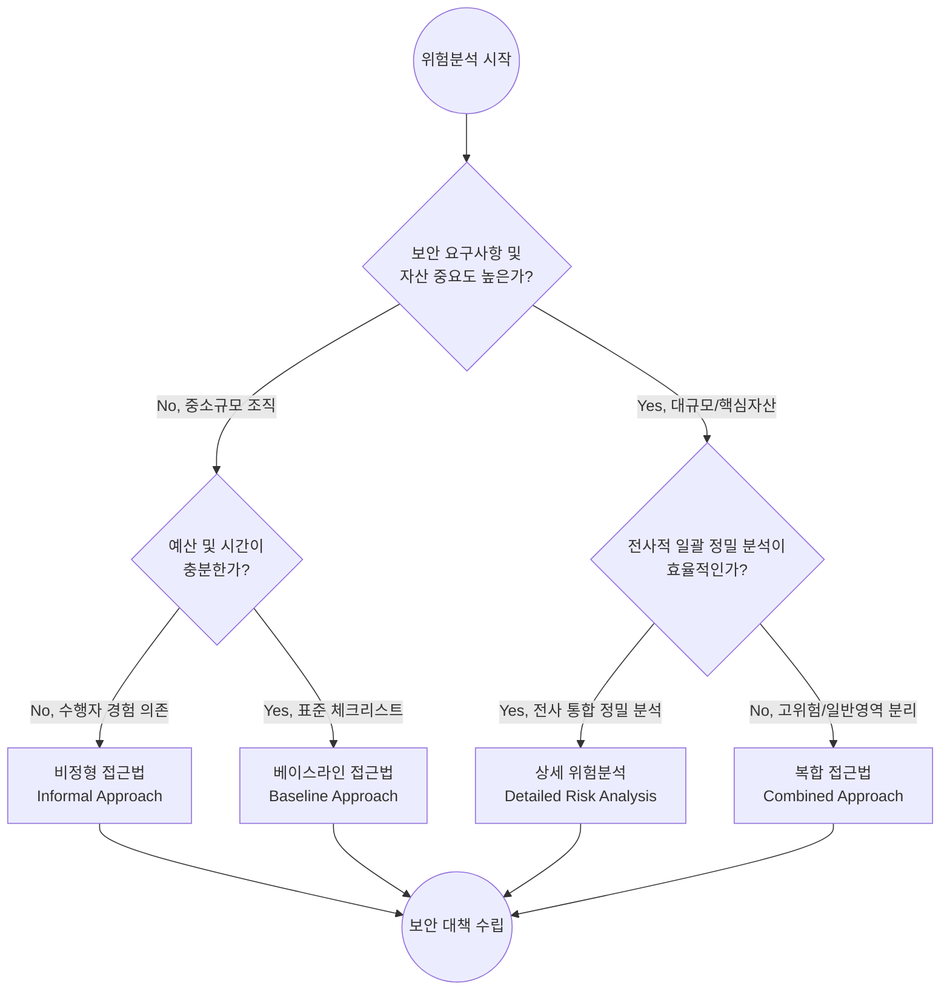

# 위험분석 방법론 (ISO/IEC 13335-1, 위험분석 전략 평가)

---

## I. 최적 보안대책 수립의 기반, 위험분석 방법론(ISO/IEC 13335-1)의 개요

위험분석 방법론(Risk Analysis Methodology)은 조직의 정보자산에 내재된 위협(Threat)과 취약성(Vulnerability)을 체계적으로 식별·평가하여 잠재적 손실 규모를 산정하고, 한정된 자원 내에서 비용 효과적인 정보보호 대책을 수립하기 위한 위험 관리 체계이다.

| 구분 | 내용 |
| :--- | :--- |
| **정의** | 자산의 가치, 위협, 취약성을 분석해 위험 크기를 산출하고 최적의 보호대책을 도출하는 평가 전략 |
| **선택 기준** | 조직의 규모, 정보자산의 중요도, 규제 요구사항, 가용한 예산 및 수행 기간을 고려하여 전략 선정 |
| **4대 전략** | 베이스라인 접근법(체크리스트), 비정형 접근법(전문가 직관), 상세 위험분석, 복합 접근법(혼용) |

---

## II. 위험분석 전략(ISO/IEC 13335-1)의 개념도 및 핵심 전략 평가

### 가. 위험분석 전략의 선택 개념도 및 의사결정 흐름

* 조직의 자산 규모, 요구되는 보안 수준, 가용한 시간과 예산을 종합적으로 고려하여 4가지 전략 중 최적의 비용 대비 효과를 낼 수 있는 접근법을 선택하여 수행함.

### 나. ISO/IEC 13335-1 위험분석 전략의 핵심 구성 요소

| 구분 | 요소기술(키워드) | 세부 설명 |
| --- | --- | --- |
| **베이스라인 접근법** | 표준 체크리스트 | 조직 전체에 표준화된 보호 기본 수준(Baseline)을 일괄 적용하여 갭(Gap) 분석 수행 |
| **베이스라인 접근법** | 신속성 및 경제성 | 광범위한 자산에 빠르고 저렴하게 적용 가능하나, 조직의 특수한 보안 환경이나 예외 상황 반영 한계 |
| **비정형 접근법** | 전문가 직관 기반 | 구조적인 방법론 없이 보안 실무자 및 전문가의 지식과 경험에 의존하여 주요 위험을 중심으로 분석 |
| **비정형 접근법** | 실무적 유연성 | 중소규모 조직에 적합하며 신속하나, 평가자의 역량 및 경험치에 따라 분석 결과의 주관성 및 편차 발생 |
| **상세 위험분석** | 자산/위협/취약성 분석 | 자산의 가치, 위협 발생 가능성, 취약성 정도를 정형화된 기법으로 깊이 있게 정밀 식별 및 평가 |
| **상세 위험분석** | 정밀성 및 고비용 | 정확하고 포괄적인 보안 대책 수립이 가능하나, 분석 수행 과정에서 막대한 인력, 시간, 비용이 소모됨 |
| **복합 접근법** | 자산 중요도 기반 분류 | 전사 정보자산을 중요도 및 위험도에 따라 분류하여 고위험 영역과 일반 영역으로 분리하여 적용 |
| **복합 접근법** | 선택적 자원 집중 | 고위험 영역은 '상세 위험분석', 나머지는 '베이스라인'을 혼용하여 비용 대비 보안 효과를 극대화하는 합리적 방식 |

---

## III. 위험 평가 기법(상세 위험분석)의 비교 및 향후 동향

### 가. 상세 위험분석 수행을 위한 정량적 vs 정성적 평가 기법 비교

| 비교 항목 | 정성적 위험분석 (Qualitative) | 정량적 위험분석 (Quantitative) |
| --- | --- | --- |
| **기본 개념** | 위험의 크기를 상/중/하 등 서술적 척도로 평가 | 위험으로 인한 잠재적 손실을 금액(화폐 가치) 등 수치로 산출 |
| **주요 기법** | 델파이 기법(전문가 합의), 시나리오법, 순위결정법 | 수학적 기대비용(ALE, SLE, ARO), [[몬테카를로 시뮬레이션]] |
| **장점** | 비재무적 영향(평판 등) 파악 용이, 신속한 평가 가능 | 명확한 수치 제시로 경영진의 보안 투자 의사결정 지원 용이 |
| **단점** | 평가자의 주관 개입, 객관적인 손실 규모 파악 곤란 | 데이터 수집 및 수학적 분석 모델 구축에 막대한 리소스 소요 |

### 나. 위험분석 방법론의 최신 동향 및 발전 방향
- **비용 최적화를 위한 복합 접근법(Combined Approach)의 표준 정착**: 고위험 핵심 자산(개인정보 DB, 결제 시스템)은 정밀 상세 분석을 적용하고, 일반 업무 자산은 베이스라인 체크리스트를 적용하여 자원 효율성 극대화.
- **CTEM 연계 기반의 지속적 위험 노출 관리로의 진화**: 연 1회성 정적 위험 평가의 한계를 극복하기 위해, 공격 표면 관리([[공격 표면 관리|ASM]]) 및 [[지속적인 위협 노출 관리|CTEM]] 솔루션과 연동한 실시간 연속 위험 평가(Continuous Risk Management) 체계 확립.
- **AI/ML 기반 정량적 사이버 리스크 모델링 고도화**: 과거 침해 사고 통계와 위협 인텔리전스([[CTI]])를 머신러닝으로 결합하여 단일 손실 예상액(SLE) 및 연간 손실 예상액(ALE)을 자동 산출하는 데이터 기반 의사결정 체계 도입.

---

### 🔗 연관 토픽

- **소속 도메인**: [[00_보안_MOC|🛡️ 보안]]
- **세부 분류**: `6. 개인정보보호 & 프라이버시 강화 기술`
- **핵심 연관 토픽**:
  - [[지속적인 위협 노출 관리|지속적인 위협 노출 관리(CTEM)]]
  - [[몬테카를로 시뮬레이션]]
  - [[DevSecOps]]
  - [[비식별화]]
  - [[개인정보보호법]]
