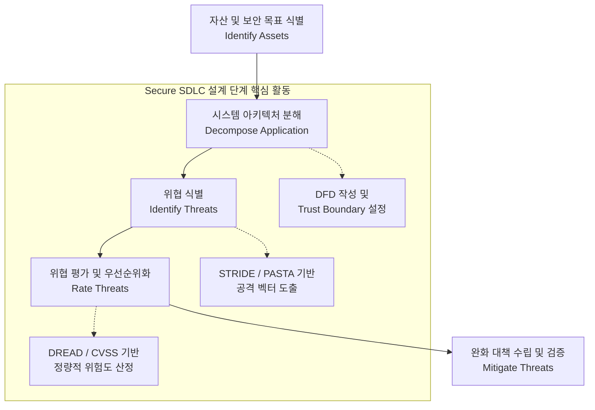

# 위협 모델링 (Threat Modeling)

---

## I. 사전 예방 중심의 보안, 위협 모델링(Threat Modeling)의 개요

위협 모델링(Threat Modeling)은 소프트웨어 개발 생명주기(Secure SDLC)의 요구사항 및 아키텍처 설계 단계에서 데이터 흐름과 신뢰 경계(Trust Boundary)를 구조적으로 분석하여, 잠재적인 보안 위협을 사전에 식별하고 비용 효과적인 완화(Mitigation) 통제를 설계하는 선제적 보안 엔지니어링 기법이다.

| 구분 | 내용 |
| :--- | :--- |
| **정의** | SW 설계 단계에서 데이터 흐름과 신뢰 경계를 분석해 잠재 위협을 식별·완화하는 정형화된 프로세스 |
| **등장 배경** | 배포 후 결함 조치 대비 비용을 획기적으로 절감(Shift-Left), Security by Design 내재화 의무화 |
| **핵심 기제** | DFD/신뢰 경계 가시화, 위협 식별 프레임워크(STRIDE/PASTA), 정량 평가(DREAD/CVSS) |

---

## II. 위협 모델링의 메커니즘 및 핵심 프레임워크

### 가. 위협 모델링의 수행 프로세스 및 개념도

### 나. 위협 모델링의 핵심 구성 요소

| 구분 | 요소기술(키워드) | 세부 설명 |
| :--- | :--- | :--- |
| **위협 식별 프레임워크** | [[STRIDE]] | Spoofing, Tampering, Repudiation, Info Disclosure, [[DoS (Denial of Service)\|DoS]], EoP 6대 위협 분류 |
| **위협 식별 프레임워크** | PASTA | 비즈니스 영향도와 공격자 관점을 융합한 7단계 위험 중심(Risk-Centric) 시뮬레이션 모델 |
| **위협 식별 프레임워크** | VAST | 애자일([[Agile]]) 및 [[DevSecOps]] CI/CD 환경에 최적화된 엔터프라이즈 시각화 모델링 |
| **위협 평가 및 정량화** | DREAD | Damage, Reproducibility, Exploitability, Affected users, Discoverability 5대 정량 척도 |
| **위협 평가 및 정량화** | [[CVSS]] | 공통 취약점 점수 시스템(0.0~10.0)을 통해 완화 조치의 우선순위를 객관적 표준화 |
| **분석 및 가시화 도구** | [[데이터 흐름도]](DFD) | 프로세스, 데이터 저장소, 외부 인터페이스 간의 흐름과 신뢰 경계(Trust Boundary) 시각화 |
| **분석 및 가시화 도구** | Attack Tree (공격 트리) | 특정 핵심 자산 탈취를 목표로 하는 공격자의 단계적 침투 경로와 비용을 트리 구조로 모델링 |
| **보안 통제 및 완화** | Mitigation (완화 설계) | 식별된 위협에 대해 입력값 검증, 암호화, 다중 인증, 최소 권한 원칙 등 구체적 보안 스펙 반영 |

---

## III. 위협 모델링 프레임워크 비교 및 최신 기술 동향

### 가. STRIDE vs PASTA 프레임워크 비교

| 비교 항목 | STRIDE 프레임워크 | PASTA (Process for Attack Simulation & Threat Analysis) |
| :--- | :--- | :--- |
| **관점 및 지향점** | 개발자 및 시스템 엔지니어링 관점 (소프트웨어 중심) | 비즈니스 영향도 및 공격자 관점 (위험 중심) |
| **핵심 목적** | 시스템 아키텍처 상의 기술적 보안 결함 신속 도출 | 비즈니스 목표와 실제 위협 행위자 TTPs를 결합한 전략적 완화 |
| **적용 단계** | 컴포넌트 설계 및 DFD 분석 단계 | 7단계 전주기 (목표 정의, 기술 범위, DFD, 위협 분석, 약점 식별, 위험 완화) |
| **적합한 조직** | 개발 팀 단위의 빠른 스프린트 및 기능 단위 검증 | 전사적 위험 관리(ERM) 및 고위험 엔터프라이즈 거버넌스 |

### 나. 위협 모델링의 최신 기술 동향 및 발전 전망
- **Continuous Threat Modeling (지속적 위협 모델링)**: 과거 1회성 정적 문서 분석을 탈피하여, CI/CD 파이프라인과 연동해 아키텍처 변경 시 자동으로 위협을 재평가하는 자동화 체계 정착.
- **Threat Modeling as Code (TmaC) 확산**: HCL, Python 등 코드로 위협 모델을 선언(IaC 연계)하고 Git을 통해 버전 관리함으로써 개발자-보안팀 간의 협업(Shift-Left) 내재화.
- **AI/LLM 파이프라인 특화 위협 모델링([[OWASP Top 10 for LLM Application 2025|OWASP Top 10 for LLM]])**: 프롬프트 인젝션, 데이터 중독, 모델 탈취 등 AI 특유의 새로운 공격 표면을 사전에 식별하고 가드레일을 설계하는 절차 표준화.

---

### 🔗 연관 토픽

- **소속 도메인**: [[00_보안_MOC|🛡️ 보안]]
- **세부 분류**: `4. 웹 & 애플리케이션 보안 · 취약점 점검`
- **핵심 연관 토픽**:
  - [[STRIDE]]
  - [[데이터 흐름도]]
  - [[CVSS]]
  - [[스마트카 보안 취약점 및 대응방안|스마트카 보안 취약점 및 대응방안 (Smart Car Security)]]
  - [[SDLC]]
