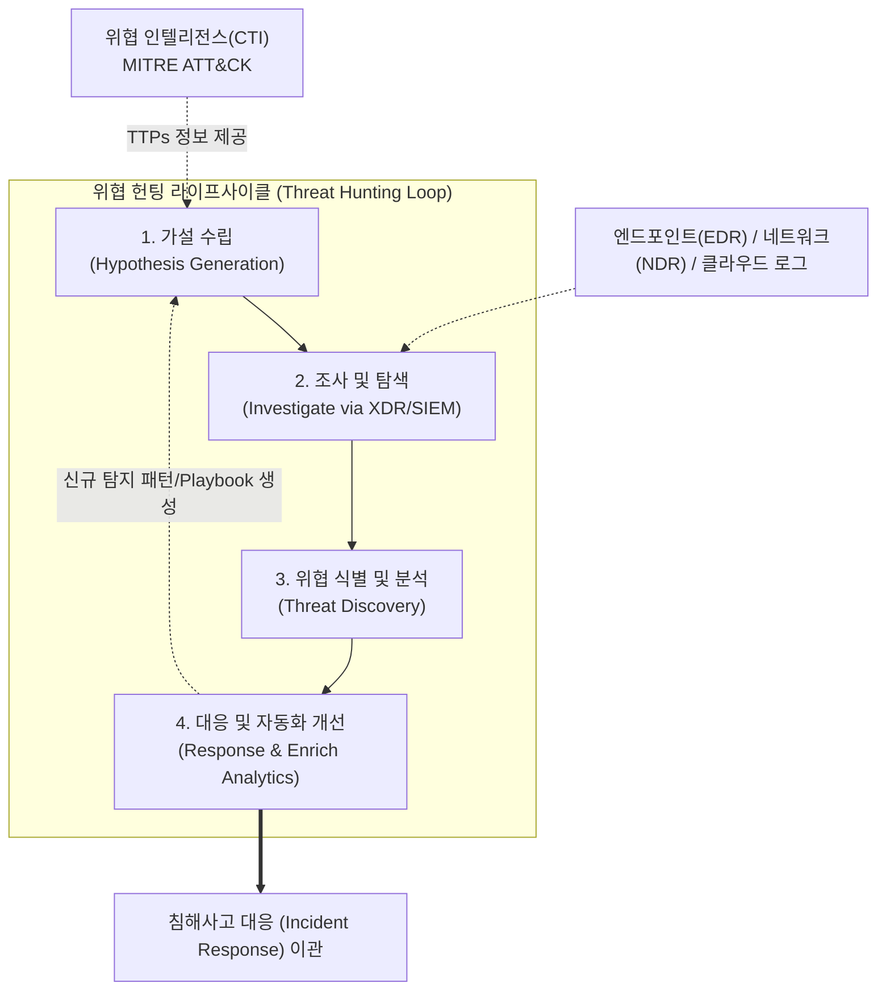

# 위협 헌팅 (Threat Hunting)

---

## I. 능동적 보안 방어, 위협 헌팅(Threat Hunting)의 개요

위협 헌팅(Threat Hunting)은 기존의 시그니처 및 룰 기반 보안 솔루션이 탐지하지 못하고 내부망에 잠복해 있는 지능형 지속 위협(APT), 파일리스 악성코드, 제로데이 위협을 위협 인텔리전스(CTI)와 가설(Hypothesis) 기반으로 능동적으로 탐색·식별·격리하는 선제적 사이버 방어 활동이다.

| 구분 | 내용 |
| :--- | :--- |
| **정의** | 방어망을 우회해 잠복 중인 지능형 미탐 위협을 가설 기반으로 능동적 탐색·제거하는 보안 활동 |
| **등장 배경** | 침해 전제(Assume Breach) 패러다임 전환, 경보 피로도(Alert Fatigue) 극복, 잠복 시간(Dwell Time) 최소화 |
| **핵심 기제** | SANS 4단계 순환 루프(가설 $\rightarrow$ 조사 $\rightarrow$ 식별 $\rightarrow$ 대응/내재화), MITRE ATT&CK TTP 분석, XDR/UEBA |

---

## II. 위협 헌팅의 개념도 및 핵심 기술 요소

### 가. 위협 헌팅의 개념도 및 수행 프로세스 (SANS 기반)

* 분석가의 가설 설정부터 시작하여, 방대한 로그 데이터를 탐색하고 발견된 위협을 기존 탐지 룰로 내재화하는 지속적 순환(Continuous Loop) 구조

### 나. 위협 헌팅의 핵심 기술 및 구성 요소

| 구분 | 요소기술(키워드) | 세부 설명 |
| --- | --- | --- |
| **분석 [[프레임워크]]** | [[MITRE ATT&CK (Adversarial Tactics, Techniques & Common Knowledge)\|MITRE ATT&CK]] | 공격자의 전술(Tactics), 기법(Techniques), 절차(Procedures)를 표준화한 지식 기반 프레임워크 |
| **분석 지표** | IoC (침해 지표) | 악성 IP, 해시값, 도메인 등 사후적으로 확인 가능한 명시적인 침해 흔적 데이터 |
| **분석 지표** | IoA (공격 지표) | 공격의 의도와 일련의 행위를 나타내는 동적 지표로, 진행 중인 공격 식별에 활용 |
| **핵심 기법** | 가설 기반 분석 | CTI, 과거 사고 이력 등을 바탕으로 "특정 공격이 발생했을 것"이라는 가설 수립 및 검증 |
| **핵심 기법** | 머신러닝 / UEBA | 사용자 및 [[엔티티]] 행위 분석(UEBA)을 통해 정상 기준선(Baseline)을 이탈하는 이상 행위 탐지 |
| **지원 플랫폼** | [[XDR]] (확장 탐지 대응) | 엔드포인트([[EDR(Endpoint Detection and Response)\|EDR]]), 네트워크(NDR), 클라우드 데이터를 통합하여 교차 상관 분석 환경 제공 |
| **지원 플랫폼** | [[SIEM]] / Data Lake | 방대한 이기종 보안 이벤트와 시스템 로그를 중앙 집중적으로 수집, 저장, 검색 |
| **자동화 도구** | [[SOAR (Security Orchestration, Automation and Response)\|SOAR]] | 식별된 위협에 대한 대응 [[프로세스]](Playbook) 자동화 및 보안 장비 간 오케스트레이션 |

---

## III. 위협 헌팅과 기존 보안관제의 비교 및 향후 전망

### 가. 위협 헌팅(Threat Hunting)과 보안관제(SIEM 기반) 비교

| 비교 항목 | 전통적 보안관제 (Traditional SOC/SIEM) | 위협 헌팅 (Threat Hunting) |
| --- | --- | --- |
| **접근 방식** | 수동적 / 사후 대응적 (Reactive) | 능동적 / 사전 주도적 (Proactive) |
| **시작점(트리거)** | 보안 장비의 알럿(Alert) 및 시그니처 경고 | 분석가의 직관, CTI 기반의 '가설(Hypothesis)' |
| **주요 분석 대상** | 기지(Known) 위협, 알려진 악성코드 및 패턴 | 미지(Unknown) 위협, 파일리스(Fileless) 공격, APT |
| **핵심 지표** | IoC (Indicator of Compromise) 중심 | TTPs, IoA (Indicator of Attack) 중심 |
| **의존성** | 자동화된 탐지 룰, 시스템 의존 | 헌터(보안 전문가)의 역량 및 데이터 분석 기법 의존 |
| **결과물** | 침해사고 대응(IR) 이관 및 차단 | 신규 위협 식별 및 기존 시스템의 '탐지 룰(Rule)' 강화 |

### 나. 위협 헌팅의 최신 동향 및 발전 전망
- **AI 증강 헌팅(AI-Assisted Threat Hunting) 도입**: Security Copilot 및 대형 언어 모델([[초거대 언어 모델|LLM]])을 활용해 자연어 기반 가설 수립, 복잡한 XDR/SIEM 쿼리 자동 생성, 이상 텔레메트리 연관 분석 수행.
- **IoC에서 TTPs 중심의 행위 기반 헌팅 전환**: 정적 침해 지표(IP, 해시)의 수명이 짧아짐에 따라 공격자의 변하지 않는 전술·기법·절차(TTPs)와 Living-off-the-Land(LotL) 정상 도구 악용 행위 집중 추적.
- **헌팅 결과의 탐지 룰([[SIEM]]/[[SOAR (Security Orchestration, Automation and Response)|SOAR]]) 자율 내재화**: 헌팅을 통해 식별된 신종 위협 패턴을 YARA-L, Sigma 룰 및 자동화 플레이북으로 즉시 변환하여 향후 동일 공격에 대한 상시 자동 탐지 체계 구축.

---

### 🔗 연관 토픽

- **소속 도메인**: [[00_보안_MOC|🛡️ 보안]]
- **세부 분류**: `3. 네트워크 & 엔드포인트 · 인프라 보안`
- **핵심 연관 토픽**:
  - [[EDR(Endpoint Detection and Response)]]
  - [[CTI]]
  - [[XDR|XDR(eXtended Detection Response)]]
  - [[MITRE ATT&CK (Adversarial Tactics, Techniques & Common Knowledge)]]
  - [[SIEM]]
