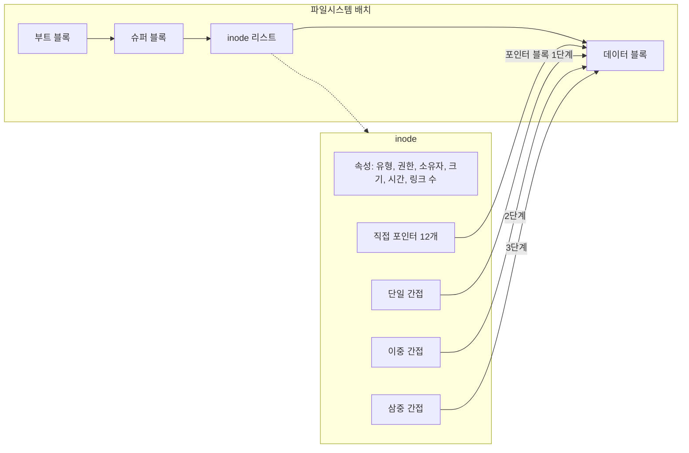

# 파일 시스템 (유닉스 파일시스템 중심)

---

## I. inode로 파일을 찾는, 유닉스 파일시스템의 개요

### 가. 정의

- 저장 장치의 데이터를 **계층적 디렉터리 트리와 inode(인덱스 노드) 기반으로 조직해 생성·검색·수정·삭제를 제공**하는 유닉스 계열 OS의 파일 관리 구조

### 나. 특징

| 구분 | 내용 |
| --- | --- |
| 단일 트리 | 루트(`/`) 아래 하나의 트리, 다른 장치는 마운트로 연결 |
| 모든 것은 파일 | 장치, 파이프, 소켓도 파일 인터페이스로 접근 |
| 메타데이터 분리 | 파일 속성은 inode, 파일 이름은 디렉터리 항목에 저장 |
| 접근 제어 | 소유자·그룹·기타 사용자별 rwx 권한 |

---

## II. 구조 및 구성요소

### 가. 디스크 배치와 inode 블록 포인터

- 작은 파일은 직접 포인터로, 큰 파일은 간접 포인터 단계를 늘려 블록 위치를 찾음 (예: 전통 UFS·ext2·ext3)

### 나. 구성요소

| 구분 | 요소 | 설명 |
| --- | --- | --- |
| 디스크 영역 | 부트 블록 | 부트스트랩 코드 |
| | 슈퍼 블록 | 파일시스템 크기, 블록·inode 수, 빈 블록 정보 등 전체 메타데이터 |
| | inode 리스트 | 파일별 inode 저장 영역 |
| | 데이터 블록 | 파일 내용, 디렉터리 항목(파일명 ↔ inode 번호) |
| inode | 속성 | 유형, 권한, 소유자, 크기, 링크 수, atime(접근)·mtime(내용 수정)·ctime(inode 변경) |
| | 블록 포인터 | 직접·단일·이중·삼중 간접 (파일명은 포함하지 않음) |
| 링크 | 하드 링크 | 같은 inode를 가리키는 다른 이름, 링크 수 증가, 같은 파일시스템 안에서만 가능 |
| | 심볼릭 링크 | 대상 경로를 내용으로 가진 별도 파일, 다른 파일시스템·디렉터리도 가리킴 |
| 계층 | VFS | ext4·XFS·NFS 등을 같은 시스템 콜로 접근하게 하는 [[추상화]] 계층 |

---

## III. 비교 및 동향

### 가. 유닉스 계열 vs NTFS

| 비교 항목 | 유닉스·Linux (ext4, XFS) | Windows NTFS |
| --- | --- | --- |
| 트리 구조 | 단일 루트, 마운트 | 드라이브 문자별 트리 |
| 메타데이터 | inode | MFT (Master File Table) 레코드 |
| 블록 관리 | 간접 포인터(ext2/3), 익스텐트(ext4·XFS) | 런(Run) 기반 익스텐트 |
| 권한 | rwx + POSIX ACL | ACL 중심 |
| 대소문자 | 구분 | 기본적으로 구분하지 않음 (보존은 함) |

### 나. 동향

- **저널링·익스텐트**: ext4·XFS는 메타데이터 저널로 크래시 후 빠르게 복구하고, 연속 블록을 익스텐트로 관리해 대용량 파일 효율 향상
- **CoW 파일시스템**: ZFS·Btrfs는 덮어쓰지 않고 새 블록에 기록해 스냅샷·체크섬·볼륨 관리 제공
- **분산 파일시스템**: [[HDFS]], CephFS, AWS EFS가 여러 노드의 저장소를 하나의 네임스페이스로 제공

---

### 🔗 연관 토픽

- **소속 도메인**: [[00_운영체제_MOC|⚙️ 운영체제]]
- **세부 분류**: `5. 가상 메모리 관리 & 페이지 교체 알고리즘`
- **핵심 연관 토픽**:
  - [[유닉스의 inode]]
  - [[커널|커널(Kernel)]]
  - [[디스크 스케줄링|디스크 스케줄링(Disk Scheduling)]]
  - [[추상화|추상화 (Abstraction)]]
  - [[HDFS]]
