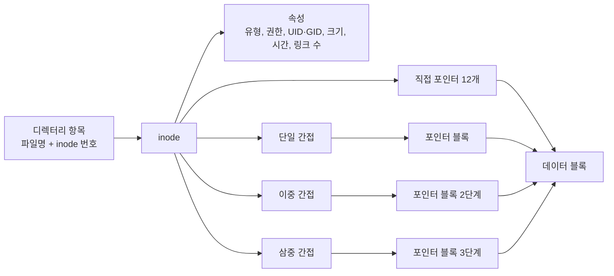

# 유닉스의 inode

---

## I. 이름 없는 파일 정보, inode의 개요

### 가. 정의

- 유닉스 계열 파일시스템에서 **파일 이름과 데이터 내용을 제외한 파일의 속성과 데이터 블록 위치를 담는 고정 크기 자료구조**, 파일시스템 안에서 inode 번호로 식별

### 나. 특징

| 구분 | 내용 |
| --- | --- |
| 이름 분리 | 디렉터리 항목이 "이름 ↔ inode 번호"를 매핑, inode에는 이름이 없음 |
| 하드 링크 | 여러 이름이 같은 inode를 공유, 링크 수가 0이 되고 열린 곳이 없으면 삭제 |
| 다단계 포인터 | 직접·간접 포인터로 작은 파일은 빠르게, 큰 파일도 수용 |
| 개수 제한 | 전통 ext 계열은 생성 시 inode 수가 고정 → 작은 파일이 많으면 공간이 남아도 inode 고갈 |

---

## II. 구조 및 구성요소

### 가. inode 참조 구조 (ext2·ext3 예)

- 경로를 따라 디렉터리 항목에서 inode 번호를 찾고, inode의 포인터를 따라 데이터 블록에 접근

### 나. 구성요소

| 구분 | 요소 | 설명 |
| --- | --- | --- |
| 식별 | inode 번호 | 파일시스템 안에서 유일 |
| 속성 | 모드 | 파일 유형(일반·디렉터리·링크·장치)과 권한(rwx, SUID·SGID·Sticky) |
| | 소유자 | UID, GID |
| | 시간 | atime(접근), mtime(내용 수정), ctime(inode 변경), ext4는 생성 시간(crtime) 추가 |
| | 크기·블록 수 | 파일 바이트 수, 할당 블록 수 |
| | 링크 수 | 이 inode를 가리키는 디렉터리 항목 수 |
| 블록 포인터 | 직접 포인터 (12개) | 데이터 블록 주소를 직접 보관 |
| | 단일·이중·삼중 간접 | 포인터 블록을 1~3단계 거쳐 데이터 블록 지정 |
| 최대 크기 예 | 블록 4KB, 포인터 4B | 포인터 블록당 1,024개 → 삼중 간접까지 약 4TB 주소 지정 |

---

## III. 비교 및 동향

### 가. 블록 매핑 방식 비교

| 비교 항목 | 간접 포인터 (ext2·ext3) | 익스텐트 (ext4·XFS) | CoW 트리 (Btrfs·ZFS) |
| --- | --- | --- | --- |
| 표현 | 블록마다 포인터 | 시작 블록 + 길이 | B-트리(Btrfs)·블록 포인터 트리(ZFS) |
| 대용량 파일 | 포인터 블록 탐색 비용 큼 | 메타데이터 작고 순차 I/O 유리 | 스냅샷·복제에 유리 |
| 쓰기 방식 | 제자리 갱신 + 저널 (ext3) | 제자리 갱신 + 저널, 지연 할당 | 새 위치에 기록 후 포인터 교체 |
| 무결성 | 저널 | 메타데이터 체크섬 (ext4·XFS v5) | 데이터·메타데이터 체크섬, 중복 구성 시 자동 복구 |

### 나. 동향

- **익스텐트 기본화**: ext4·XFS 모두 inode 안에 익스텐트 트리를 두어 대용량 파일 메타데이터 축소
- **동적 inode 할당**: XFS·Btrfs는 필요 시 inode를 할당해 고정 개수에 따른 고갈 문제 회피
- **고속 매체 대응**: NVMe 환경에서 메타데이터 잠금 경합을 줄이는 방향으로 파일시스템 내부 구조 최적화 (예: XFS 병렬 할당 그룹)

---

### 🔗 연관 토픽

- **소속 도메인**: [[00_운영체제_MOC|⚙️ 운영체제]]
- **세부 분류**: `6. 커널 아키텍처 & 입출력 시스템`
- **핵심 연관 토픽**:
  - [[유닉스 파일 시스템|파일 시스템(유닉스 파일시스템)]]
  - [[커널|커널(Kernel)]]
  - [[디스크 스케줄링|디스크 스케줄링(Disk Scheduling)]]
  - [[단편화]]
  - [[지역성|지역성(Locality)]]
