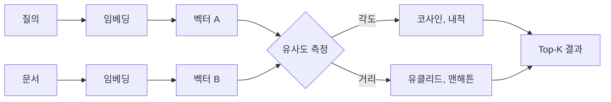

# 유사도 (Similarity)

---

## I. 얼마나 비슷한가를 수치로, 유사도의 개요

### 가. 정의

- 두 데이터(벡터·집합·문자열 등)가 **얼마나 비슷한지를 거리·각도·겹침 정도로 수치화**한 지표 (거리가 작을수록 유사도가 큼)

### 나. 특징

| 구분 | 내용 |
| --- | --- |
| 활용 | 추천(협업 필터링), 군집화, [[KNN 알고리즘\|KNN]] 분류, 검색 |
| 데이터별 선택 | 연속형·범주형·텍스트·이진 데이터와 희소성에 따라 지표 선택 |
| 거리 공리 | 거리 지표는 비음수·대칭·삼각부등식 만족, 코사인 유사도(1−cos 포함)는 삼각부등식 불만족으로 엄밀한 거리 아님 |
| 벡터 검색 | RAG·추천에서 임베딩 간 유사도 연산이 핵심 |

---

## II. 측정 구조 및 주요 지표

### 가. 임베딩 유사도 검색 흐름

- 데이터를 같은 벡터 공간에 임베딩한 뒤 각도·거리로 비교해 가장 가까운 항목을 반환

### 나. 주요 지표

| 구분 | 요소 | 설명 |
| --- | --- | --- |
| 각도 | 코사인 유사도 | $\frac{A \cdot B}{\lVert A \rVert \lVert B \rVert}$, -1~1, 크기 무시·방향 비교, 텍스트 임베딩에 주로 사용 |
| | 피어슨 상관계수 | 평균을 뺀 벡터의 코사인, 사용자별 평점 기준 차이 보정 |
| 거리 | 유클리드 (L2) | 직선 거리, K-Means 등 연속형 데이터 |
| | 맨해튼 (L1) | 축 방향 거리 합, L2보다 큰 차이에 덜 민감 |
| | 민코프스키 | $(\sum \lvert a_i - b_i \rvert^p)^{1/p}$, p=1 맨해튼·p=2 유클리드 |
| | 마할라노비스 | 공분산을 반영한 거리, 변수 간 상관·척도 차이 보정 |
| 집합 | 자카드 | $\lvert A \cap B \rvert / \lvert A \cup B \rvert$, 중복 문서·장바구니 비교 |
| 문자열 | 레벤슈타인 | 삽입·삭제·대체 최소 편집 횟수, 오타 교정 |
| 이진 | 해밍 | 같은 길이 비트열의 다른 자리 수, 오류 검출 |

---

## III. 비교 및 동향

### 가. 유클리드 거리 vs 코사인 유사도

| 비교 항목 | 유클리드 거리 | 코사인 유사도 |
| --- | --- | --- |
| 기준 | 절대 거리 (크기 반영) | 사잇각 (방향만) |
| 크기 민감도 | 높음 (문서 길이 영향) | 낮음 |
| 활용 | 좌표·센서·이미지 특징 | 문서·단어 임베딩 |
| 관계 | 정규화 벡터에서 $\lVert A-B \rVert^2 = 2(1-\cos\theta)$로 순위 동일 | |
| 한계 | 고차원에서 거리 차이가 줄어듦 (차원의 저주) | 크기 정보 손실 |

### 나. 동향

- **유사도 학습**: 대조 학습(SimCLR, CLIP)·메트릭 학습으로 의미가 가까운 데이터가 가깝도록 임베딩 공간 자체를 학습
- **근사 최근접 검색**: 대규모 임베딩에서 HNSW·IVF-PQ 기반 ANN(FAISS 등)으로 검색 속도 확보 ([[벡터 데이터베이스]])

---

### 🔗 연관 토픽

- **소속 도메인**: [[00_인공지능_MOC|🤖 인공지능]]
- **세부 분류**: `1. 수학 · 통계학 & 데이터 전처리`
- **핵심 연관 토픽**:
  - [[거리 공식|거리 공식(Distance Formula)]]
  - [[벡터 데이터베이스|벡터 데이터베이스(Vector Database)]]
  - [[KNN 알고리즘]]
  - [[TF-IDF (Term Frequency - Inverse Document Frequency)]]
  - [[상관 관계 분석|상관 관계 분석 (Correlation Analysis)]]
