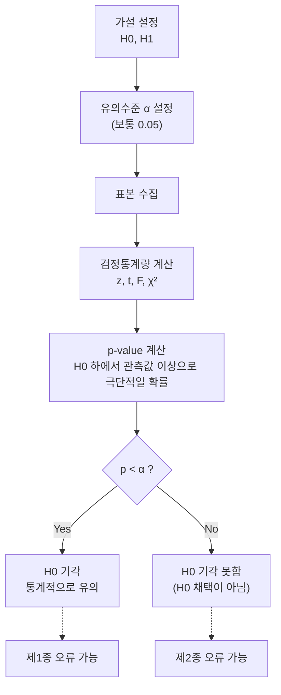

# 유의확률 (p-value)

---

## I. 귀무가설 아래 관측 결과의 극단성, 유의확률의 개요

### 가. 정의

- **귀무가설($H_0$)이 참이라고 가정할 때, 관측된 검정통계량 이상으로 극단적인 결과가 나올 확률**

### 나. 특징

| 구분 | 내용 |
| --- | --- |
| 판단 지표 | 유의수준 $\alpha$와 비교해 $p < \alpha$이면 $H_0$ 기각 |
| 올바른 해석 | 데이터가 $H_0$와 얼마나 맞지 않는지의 척도, **$H_0$가 참일 확률이 아님** |
| 효과 크기와 별개 | 작은 p-value가 큰 효과를 뜻하지 않음 (표본이 크면 미세한 차이도 유의) |
| 오용 | p-hacking, 0.05 이분법 판단 문제로 효과 크기·신뢰구간 병기 권고 |

---

## II. 산출 절차 및 구성요소

### 가. 가설 검정 절차

- 검정통계량의 분포에서 p-value를 구하고 사전에 정한 $\alpha$와 비교해 유의성 판정

### 나. 구성요소

| 구분 | 요소 | 설명 |
| --- | --- | --- |
| 가설 | 귀무가설 $H_0$ | 차이·효과가 없다는 기본 가설 |
| | 대립가설 $H_1$ | 입증하려는 주장, 단측·양측 설정에 따라 p-value 계산이 달라짐 |
| 통계량 | 검정통계량 | 표본으로 계산한 z, t, $\chi^2$, F 값 |
| 기준 | 유의수준 $\alpha$ | 제1종 오류를 허용할 최대 확률 |
| | 기각역 | 임계치 밖, $H_0$를 기각하는 통계량 범위 |
| 오류 | 제1종 오류 ($\alpha$) | $H_0$가 참인데 기각 (거짓 양성) |
| | 제2종 오류 ($\beta$) | $H_0$가 거짓인데 기각하지 못함 (거짓 음성), 검정력 $= 1-\beta$ |
| 오용 | p-hacking | 유의한 결과가 나올 때까지 분석·변수·표본을 바꾸는 행위 |

---

## III. 비교 및 동향

### 가. p-value vs 보완 지표

| 비교 항목 | p-value | 효과 크기 | 신뢰구간 |
| --- | --- | --- | --- |
| 목적 | 통계적 유의성 | 실질적 차이의 크기 | 모수 추정 범위·정밀도 |
| 형태 | 0~1 확률 | 표준화 수치 (Cohen's d, r 등) | [하한, 상한] |
| 표본 크기 영향 | 실제 효과가 있으면 표본이 클수록 작아짐 | 추정값 자체는 표본 크기에 크게 좌우되지 않음 | 표본이 클수록 좁아짐 |
| 정보 | 기각 여부 판단 근거 | 효과의 중요도 | 불확실성 |

### 나. 동향

- **ASA 성명 (2016)**: 미국통계학회가 p-value 오용을 경계하는 원칙을 발표, 정확한 p-value와 효과 크기·신뢰구간 함께 보고
- **다중 검정 보정**: 지표가 많은 A/B 테스트에서 Bonferroni·Benjamini-Hochberg(FDR) 보정, 순차 검정(Sequential Testing)으로 반복 확인 문제 대응
- **베이지안 대안**: 사후확률·베이즈 팩터로 가설의 상대적 증거를 직접 표현 ([[베이즈 추론]])

---

### 🔗 연관 토픽

- **소속 도메인**: [[00_인공지능_MOC|🤖 인공지능]]
- **세부 분류**: `1. 수학 · 통계학 & 데이터 전처리`
- **핵심 연관 토픽**:
  - [[가설 검정]]
  - [[t-검정 (t-test)]]
  - [[Z-검정|Z-검정 (Z-test)]]
  - [[추론 통계|추론 통계(Inferential Statistics)]]
  - [[베이즈 추론]]
