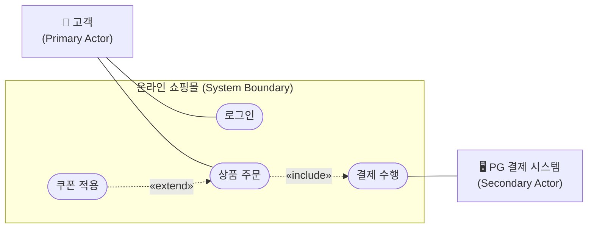

# 유즈케이스 다이어그램 (Use Case Diagram)

---

## I. 사용자 관점의 기능 요구사항 모델, 유즈케이스 다이어그램의 개요

### 가. 정의

- 시스템이 제공할 기능(Use Case)과 외부 주체(Actor)의 상호작용을 **사용자 관점에서 시각화**하여 기능 요구사항과 시스템 범위를 정의하는 [[UML]] 행위 다이어그램

### 나. 특징

| 구분 | 내용 |
| --- | --- |
| 요구사항 가시화 | 내부 구현이 아닌 사용자가 얻는 기능 중심으로 표현 |
| 범위 확정 | 시스템 경계(System Boundary)로 개발 범위를 명확히 구분 |
| 의사소통 | 고객·기획자·개발자 간 공통 이해 도구 |
| 테스트 기준 | 유즈케이스 시나리오가 [[시스템 테스트]] 케이스 도출의 기준 |

---

## II. 구성 및 핵심 요소

### 가. 개념도

- 주문 시 결제는 항상 수행되므로 포함(Include), 쿠폰 적용은 조건부로만 주문을 확장(Extend)
- 화살표 방향: Include는 기본 → 포함 유즈케이스, Extend는 확장 → 기본 유즈케이스

### 나. 구성 요소

| 구분 | 요소 | 설명 |
| --- | --- | --- |
| 사물 | 액터 (Actor) | 시스템 외부에서 상호작용하는 사용자·외부 시스템·장치 (주 액터 / 부 액터) |
| | 유즈케이스 | 액터에게 가치를 제공하는 기능 단위 (타원) |
| | 시스템 경계 | 개발 대상 범위 (사각형) |
| 관계 | 연관 (Association) | 액터와 유즈케이스 간 상호작용 (실선) |
| | 포함 (Include) | 기본 유즈케이스가 반드시 수행하는 공통 기능 (점선 화살표) |
| | 확장 (Extend) | 특정 조건(Extension Point)에서만 추가 수행되는 기능 (점선 화살표) |
| | [[일반화]] (Generalization) | 액터·유즈케이스 간 상속 관계 (빈 삼각형 화살표) |
| 명세 | 유즈케이스 명세서 | 사전·사후조건, 기본 흐름, 대안·예외 흐름을 텍스트로 기술 |

---

## III. 비교 및 동향

### 가. 유즈케이스 vs 유저 스토리

| 비교 항목 | 유즈케이스 | 유저 스토리 |
| --- | --- | --- |
| 방법론 | 구조적·[[객체지향]] (Upfront 분석) | [[Agile]] / [[SCRUM\|Scrum]] |
| 관점 | 액터와 시스템 간 상호작용 흐름 전체 | 사용자가 얻는 비즈니스 가치 |
| 형식 | 다이어그램 + 상세 명세서 | "[역할]로서 [목적]을 위해 [기능]을 원한다" |
| 상세도 | 사전·사후조건, 예외 흐름까지 구체적 | 에픽 → 스토리로 분할, 인수 조건 중심 |
| 활용 시점 | 요구사항 분석·설계 단계 | 스프린트 백로그, 지속 갱신 |

### 나. 동향

- **AI 기반 자동화**: [[초거대 언어 모델\|LLM]]이 [[요구사항 명세서]]·회의록에서 유즈케이스 다이어그램(Mermaid, PlantUML)과 명세서를 자동 생성
- **경량화**: [[DDD (Domain Driven Design)\|DDD]]·[[MSA (Micro Service Architecture)\|MSA]] 환경에서 이벤트 스토밍과 결합해 바운디드 컨텍스트 식별의 보조 도구로 활용

---

### 🔗 연관 토픽

- **소속 도메인**: [[00_소프트웨어공학_MOC|🏗️ 소프트웨어공학]]
- **세부 분류**: `3. 요구사항 공학 & UML 객체지향 분석/설계`
- **핵심 연관 토픽**:
  - [[UML|UML (정적, 동적 다이어그램)]]
  - [[요구 공학|요구 공학 (Requirements Engineering)]]
  - [[요구사항 명세서]]
  - [[시스템 테스트]]
  - [[객체지향]]
