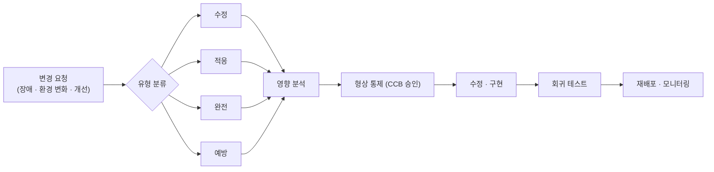

# 유지보수 (Software Maintenance)

---

## I. 인도 이후의 가장 긴 단계, 유지보수의 개요

### 가. 정의

- SW 인도 후 **결함 수정, 운영 환경 변화 적응, 기능·성능 개선, 잠재 결함 예방을 위해 SW를 수정하는 활동** ([[ISO IEC IEEE 14764|ISO/IEC/IEEE 14764]])

### 나. 특징

| 구분 | 내용 |
| --- | --- |
| 비용 비중 | 생명주기 총비용의 60~80%를 차지하는 최장 단계 |
| 지속 진화 | 폐기 전까지 변경을 수용하며 진화 ([[Lehman의 Software 변화의 원리\|Lehman 법칙]]) |
| 품질 저하 위험 | 반복 수정으로 구조가 퇴화하고 [[기술 부채]] 누적 |
| 통제 필요 | 변경마다 영향 분석·형상 통제·회귀 시험 필요 |

---

## II. 유지보수 절차 및 유형

### 가. 유지보수 절차

- 변경 요청을 유형별로 분류하고 영향 분석과 형상 통제 승인 후 수정, 회귀 테스트를 거쳐 재배포

### 나. 유형 및 관리 요소

| 구분 | 요소 | 설명 |
| --- | --- | --- |
| 정정 (Correction) | 수정 (Corrective) | 운영 중 발견된 결함을 사후 수정 |
| | 예방 (Preventive) | 운영 장애가 되기 전 잠재 결함을 발견·수정 |
| 개선 (Enhancement) | 적응 (Adaptive) | OS·[[DBMS]]·법제도 등 환경 변화에 맞춰 변경 |
| | 완전 (Perfective) | 기능 추가·성능·유지보수성 개선 (유지보수 비용의 약 50%로 가장 큼) |
| 관리 | [[형상 관리]] | 변경 식별·통제·상태 기록·감사 |
| | 영향 분석 | 변경이 다른 모듈에 미치는 파급 범위 식별 |
| | [[리그레션 테스트\|회귀 테스트]] | 기존 기능의 부작용 검증 |
| 구조 개선 | 재공학 | 역공학으로 레거시를 분석해 구조 재구성 ([[3R]]) |
| 서비스 관리 | [[SLA\|SLA]] | 가용률·복구 시간(MTTR) 등 서비스 수준 약정 기반 수행 |

---

## III. 비교 및 동향

### 가. 전통적 유지보수 vs 지능형 운영

| 비교 항목 | 전통적 ([[ITSM(Information Technology Service Management)\|ITSM]] 중심) | 지능형 (AIOps · [[DevOps]]) |
| --- | --- | --- |
| 대응 방식 | 장애 발생 후 사후 대응 | 이상 징후 탐지로 사전 대응 |
| 배포 | 월·분기 단위 정기 배포 | CI/CD 기반 상시 배포 |
| 결함 분석 | 개발자 수동 분석 | 로그·APM 분석, LLM 수정 제안 |
| 핵심 지표 | MTBF, MTTR | 배포 빈도, 변경 실패율 (DORA) |

### 나. 동향

- LLM 기반 레거시(COBOL 등) 코드 분석·문서화·전환 도구로 현대화 추진
- AIOps로 로그·메트릭을 분석해 장애 예측과 자동 조치 수행

---

### 🔗 연관 토픽

- **소속 도메인**: [[00_소프트웨어공학_MOC|🏗️ 소프트웨어공학]]
- **세부 분류**: `1. 소프트웨어 개발 생명주기(SDLC) & 방법론`
- **핵심 연관 토픽**:
  - [[ISO IEC IEEE 14764|ISO/IEC/IEEE 14764]]
  - [[Lehman의 Software 변화의 원리]]
  - [[기술 부채]]
  - [[형상 관리]]
  - [[3R]]
