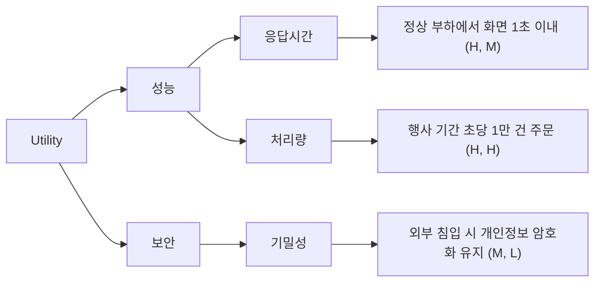

# 유틸리티 트리 (Utility Tree)

---

## I. 품질 목표를 시나리오로 내리는 트리, 유틸리티 트리의 개요

### 가. 정의

- [[ATAM]]에서 시스템의 **효용(Utility)을 품질 속성 → 세부 속성 → 품질 속성 시나리오로 계층 분해하고 중요도·난이도로 우선순위를 매기는** 트리 모델

### 나. 특징

| 구분 | 내용 |
| --- | --- |
| 구체화 | 모호한 품질 목표를 측정 가능한 시나리오로 하향 분해 |
| 우선순위화 | 각 시나리오에 (중요도, 난이도)를 H·M·L로 부여 |
| 평가 초점 | (H, H) 시나리오를 아키텍처 평가의 중심으로 선정 |
| 합의 | 이해관계자 간 품질 목표의 공통 이해 형성 |

---

## II. 구조 및 구성요소

### 가. 트리 구조 예시

- 루트 효용에서 품질 속성과 세부 속성을 거쳐 말단 시나리오로 내려가며, (H, H)인 S2가 우선 분석 대상

### 나. 구성요소

| 구분 | 요소 | 설명 |
| --- | --- | --- |
| 계층 | Utility | 시스템 전체 품질의 루트 노드 |
| | 품질 속성 | 성능·[[HA(High Availability)\|가용성]]·보안·변경 용이성 등 |
| | 세부 속성 | 품질 속성을 측정 가능한 하위 특성으로 세분 (예: [[응답시간]]) |
| | 시나리오 | 말단 노드, [[소프트웨어 품질 속성 시나리오\|자극·환경·응답·측정치]]로 기술 |
| 평가 | 중요도 | 사업 목표 달성에 대한 시나리오의 중요성 |
| | 난이도 | 아키텍처로 달성하기 위한 기술 난이도·위험 |
| 결과 | 아키텍처 드라이버 | (H, H) 시나리오로 접근법 분석과 민감점·트레이드오프점 도출의 기준 |

---

## III. 비교 및 동향

### 가. 유틸리티 트리 vs 유즈케이스

| 비교 항목 | 유틸리티 트리 | 유즈케이스 |
| --- | --- | --- |
| 대상 | 비기능 요구 (품질 속성) | 기능 요구 |
| 관점 | 아키텍트·시스템 구조 | 액터·업무 흐름 |
| 형태 | 계층 트리 | 다이어그램과 흐름 명세 |
| 우선순위 | (중요도, 난이도) | 사업 가치, 위험 |
| 활용 단계 | 아키텍처 설계·평가 | 요구 분석·설계 |

### 나. 동향

- [[MSA (Micro Service Architecture)|MSA]]·클라우드 환경에서 회복성·확장성 시나리오가 상위 우선순위로 부상
- (H, H) 시나리오를 [[성능 테스트]]·[[카오스 엔지니어링]] 실험으로 연결해 지속적 아키텍처 검증에 활용

---

### 🔗 연관 토픽

- **소속 도메인**: [[00_소프트웨어공학_MOC|🏗️ 소프트웨어공학]]
- **세부 분류**: `3. 요구사항 공학 & UML 객체지향 분석/설계`
- **핵심 연관 토픽**:
  - [[ATAM]]
  - [[소프트웨어 품질 속성 시나리오]]
  - [[SW Architecture 평가]]
  - [[CBAM]]
  - [[소프트웨어 아키텍처|소프트웨어 아키텍쳐]]
