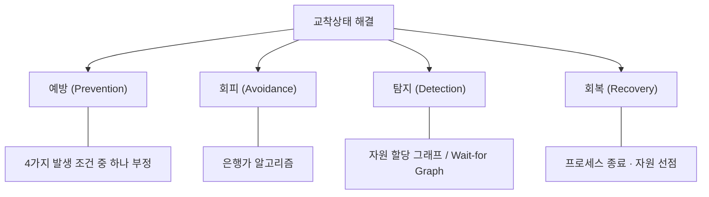
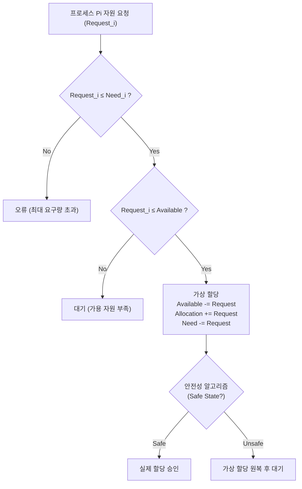

# 은행가 알고리즘 (Banker's Algorithm)

---

## I. 교착상태 회피 기법, 은행가 알고리즘의 개요

### 가. 은행가 알고리즘의 정의

- 운영체제가 자원을 할당하기 전에 할당 결과를 **시뮬레이션하여 시스템이 안전 상태(Safe State)를 유지할 때만 할당을 승인**하는 [[교착상태]] 회피(Avoidance) [[알고리즘]]
- 다익스트라(E. W. Dijkstra)가 은행의 대출 심사 원리에서 착안하여 제안

### 나. 특징

| 구분 | 내용 |
| --- | --- |
| 사전 정보 필요 | 각 [[프로세스]]의 최대 자원 요구량(Max)을 미리 알아야 함 |
| 안전 순서열 탐색 | 할당 후에도 모든 프로세스가 종료 가능한 순서(Safe Sequence)가 있는지 확인 |
| 런타임 판단 | 요청 시점마다 안전성 검사를 수행 |

### 다. 교착상태 해결 기법에서의 위치

---

## II. 은행가 알고리즘 동작 원리 및 구성요소

### 가. 자원 요청 처리 흐름

### 나. 핵심 자료구조 (프로세스 n개, 자원 유형 m개)

| 자료구조 | 형태 | 의미 |
| --- | --- | --- |
| Available | 1차원 배열 [m] | 자원 유형별 현재 가용 [[인스턴스]] 수 |
| Max | 2차원 행렬 [n×m] | 프로세스별 최대 요구량 |
| Allocation | 2차원 행렬 [n×m] | 프로세스별 현재 할당량 |
| Need | 2차원 행렬 [n×m] | 추가로 필요한 양 (Need = Max − Allocation) |

### 다. 하위 알고리즘

| 알고리즘 | 역할 |
| --- | --- |
| 자원 요청 알고리즘 | 요청이 Need·Available 범위 안인지 확인하고 가상 할당 |
| 안전성 알고리즘 | Work = Available에서 시작해 Need ≤ Work인 프로세스를 차례로 종료시키며 안전 순서열 탐색 |

---

## III. 기법 비교 및 한계

### 가. 교착상태 예방 vs 회피

| 비교 항목 | 예방 (Prevention) | 회피 (Avoidance) |
| --- | --- | --- |
| 개념 | 상호배제·점유대기·비선점·환형대기 중 하나 이상 차단 | 할당 전에 안전 상태 여부를 검사 |
| 적용 시점 | 설계 단계 (정적 통제) | 자원 할당 시점 (동적 판단) |
| 자원 활용도 | 낮음 | 예방보다 높음 |
| 대표 기법 | 자원 순서화, 일괄 할당 | 은행가 알고리즘 |

### 나. 한계 및 활용

- **한계**: 프로세스 수와 최대 요구량이 고정되어야 하므로 동적 환경에 부적합하고, 안전성 검사 비용이 O(m × n²)로 큼
- **실제 OS**: 범용 OS(Windows, Linux)는 교착상태를 무시하는 타조(Ostrich) 알고리즘을 쓰고, DBMS는 대기 그래프 기반 탐지·회복을 주로 사용
- **응용**: 클라우드 자원 [[프로비저닝]]의 한도 설정, RTOS 자원 [[스케줄링]] 모델 등에 안전 상태 개념이 활용됨
- 참고: Lamport의 **Bakery 알고리즘**은 번호표로 임계영역 진입 순서를 정하는 **상호배제** 알고리즘으로, 교착상태 회피 기법인 은행가 알고리즘과는 목적이 다름

---

### 🔗 연관 토픽

- **소속 도메인**: [[00_운영체제_MOC|⚙️ 운영체제]]
- **세부 분류**: `3. 프로세스 동기화 & 임계영역 상호배제`
- **핵심 연관 토픽**:
  - [[교착상태|교착상태 (Deadlock)]]
  - [[자원할당 그래프]]
  - [[OS(운영체제)]]
  - [[스케줄링]]
  - [[프로세스]]
