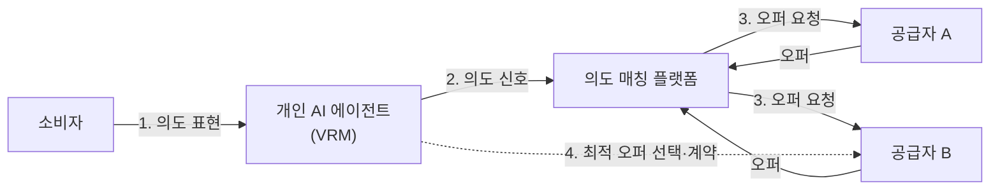

# 의도 경제 (Intention Economy)

---

## I. 관심을 끄는 시장에서 의도를 받는 시장으로, 의도 경제의 개요

### 가. 정의

- 소비자가 자신의 **구매 의도(Intent)를 직접 시장에 알리고, 공급자가 그 의도를 충족하려 경쟁**하는 소비자 주도 경제 모델 (Doc Searls, 『The Intention Economy』 2012)

### 나. 등장 배경 및 특징

| 구분 | 내용 |
| --- | --- |
| 배경 | 추적 기반 타깃 광고(주목 경제)에 대한 피로, [[마이데이터]] 등 개인 데이터 주권 강화 |
| 기술 동인 | 사용자 대신 의도를 파악·협상하는 개인 AI 에이전트 등장 |
| 주도권 역전 | 공급자 → 소비자, 소비자가 공급자와의 관계를 관리 (VRM) |
| 거래 구조 | 의도 신호 발신 → 공급자 오퍼 → 소비자 선택 (역경매형) |

---

## II. 의도 경제의 구조 및 구성요소

### 가. 개념도

- 개인 에이전트가 의도를 필요한 범위만 공개하고, 공급자 오퍼 중 조건에 맞는 것을 소비자 대신 비교·선택

### 나. 구성요소

| 구분 | 요소 | 설명 |
| --- | --- | --- |
| 관계 관리 | VRM (Vendor Relationship Management) | 소비자가 여러 공급자와의 관계·데이터를 직접 관리 (CRM의 반대 개념) |
| | 제로파티 데이터 | 소비자가 자발적으로 제공한 선호·의도 데이터 |
| 지능화 | 개인 AI 에이전트 | 맥락을 분석해 의도를 구체화하고 대리 탐색·협상 |
| | 의도 매칭 | 의도 신호와 공급자 상품을 연결하는 [[알고리즘]] |
| 데이터 주권 | PDS (Personal Data Store) | 개인 데이터를 사용자 통제 저장소에 보관 (예: Solid Pod) |
| | DID (분산 신원) | 중앙 기관 없이 신원 증명, 최소 정보 공개 |
| | [[영지식증명\|ZKP]] 등 PET | 조건 충족 여부만 증명해 개인정보 노출 최소화 |
| 거래 | 스마트 계약 | 조건 충족 시 거래·결제 자동 실행 |

---

## III. 주목 경제 비교 및 동향

### 가. 주목 경제 vs 의도 경제

| 구분 | 주목 경제 (Attention Economy) | 의도 경제 (Intention Economy) |
| --- | --- | --- |
| 핵심 자원 | 소비자의 시간·관심 | 소비자의 구체적 목적·의도 |
| 주도권 | 플랫폼·공급자 | 소비자 |
| 마케팅 | 추적 기반 타깃 광고 (Push) | 의도 기반 맞춤 오퍼 (Pull) |
| 데이터 | 서드파티 행동 추적 데이터 | 제로파티·퍼스트파티 데이터 |
| 관계 관리 | [[CRM]] | VRM |

### 나. 동향

- **AI 에이전트 커머스**: 사용자 대신 검색·비교·결제하는 쇼핑 에이전트 등장으로 VRM 구상이 현실화
- **의도 조작 우려**: 에이전트가 의도를 유도·판매하는 방향으로 악용될 수 있다는 학계 경고 (Cambridge 연구진, 2024)
- **표준·거버넌스**: 의도 신호 교환 규격, 개인정보 최소 공개, 에이전트 책임 소재에 대한 제도 정비 필요

---

### 🔗 연관 토픽

- **소속 도메인**: [[00_경영전략_MOC|📈 경영전략]]
- **세부 분류**: `1. 경영 환경 분석 & 전략 수립 프레임워크`
- **핵심 연관 토픽**:
  - [[CRM]]
  - [[마이데이터]]
  - [[에이전틱 AI|에이전틱 AI(Agentic AI)]]
  - [[영지식증명|영지식증명(Zero Knowledge Proof)]]
  - [[그로스 해킹|그로스 해킹(Growth hacking)]]
