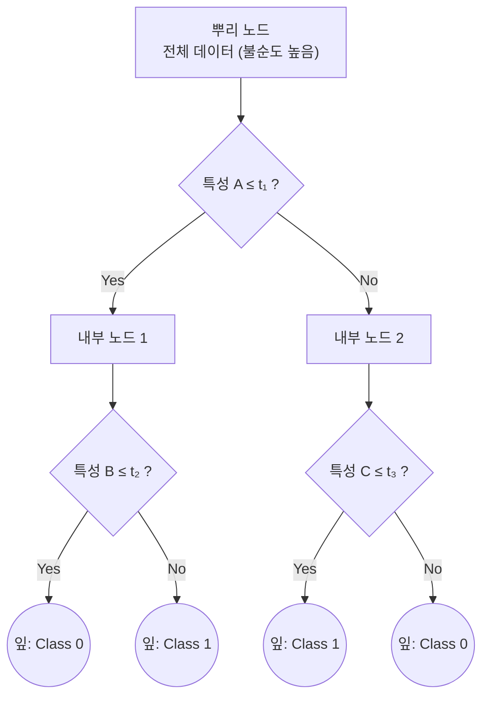

# 의사결정나무 (Decision Tree)

---

## I. 규칙으로 읽히는 모델, 의사결정나무의 개요

### 가. 정의

- 불순도가 가장 많이 줄어드는 기준으로 **데이터를 재귀적으로 분할해 If-Then 규칙 트리를 만들고 분류·회귀**를 수행하는 [[지도학습]] 모델

### 나. 특징

| 구분 | 내용 |
| --- | --- |
| 설명력 | 분할 규칙을 그대로 읽을 수 있는 화이트박스 모델 |
| 전처리 부담 | 스케일링·정규화 불필요, 범주·수치 변수 혼용 가능 |
| 과적합 | 깊어질수록 학습 데이터에 과적합, 가지치기 필요 |
| 불안정성 | 데이터가 조금만 바뀌어도 트리 구조가 크게 변함 |

---

## II. 구조 및 핵심 요소

### 가. 개념도

- 각 노드에서 불순도 감소(정보 이득)가 최대인 변수·임계값을 찾아 분할, 정지 조건까지 반복

### 나. 핵심 요소

| 구분 | 요소 | 설명 |
| --- | --- | --- |
| 구조 | 노드 | 뿌리(전체), 내부(분기), 잎(예측값) |
| 분할 기준 | 정보 이득 | 부모 불순도 − 자식 불순도의 가중 평균 |
| | 지니 불순도 | $1 - \sum p_k^2$, CART 분류 기준 (경제학의 지니 계수와 다름) |
| | 엔트로피 | $-\sum p_k \log_2 p_k$, 0이면 순수 (ID3, C4.5) |
| | 분산 감소 | 회귀 트리 기준, 분할 후 MSE 감소량 |
| 과적합 방지 | 사전 가지치기 | 최대 깊이, 최소 표본 수 제한 |
| | 사후 가지치기 | 완전 성장 후 비용-복잡도 가지치기 |
| 알고리즘 | CART | 지니·분산 기준 이진 분할, 분류·회귀 지원 |
| | ID3·C4.5 | 정보 이득·정보 이득 비율(Gain Ratio), 다지 분할 |

---

## III. 비교 및 동향

### 가. 의사결정나무 vs 랜덤 포레스트

| 비교 항목 | 의사결정나무 | [[랜덤 포레스트]] |
| --- | --- | --- |
| 구조 | 단일 트리 | 다수 트리 [[배깅]] + 특성 무작위 선택 |
| 해석력 | 높음 | 낮음 (변수 중요도로 간접 해석) |
| 과적합 | 취약 | 평균·투표로 분산 감소 |
| 안정성 | 데이터 변화에 민감 | 강건 |
| 성능 | 상대적으로 낮음 | 높음 |

### 나. 동향

- **부스팅의 기본 학습기**: XGBoost, LightGBM, CatBoost 등 그래디언트 [[부스팅]]의 약한 학습기로 정형 데이터 분야 표준 ([[앙상블 학습]])
- **설명 가능성**: 금융·의료 등에서 규칙 추출, 블랙박스 모델의 대리 모델(Surrogate)로 활용 ([[XAI]])

---

### 🔗 연관 토픽

- **소속 도메인**: [[00_인공지능_MOC|🤖 인공지능]]
- **세부 분류**: `1. 수학 · 통계학 & 데이터 전처리`
- **핵심 연관 토픽**:
  - [[랜덤 포레스트|랜덤 포레스트 (Random Forest)]]
  - [[앙상블 학습|앙상블 학습(Ensemble Learning)]]
  - [[배깅]]
  - [[부스팅]]
  - [[XAI]]
