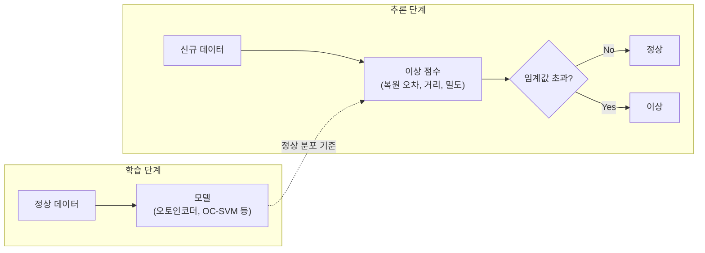

# 이상 감지 (Anomaly Detection)

---

## I. 정상에서 벗어난 것을 찾는, 이상 감지의 개요

### 가. 정의

- 데이터에서 **정상 패턴이나 기대 분포를 벗어난 관측치·사건([[이상치]], Novelty)을 식별**하는 분석 기법

### 나. 필요성 및 특징

| 구분 | 내용 |
| --- | --- |
| 극단적 불균형 | 이상 사례가 매우 드문 [[클래스 불균형]] 환경 |
| 적용 분야 | 제조 비전 검사, 보안 침입 탐지, 금융 FDS, 예지보전, IT 운영(AIOps) |
| 학습 방식 | 이상 레이블이 부족해 비지도·정상 데이터 기반 학습이 주류 |
| 이상 유형 | 점 이상, 맥락 이상(시점에 따라 이상), 집단 이상 |

---

## II. 동작 구조 및 핵심 기술

### 가. 개념도

- 정상 데이터의 분포를 학습하고, 신규 데이터의 이상 점수를 임계값과 비교해 판정

### 나. 핵심 기술

| 구분 | 요소 | 설명 |
| --- | --- | --- |
| 학습 방식 | 정상 데이터 기반 (One-Class) | 정상만 학습해 경계·분포 형성 |
| | [[비지도 학습]] | 레이블 없이 저밀도 영역을 이상으로 판단 |
| 판단 기준 | 복원 오차 | 오토인코더로 압축·복원 시 오차가 큰 데이터 |
| | 거리·밀도 | kNN 거리, LOF, GMM, PatchCore(정상 패치 특징 메모리와의 거리) |
| | 고립 | Isolation Forest, 적은 분할로 고립되는 데이터 |
| 경계 모델 | One-Class [[서포트 벡터 머신\|SVM]]·Deep SVDD | 정상 데이터를 감싸는 경계·최소 초구 학습 |
| 생성 모델 | [[GAN (Generative Adversarial Network)\|GAN]]·[[Diffusion 모델]] | 정상 분포 학습 후 복원·재구성 차이로 탐지 |
| 그래프 | GNN | 거래·네트워크 관계에서 이상 노드·간선 탐지 |
| 운영 | AIOps·[[MLOps]] | 로그·메트릭 스트림 실시간 탐지와 알람 |

---

## III. 비교 및 동향

### 가. 레이블 유무에 따른 비교

| 비교 항목 | 지도 학습 | 정상 데이터 기반 (Semi) | 비지도 학습 |
| --- | --- | --- | --- |
| 데이터 | 정상·이상 레이블 | 정상 데이터만 | 레이블 없음 (대부분 정상 가정) |
| 알고리즘 | 랜덤 포레스트, [[CNN]] 분류기 | One-Class SVM, Deep SVDD, 오토인코더 | Isolation Forest, LOF, [[PCA(Principal Component Analysis)\|PCA]] |
| 장점 | 알려진 이상 유형에 높은 정확도 | 이상 데이터 수집 부담 적음, 새 유형 대응 | 레이블 비용 없음 |
| 단점 | 레이블 구축 비용, 미지 유형 탐지 어려움 | 임계값 설정에 민감 | 오탐 많음, 평가 어려움 |

### 나. 동향

- **설명 가능한 탐지**: 이상 판정 근거를 SHAP·이상 영역 히트맵으로 제시해 현장 조치 지원 ([[XAI]])
- **멀티모달·파운데이션 모델**: 이미지·진동·로그를 결합하거나, 비전-언어 모델로 학습 없이 결함을 찾는 제로샷 이상 탐지 연구 (WinCLIP 등)
- **엣지 실시간 탐지**: 공장 카메라·IoT 장비에서 경량 모델을 직접 구동해 지연 없이 탐지 ([[온디바이스 AI]])

---

### 🔗 연관 토픽

- **소속 도메인**: [[00_인공지능_MOC|🤖 인공지능]]
- **세부 분류**: `1. 수학 · 통계학 & 데이터 전처리`
- **핵심 연관 토픽**:
  - [[이상치]]
  - [[비지도 학습]]
  - [[클래스 불균형|클래스 불균형(Class Imbalance)]]
  - [[VAE|VAE(Variational Autoencoder)]]
  - [[DBSCAN(밀도 기반 클러스터링)]]
