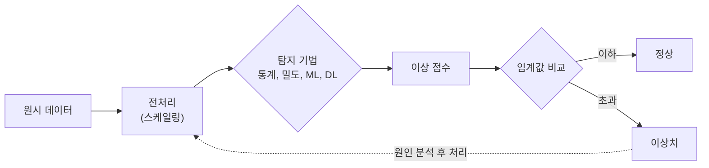

# 이상치 (Outlier)

---

## I. 분포에서 크게 벗어난 관측값, 이상치의 개요

### 가. 정의

- 전체 데이터의 일반적 분포에서 **크게 벗어나 측정 오류 또는 특이 현상을 반영하는 관측값**

### 나. 필요성 및 특징

| 구분 | 내용 |
| --- | --- |
| 품질 영향 | 평균·분산·회귀계수를 왜곡하고 모델 학습을 흔듦 |
| 신호 가치 | 금융 사기·설비 고장처럼 이상치 자체가 탐지 대상일 수 있음 ([[이상 감지]]) |
| 유형 | 단변량(한 변수에서 극단), 다변량(변수 조합이 비정상), 맥락적(시점·조건에 따라 비정상) |
| 처리 원칙 | 원인을 먼저 판단 후 제거·변환·유지 결정 ([[결측치]]와 함께 정제) |

---

## II. 탐지 구조 및 기법

### 가. 탐지 흐름

- 기법별 이상 점수를 계산해 임계값으로 판정하고, 원인 분석 결과를 전처리에 반영

### 나. 탐지 기법

| 구분 | 요소 | 설명 |
| --- | --- | --- |
| 통계 | Z-Score | 정규분포 가정, $\lvert Z \rvert > 3$이면 이상치 |
| | IQR | $Q_1 - 1.5 \times IQR$ 미만, $Q_3 + 1.5 \times IQR$ 초과 (분포 가정 불필요) |
| | MAD | 중앙값 기준 절대편차, 이상치에 강건한 Z-Score 대안 |
| 밀도·거리 | LOF | 이웃 대비 국소 밀도가 낮은 정도 |
| | [[DBSCAN(밀도 기반 클러스터링)\|DBSCAN]] | 어떤 군집에도 속하지 않는 노이즈 점 |
| | 마할라노비스 거리 | 공분산을 고려한 다변량 이상치 탐지 |
| ML | Isolation Forest | 무작위 분할에서 경로 길이가 짧은(쉽게 고립되는) 점 |
| | One-Class [[서포트 벡터 머신\|SVM]] | 정상 데이터 경계 학습 |
| DL | 오토인코더 | 복원 오차가 큰 점 |
| 처리 | 제거·윈저라이징·변환 | 오류면 삭제, 극단값은 백분위 경계값 대체·로그 변환 |

---

## III. 비교 및 동향

### 가. 탐지 기법 비교

| 비교 항목 | 통계 기법 | ML·밀도 기법 | 딥러닝 기법 |
| --- | --- | --- | --- |
| 대표 | Z-Score, IQR, MAD | LOF, DBSCAN, Isolation Forest, OC-SVM | 오토인코더, [[GAN (Generative Adversarial Network)\|GAN]] |
| 가정 | 분포 가정 (Z-Score) | 분포 가정 불필요 | 대량 데이터 필요 |
| 차원 | 주로 단변량 | 다변량 | 고차원·비정형 (이미지, 시계열) |
| 비용 | 낮음 | 중간 | 높음 |
| 설명력 | 높음 | 중간 | 낮음 ([[XAI]] 필요) |

### 나. 동향

- **데이터 중심 AI**: 레이블 오류·이상 데이터 정제가 모델 개선만큼 중요해지면서 데이터 품질 파이프라인에 이상치 탐지 내재화
- **사전학습 기반 탐지**: 합성 데이터로 사전학습한 PFN 계열 모델로 별도 학습 없이 정형 데이터 이상치를 추론하는 연구 등장
- **설명 연계**: SHAP·[[LIME]]으로 어떤 변수가 이상 점수에 기여했는지 제시

---

### 🔗 연관 토픽

- **소속 도메인**: [[00_인공지능_MOC|🤖 인공지능]]
- **세부 분류**: `1. 수학 · 통계학 & 데이터 전처리`
- **핵심 연관 토픽**:
  - [[결측치]]
  - [[이상 감지]]
  - [[데이터 전처리]]
  - [[왜도 & 첨도|왜도(skewness) & 첨도(kurtosis)]]
  - [[DBSCAN(밀도 기반 클러스터링)]]
