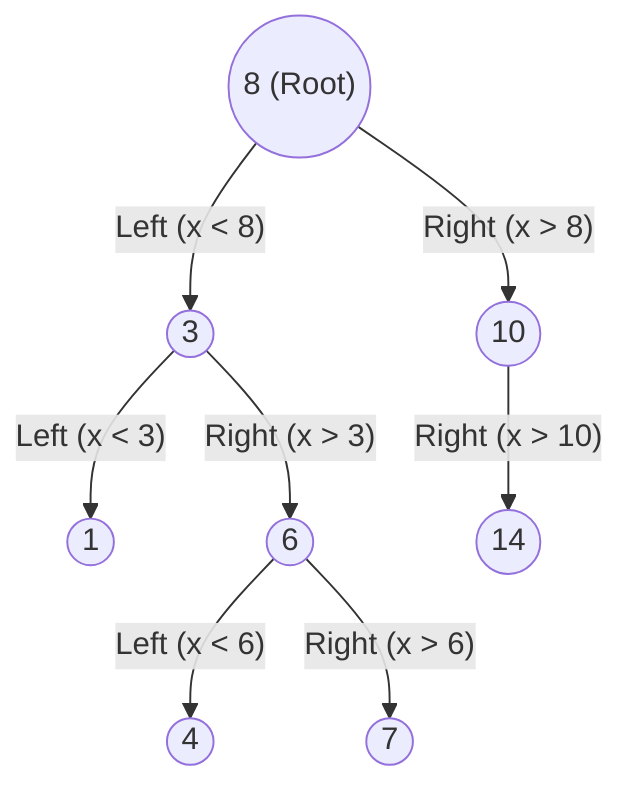

# 이진 탐색 트리 (Binary Search Tree, BST)

---

## I. 정렬과 빠른 탐색을 지원하는 계층형 자료구조, 이진 탐색 트리의 개요

### 가. 정의

- 모든 노드에 대해 **왼쪽 서브트리는 부모보다 작은 키를, 오른쪽 서브트리는 부모보다 큰 키를 갖도록 정렬된 이진 트리 기반 자료구조**

### 나. 특징 및 필요성

| 구분 | 내용 |
| --- | --- |
| 배열과 리스트 결합 | 배열의 빠른 이진 탐색($O(\log N)$)과 연결 리스트의 동적 삽입·삭제 장점을 융합 |
| 중위 순회 정렬 | 트리를 중위 순회(Inorder Traversal: Left $\rightarrow$ Root $\rightarrow$ Right)하면 오름차순 정렬 데이터 획득 |
| 평균 연산 효율 | 균형 잡힌 상태에서 검색, 삽입, 삭제 연산의 평균 시간 복잡도 $O(\log N)$ 제공 |
| 편향 트리 한계 | 정렬된 데이터 연속 삽입 시 한쪽으로 기울어지는 편향(Skewed) 발생으로 최악 시간 복잡도 $O(N)$으로 퇴화 |

---

## II. 개념도 및 핵심 구성요소

### 가. 개념도

- 루트(8)를 기준으로 작은 값(3)은 좌측, 큰 값(10)은 우측으로 재귀 분기하며, 매 비교 단계마다 탐색 대상 공간을 절반으로 축소

### 나. 핵심 구성요소 및 연산 규칙

| 구분 | 요소 | 설명 |
| --- | --- | --- |
| 노드 구조 | Key / Value | 데이터 값을 보관하는 필드 |
| | Pointer | 좌측 자식(Left)과 우측 자식(Right) 노드의 메모리 주소를 가리키는 2개의 포인터 |
| 기본 연산 | 탐색 (Search) | 루트부터 시작하여 타겟이 작으면 좌측, 크면 우측으로 이동 (평균 $O(\log N)$) |
| | 삽입 (Insert) | 타겟 크기를 비교하며 단말(Leaf) 노드 위치를 찾아 새 노드를 연결 (평균 $O(\log N)$) |
| 삭제 연산 | 차수 0 (단말) | 자식이 없는 리프 노드는 부모와의 링크를 해제하고 메모리 반환 |
| | 차수 1 (단일 자식) | 삭제 노드의 부모와 삭제 노드의 자식을 직접 연결 |
| | 차수 2 (두 자식) | 왼쪽 서브트리의 최댓값 또는 오른쪽 서브트리의 최솟값(Inorder Successor)으로 대체 |
| 균형 보완 | AVL 트리 | 노드 삽입·삭제 시 균형 인수(좌우 높이 차이 1 이하)를 유지하도록 회전 연산 수행 |
| | Red-Black 트리 | 노드 색상(Red/Black) 속성과 회전을 결합하여 최악 $O(\log N)$ 탐색 보장 |

---

## III. 자료구조 비교 및 동향

### 가. 이진 탐색 트리 vs 배열 vs 해시 테이블

| 비교 항목 | 이진 탐색 트리 (BST) | 정렬 배열 (Sorted Array) | 해시 테이블 (Hash Table) |
| --- | --- | --- | --- |
| 데이터 정렬 | 항상 정렬된 상태 유지 | 항상 정렬된 상태 유지 | 정렬되지 않음 (Unordered) |
| 탐색 시간 (평균) | $O(\log N)$ | $O(\log N)$ (이진 탐색) | $O(1)$ |
| 삽입·삭제 (평균) | $O(\log N)$ (포인터 연결) | $O(N)$ (데이터 시프트 필요) | $O(1)$ |
| 범위 검색 | 우수 (중위 순회로 범위 추출 용이) | 우수 (이진 탐색 후 연속 읽기) | 취약 (전체 버킷 탐색 필요) |
| 메모리 구조 | 포인터 기반 비연속 메모리 | 연속 메모리 할당 (캐시 우수) | 버킷 배열 및 충돌 체이닝 공간 필요 |

### 나. 동향

- **캐시 친화적(Cache-Conscious) B+Tree로의 진화**: 전통적 BST는 잦은 포인터 추적으로 CPU 캐시 미스가 심각하므로, 데이터베이스 엔진은 노드 크기를 캐시 라인/디스크 블록에 맞춘 B+Tree를 표준 색인으로 채택
- **동시성 락 프리(Lock-Free) 트리 적용**: 멀티코어 환경에서 락 경합을 줄이기 위해 원자적 CAS 연산 및 낙관적 락(Optimistic Concurrency Control) 기반의 병행 BST 도입
- **학습된 색인(Learned Index)**: 기계학습 모델이 데이터 키의 누적 분포 함수(CDF)를 학습하여 탐색 트리 분기 계층을 수식 추론으로 대체하는 차세대 인덱싱 기법 연구 확산

---

### 🔗 연관 토픽

- **소속 도메인**: [[00_컴퓨터구조_MOC|💻 컴퓨터구조]]
- **세부 분류**: `4. 기본 자료구조 (Data Structures)`
- **핵심 연관 토픽**:
  - [[AVL 트리]]
  - [[트리 순회|트리 순회 (Tree Traversal)]]
  - [[힙|힙 (Heap)]]
  - [[Balanced Tree B-Tree|Balanced Tree B-Tree (비트리)]]
  - [[해시 테이블]]
