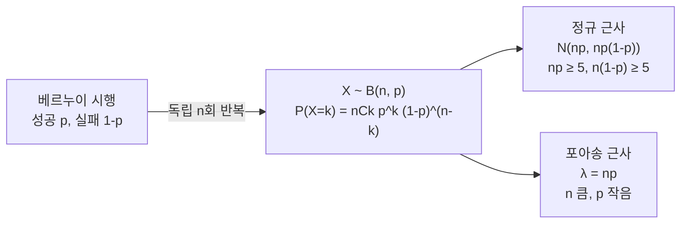

# 이항분포 (Binomial Distribution)

---

## I. n번 시행 중 성공 횟수, 이항분포의 개요

### 가. 정의

- 성공 확률 $p$인 [[베르누이 분포|베르누이 시행]]을 **독립적으로 $n$회 반복했을 때 성공 횟수 $X$가 따르는 이산확률분포**, $X \sim B(n, p)$

### 나. 전제조건 및 특징

| 구분 | 내용 |
| --- | --- |
| 시행 횟수 고정 | $n$이 미리 정해짐 |
| 이진 결과 | 매 시행 성공 또는 실패 |
| 독립성 | 각 시행 결과가 서로 영향 없음 |
| 확률 불변 | 매 시행 $p$ 일정 (비복원 추출은 초기하분포) |
| 근사 | $n$이 크면 정규분포, $n$이 크고 $p$가 작으면 [[포아송 분포]]로 근사 |

---

## II. 구조 및 주요 통계량

### 가. 개념도

- $n$번 중 $k$번 성공하는 경우의 수 $\binom{n}{k}$에 각 경우의 확률을 곱해 PMF를 구성

### 나. 주요 통계량

| 구분 | 요소 | 설명 |
| --- | --- | --- |
| 모수 | $n$, $p$ | 시행 횟수, 성공 확률 ($q = 1-p$) |
| 확률 함수 | PMF | $P(X=k) = \binom{n}{k}p^k(1-p)^{n-k}$, $k = 0, \dots, n$ |
| | 이항계수 | $\binom{n}{k} = \frac{n!}{k!(n-k)!}$ |
| 통계량 | 기댓값 | $E(X) = np$ |
| | 분산 | $V(X) = np(1-p)$, $p = 0.5$에서 최대 |
| 극한 | 드무아브르-라플라스 정리 | $n$이 클 때 정규분포 $N(np, np(1-p))$로 근사 ([[중심극한정리]]의 특수한 경우) |
| | 포아송 극한 | $n \to \infty$, $p \to 0$, $np = \lambda$ 일정 시 포아송 분포 |

---

## III. 비교 및 동향

### 가. 이항분포 vs 포아송분포

| 비교 항목 | 이항분포 | 포아송분포 |
| --- | --- | --- |
| 확률변수 | 고정된 $n$회 중 성공 횟수 | 단위 시간·공간당 사건 발생 수 |
| 범위 | $0 \sim n$ | $0, 1, 2, \dots$ (상한 없음) |
| 모수 | $n$, $p$ | $\lambda$ |
| 평균·분산 | 평균 $np$ ≥ 분산 $np(1-p)$ | 평균 = 분산 = $\lambda$ |
| IT 적용 | 전환율 검정, 이진 분류 정확도 | 트래픽 도착 수, 장애 발생 건수 |

### 나. 동향

- **A/B 테스트**: 전환율·클릭률 비교를 위한 두 비율 검정과 표본 크기 산정의 근거
- **모델 평가 신뢰구간**: 테스트셋 정확도·LLM 벤치마크 정답률을 이항 비율로 보고 Wilson 구간 등으로 불확실성 표시
- **손실 함수**: 이항(베르누이) 우도의 음의 로그가 이진 크로스 엔트로피 ([[손실함수]])

---

### 🔗 연관 토픽

- **소속 도메인**: [[00_인공지능_MOC|🤖 인공지능]]
- **세부 분류**: `1. 수학 · 통계학 & 데이터 전처리`
- **핵심 연관 토픽**:
  - [[베르누이 분포|베르누이 분포 (Bernoulli distribution)]]
  - [[포아송 분포|포아송 분포 (Poisson Distribution)]]
  - [[정규분포|정규분포(Normal Distribution)]]
  - [[중심극한정리|중심극한정리 (Central Limit Theorem)]]
  - [[확률분포]]
