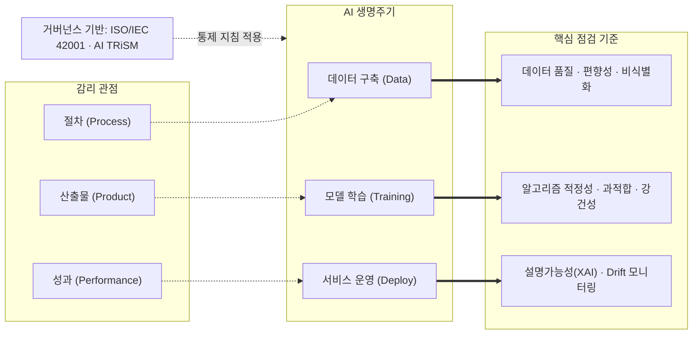

# 인공지능 감리 (AI Audit)

---

## I. AI의 신뢰성·안전성 확보를 위한 검증, 인공지능 감리의 개요

### 가. 인공지능 감리의 정의
- AI 시스템이 목적을 달성하면서 데이터 편향, 알고리즘 오류, 보안 취약점, 윤리 문제 없이 공정하고 안전하게 작동하는지를 독립된 제3자가 데이터 구축부터 운영까지 점검하고 개선을 권고하는 종합 검증 활동이다.

### 나. 필요성 및 특징

| 구분 | 내용 |
| --- | --- |
| 블랙박스 특성 극복 | 규칙 기반 SW와 달리 데이터로 로직이 결정되는 확률론적 모델이므로 코드 리뷰를 넘어선 데이터·가중치 검증 필수 |
| 성능 노후화(Drift) 대응 | 운영 환경 배포 후 데이터 및 개념 변화(Concept Drift)로 인한 모델 성능 저하와 왜곡을 상시 감시 |
| 글로벌 규제 적합성 | [[AI 기본법]], EU AI Act 등 고위험 AI에 대한 신뢰성 검증 및 적합성 평가 의무화에 선제 대응 |

---

## II. 인공지능 감리 프레임워크 및 점검 항목

### 가. 인공지능 감리 프레임워크 개념도

### 나. 생명주기별 주요 점검 항목

| 단계 | 점검 영역 | 핵심 점검 내용 |
| --- | --- | --- |
| 데이터 구축 | 품질·편향·프라이버시 | 데이터 대표성·균형성, 개인정보 [[비식별화]]·가명처리 적정성, [[데이터 라벨링과 어노테이션\|라벨링]] 정확도와 검수 절차, 데이터 오염 방어 |
| 모델 학습 | 성능·강건성 | Train/Validation/Test 분리, 목표 지표(Precision·Recall·F1) 달성, 과적합 방지([[Dropout]] 등), [[적대적 공격]] 대응 |
| 서비스 운영 | 투명성·윤리·모니터링 | 판단 근거 설명(XAI), [[AI 윤리]] 준수, [[모델 드리프트 컨셉 드리프트 & 데이터 드리프트\|Concept Drift]] 감시 및 재학습 통제, 법령·저작권 준수 |

---

## III. 기존 감리와의 비교 및 최신 동향

### 가. 정보시스템 감리 vs 인공지능 감리

| 비교 항목 | 정보시스템 감리 (Rule-based) | 인공지능 감리 (Data-driven) |
| --- | --- | --- |
| 개발 특성 | 결정론적, 논리 구현 | 확률론적, 데이터 학습 |
| 점검 대상 | 소스코드, [[데이터베이스 정규화\|DB 설계]], 아키텍처 | 데이터 품질·[[편향]], 모델 성능·파라미터 |
| 오류 성격 | 명확한 로직 오류 | 통계적 오차, 편향, [[할루시네이션]] |
| 테스트 | [[테스트 오라클]] 명확 | 오라클 부재 → 통계적 검증 |
| 유지보수 | 코드 수정(Patch) | 데이터 수집 후 재학습([[Fine-Tuning]]) |
| 핵심 가치 | 기능성, 효율성 | 신뢰성, 공정성, 설명 가능성 |

### 나. 최신 동향 및 제언
- **생성형 AI 레드티밍(Red Teaming) 감리 의무화**: 프롬프트 인젝션 및 탈옥(Jailbreak), 데이터 추출 공격에 대응하여 모델 배포 전 적대적 취약점 진단 정례화.
- **글로벌 규제 기반 적합성 평가 연계**: EU AI Act 및 국가별 인공지능 기본법의 고위험 AI 시장 진입 요건에 대응하기 위한 독립 제3자 감리 체계 구축.
- **AI TRiSM 및 MLOps 자동화 감리 도구 도입**: ISO/IEC 42001 및 NIA 실무 가이드를 준용하여 편향 탐지, 성능 드리프트 추적을 MLOps 파이프라인에 내재화.

---

### 🔗 연관 토픽

- **소속 도메인**: [[00_인공지능_MOC|🤖 인공지능]]
- **세부 분류**: `2. 머신러닝 기초 & 핵심 알고리즘`
- **핵심 연관 토픽**:
  - [[AI 거버넌스|AI 거버넌스 (AI Governance)]]
  - [[정보시스템 감리]]
  - [[편향]]
  - [[XAI]]
  - [[AI TRiSM|AI TRiSM(AI Trust Risk and Security Management)]]
