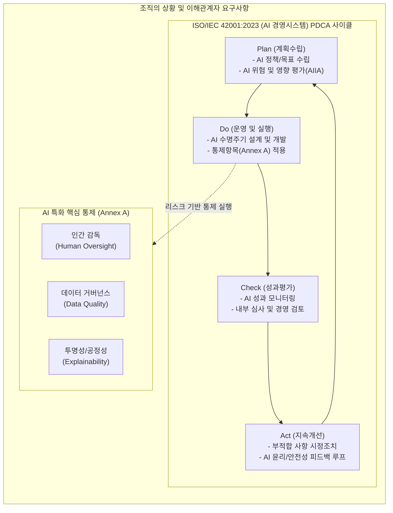

# 인공지능 경영시스템(ISO 42001:2023)

---

## I. 신뢰할 수 있는 AI 생태계를 위한 국제 표준, ISO/IEC 42001의 개요

### 가. 인공지능 경영시스템(ISO/IEC 42001)의 정의
- 조직이 AI 시스템의 기획, 개발, 운영 전 생애주기에서 안전성, 투명성, 윤리적 책임성을 체계적으로 관리하고 지속 개선할 수 있도록 요구사항을 규정한 세계 최초의 인공지능 경영시스템 국제 표준이다.

### 나. ISO/IEC 42001의 등장 배경 및 주요 특징

| 구분 | 주요 내용 |
| --- | --- |
| AI 고유 리스크 통제 | 환각(Hallucination), 데이터 편향성, 블랙박스 설명 불가능성 등 전통 IT와 다른 AI 리스크 통제 거버넌스 확립 |
| 글로벌 규제 적합성 | EU AI Act, 각국 AI 기본법 등 고위험 AI에 대한 신뢰성 검증 및 적합성 평가 의무화에 대한 입증 수단 제공 |
| HLS(고위구조) 기반 통합 | ISO 9001(품질), ISO 27001(정보보안), ISO 27701(개인정보)과 동일한 PDCA 프레임워크로 유연한 연계 구축 가능 |
| Annex A 통제 세부화 | 데이터 거버넌스, AI 영향평가(AIIA), 인간 감독(Human Oversight), 제3자 공급망 관리 등 38개 통제항목 제시 |

---

## II. ISO 42001의 개념도 및 핵심 통제/기술 요소

### 가. ISO 42001의 개념도 및 동작원리

* 조직의 목표에 맞춰 AI 위험과 기회를 식별(Plan)하고, AI 생명주기 전반에 거버넌스를 실행(Do)하며, 성과를 점검(Check)하고 지속 개선(Act)하는 구조로 작동함.

### 나. ISO 42001의 핵심 구성 요소 (요구사항 및 Annex A 기반)

| 구분 | 요소기술(키워드) | 세부 설명 |
| --- | --- | --- |
| **기획 / 위험관리** | AI 영향 평가 (AIIA) | - AI 시스템이 인간, 사회, 프라이버시, 안전에 미칠 잠재적 영향을 사전에 식별하고 평가하는 체계 |
| **기획 / 위험관리** | AI 위험 평가 체계 | - 편향성, 모델 드리프트, 데이터 품질 저하 등 AI 고유의 위험(Risk)을 식별하고 완화 우선순위를 결정 |
| **정책 / 조직지원** | AI 리더십 및 거버넌스 | - 최고경영진 주도의 AI 정책 수립, 전사적 R&R 배분 및 AI 시스템 인벤토리(Inventory) 자산 관리 체계 확립 |
| **운영 / 데이터** | [[데이터 거버넌스]] | - 학습 및 추론에 사용되는 데이터의 출처, 품질, 정합성, 개인정보 보호 및 편향 방지를 위한 통제 활동 |
| **운영 / [[프로세스]]** | AI 수명주기(Lifecycle) | - 기획-데이터 준비-설계-학습-검증-배포-폐기에 이르는 AI 전 주기별 승인 기준 및 기술 문서화 프로세스 구축 |
| **[[신뢰성]] / 윤리** | 인간 감독 (Oversight) | - AI의 오작동 및 윤리적 오류를 방지하기 위해 중요 의사결정 과정에 인간이 개입하고 통제할 수 있는 장치 마련 |
| **신뢰성 / 윤리** | 투명성 및 설명가능성 | - 의사결정 알고리즘의 도출 근거를 투명하게 제시(Explainability)하고, 챗봇/[[딥페이크]] 등의 경우 AI 활용 여부를 명시 |
| **통제 / 보안** | 공급자(Supply Chain) 관리 | - 타사의 외부 AI 모델(API), 클라우드 인프라 활용 시 발생할 수 있는 서드파티(제3자) 리스크 관리 및 평가 수행 |

---

## III. ISO 42001과 EU AI Act 비교 및 산업 활용 전망

### 가. ISO 42001과 글로벌 규제(EU AI Act) 비교

| 비교 항목 | ISO/IEC 42001 (국제 표준) | EU AI Act (유럽연합 인공지능법) |
| --- | --- | --- |
| **성격 및 지위** | 자발적 국제 경영시스템 표준 (인증 체계) | 법적 구속력을 가지는 강력한 국제 무역 규제법 |
| **적용 대상** | AI를 개발/제공/사용하는 모든 유형의 조직 | 위험도(금지/고위험/제한적/최소)에 따라 차등 적용 |
| **핵심 목적** | 조직 내 자율적 [[AI 거버넌스]] 내재화 및 지속 개선 | 시민의 기본권 보호 및 고위험 AI에 대한 의무 부과 |
| **위반 시 제재** | 인증 취소 (비즈니스 입찰/신뢰도 하락) | 최대 3,500만 유로 또는 글로벌 매출의 7% 과징금 |

### 나. 향후 활용 동향 및 시사점
- **글로벌 규제 준수를 위한 표준 증적(Evidence) 활용**: EU AI Act의 고위험 인공지능 시스템이 요구하는 데이터 거버넌스, 리스크 관리, 인간 감독 등의 엄격한 의무 사항을 충족하고 있음을 증명하는 디팩토 기준표로 활용 확산.
- **정보보안 경영시스템과의 통합 심사 확대**: AI 시스템의 데이터 보안 및 프라이버시 위험에 대응하기 위해 기존 ISO 27001 및 [[ISO 27701]] 체계 위에 ISO 42001을 연계 구축하는 통합 거버넌스 모델 보편화.
- **AI 공급망 및 B2B 신뢰성 지표 정착**: 서드파티 파운데이션 모델 API 및 외부 MLaaS 솔루션 도입 시 공급자 평가 및 AI 소프트웨어 자재명세서(AI-BOM) 검증의 필수 요구조건으로 인증 채택 가속화.

---

### 🔗 연관 토픽

- **소속 도메인**: [[00_인공지능_MOC|🤖 인공지능]]
- **세부 분류**: `6. 설명가능한 AI (XAI) & AI 윤리 · 거버넌스`
- **핵심 연관 토픽**:
  - [[편향]]
  - [[AI 거버넌스|AI 거버넌스 (AI Governance)]]
  - [[인공지능]]
  - [[XAI]]
  - [[딥페이크|딥페이크(Deepfake)]]
