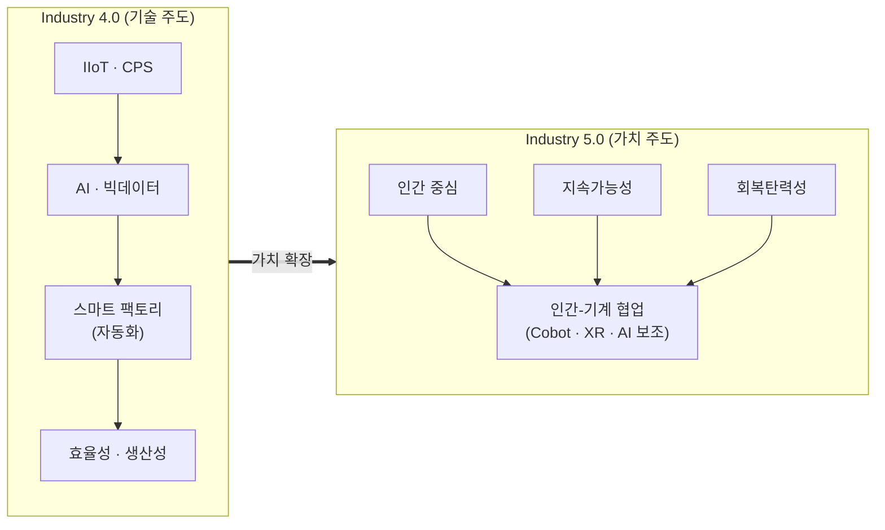

# 인더스트리 4.0 · 5.0 (Industry 4.0 · 5.0)

---

## I. 기술 중심에서 가치 중심으로, 인더스트리 4.0·5.0의 개요

### 가. 정의

- **인더스트리 4.0**: IoT·[[CPS]]·AI·빅데이터를 융합하여 **설비·제품·시스템이 연결되고 스스로 최적화되는 스마트 제조**를 추구하는 산업 패러다임 (2011년 독일 하노버 산업박람회에서 제시)
- **인더스트리 5.0**: 4.0의 기술 기반 위에 **인간 중심(Human-centric)·지속가능성(Sustainability)·회복탄력성(Resilience)** 을 핵심 가치로 더한 산업 패러다임 (2021년 EU 집행위원회 보고서)

### 나. 등장 배경

| 구분 | 내용 |
| --- | --- |
| 4.0 배경 | 제조 경쟁력 강화, 맞춤형 대량생산(Mass Customization) 수요 |
| 5.0 배경 | 자동화 중심의 인간 소외 우려, 기후 위기 대응 |
| | 팬데믹·지정학 갈등에 따른 공급망 충격 대응 |
| 관계 | 5.0은 4.0을 대체하지 않고 목표와 가치를 보완 |

---

## II. 구조 및 기술요소

### 가. 패러다임 전환

- 효율성 중심의 4.0에 인간·환경·회복력 가치를 더해 기술이 사람과 사회에 기여하도록 방향 전환

### 나. 기술요소

| 구분 | 요소 | 설명 |
| --- | --- | --- |
| Industry 4.0 | CPS · [[디지털 트윈]] | 물리 설비와 가상 모델을 연동해 실시간 제어·최적화 |
| | IIoT | 설비·센서 연결로 공정 데이터 수집 |
| | 예지보전 | AI로 고장 사전 예측, 비계획 정지 최소화 |
| Industry 5.0 | 협동 로봇 (Cobot) | 안전 기능을 갖추고 작업자와 같은 공간에서 협업 |
| | XR 작업 지원 | AR로 조립 가이드·원격 지원 제공 |
| | Human-in-the-Loop AI | AI가 판단을 보조하고 사람이 최종 결정, [[XAI]]로 근거 제시 |
| | 순환 경제 · 탄소 관리 | 에너지 효율·탄소 배출 추적, 재활용 설계 |
| | 탄력적 [[SCM (Supply Chain Management)\|SCM]] | 공급 차질 시 대체 조달·재계획 |

---

## III. 비교 및 동향

### 가. 인더스트리 4.0 vs 5.0

| 비교 항목 | 인더스트리 4.0 | 인더스트리 5.0 |
| --- | --- | --- |
| 관점 | 기술 주도 | 가치 주도 |
| 목표 | 생산성·효율·원가 절감 | 작업자 복지, 지속가능성, 공급망 복원력 |
| 인간의 역할 | 자동화로 대체·감독 | 기계와 협업하는 주체, 역량 강화 대상 |
| 제조 형태 | 자동화된 [[Smart Factory\|스마트 팩토리]] | 인간-기계 협업 생산 |
| 환경 · 사회 | 효율 향상의 부수 효과 | 탄소 중립·[[ESG 경영]]을 직접 목표로 |

### 나. 동향

- **AI 보조형 제조**: 숙련 인력 부족 대응으로 생성형 AI 작업 지원·지식 전수, [[Physical AI|물리적 AI]] 기반 로봇 확산
- **규제 연계**: EU 탄소국경조정제도(CBAM)·디지털 제품 여권(DPP) 등으로 제품 탄소·이력 데이터 관리 의무 확대
- **국내**: 스마트공장 보급 사업이 고도화·AI 자율제조 중심으로 전환

---

### 🔗 연관 토픽

- **소속 도메인**: [[00_디지털서비스_MOC|🚀 디지털서비스]]
- **세부 분류**: `3. 사물인터넷 (IoT) & 스마트 플랫폼 · 메타버스`
- **핵심 연관 토픽**:
  - [[Smart Factory|Smart Factory/스마트 팩토리(공장)]]
  - [[CPS]]
  - [[디지털 트윈|디지털 트윈 (Digital Twin)]]
  - [[Physical AI|물리적 AI]]
  - [[인공지능]]
