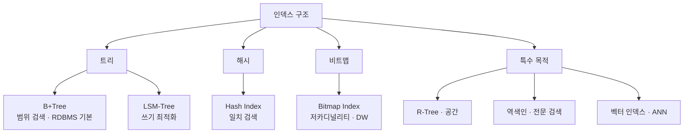

# 인덱스 구조에 따른 분류 (Index Structure Classification)

---

## I. 질의 유형에 맞는 자료구조, 인덱스 구조 분류의 개요

### 가. 정의

- 인덱스를 **내부 자료구조(트리·해시·비트맵·역색인·공간·벡터)에 따라 분류한 것**으로, 데이터 특성과 질의 형태에 맞는 구조를 선택하는 기준

### 나. 특징

| 구분 | 내용 |
| --- | --- |
| 목적 | 디스크 I/O 감소, 응답 시간 단축 |
| 트레이드오프 | 조회 성능 ↑, [[DML]] 시 인덱스 갱신 비용 ↑ |
| 선택 기준 | 일치·범위·다차원·전문·근사 검색 여부, 카디널리티 |
| 워크로드 | 읽기·쓰기 비율, OLTP·OLAP·검색·AI 용도 |

---

## II. 분류 구조 및 유형

### 가. 구조별 분류

- 같은 데이터라도 질의가 범위인지, 다중 조건인지, 텍스트·좌표·임베딩인지에 따라 적합한 구조가 다름

### 나. 유형별 특징

| 구분 | 요소 | 설명 |
| --- | --- | --- |
| 트리 | B+Tree | 균형 트리, 리프 연결 리스트로 범위 스캔, 대부분 RDBMS 기본 ([[Balanced Tree B-Tree\|B-Tree]]) |
| | LSM-Tree | MemTable에 모은 뒤 SSTable로 순차 기록·병합(Compaction), 쓰기 집약 (Cassandra, RocksDB) |
| 해시 | Hash Index | 키 → 버킷, 평균 O(1) 일치 검색, 범위·정렬 불가 |
| 비트맵 | Bitmap Index | 값별 비트 배열, AND·OR로 다중 조건 빠름, 갱신이 잦으면 부적합 |
| 공간 | R-Tree | MBR 계층으로 좌표·폴리곤 검색 ([[다차원 색인구조]]) |
| 텍스트 | 역색인 (Inverted) | 단어 → 문서 ID 목록, Elasticsearch·Lucene |
| 벡터 | HNSW·IVF | 고차원 임베딩 근사 최근접 탐색 ([[ANN(Approximate Nearest Neighbor)알고리즘\|ANN]]) |
| 저장 방식 | 클러스터형 | 데이터 자체를 키 순서로 저장, 테이블당 1개 ([[RDBMS 인덱스(index)\|인덱스]]) |

---

## III. 비교 및 동향

### 가. B+Tree vs LSM-Tree vs 벡터 인덱스

| 비교 항목 | B+Tree | LSM-Tree | 벡터 인덱스 (HNSW) |
| --- | --- | --- | --- |
| 최적화 대상 | 읽기·범위 검색 | 쓰기 처리량 | 유사도 검색 |
| 탐색 | O(log N) | MemTable + 여러 SSTable (블룸 필터 보조) | 그래프 탐색 (근사) |
| 쓰기 비용 | 제자리 갱신, 페이지 분할 | 순차 추가, 백그라운드 병합 | 그래프 연결 갱신 |
| 단점 | 랜덤 쓰기 I/O | 읽기·공간 증폭 | 메모리 사용, 정확도–속도 트레이드오프 |
| 예 | Oracle, MySQL, PostgreSQL | Cassandra, HBase, RocksDB | Milvus, pgvector |

### 나. 동향

- **학습 인덱스**: 데이터 분포(CDF)를 모델로 학습해 B-Tree를 대체하는 Learned Index 연구 (Kraska 외, 2018)
- **RDBMS 벡터 인덱스 내장**: PostgreSQL pgvector(HNSW·IVFFlat), Oracle 23ai 등 관계형 DB에 벡터 인덱스 추가
- **HTAP 혼합 구조**: 행 저장 B+Tree와 열 저장(컬럼스토어) 인덱스를 함께 운영

---

### 🔗 연관 토픽

- **소속 도메인**: [[00_데이터베이스_MOC|🗄️ 데이터베이스]]
- **세부 분류**: `4. 물리 저장 구조 & 인덱스 최적화`
- **핵심 연관 토픽**:
  - [[RDBMS 인덱스(index)]]
  - [[다차원 색인구조]]
  - [[Balanced Tree B-Tree]]
  - [[벡터 데이터베이스]]
  - [[OLAP]]
