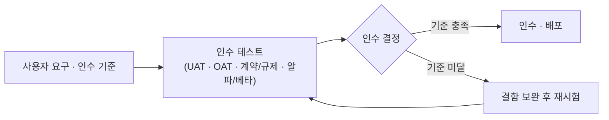

# 인수 테스트 (Acceptance Test)

---

## I. 올바른 제품인지 확인하는 마지막 관문, 인수 테스트의 개요

### 가. 정의

- 완성된 시스템이 **사용자·고객의 업무 요구와 인수 기준을 충족하는지 확인해 인수 여부를 결정**하는 최종 테스트 레벨

### 나. 특징

| 구분 | 내용 |
| --- | --- |
| 확인 중심 | "올바른 제품을 만들었는가" (Validation) |
| 사용자 주도 | 실제 사용자·고객·운영자가 수행 또는 참여 |
| 운영 유사 환경 | 운영과 같거나 유사한 환경에서 수행 |
| 의사결정 | 결과에 따라 인수(Sign-off) 또는 보완 요구 |

---

## II. 수행 흐름 및 유형

### 가. 수행 흐름

- 사전에 합의한 인수 기준에 따라 유형별 테스트를 수행하고, 충족 시 인수(Sign-off)하여 운영 배포

### 나. 유형 및 구성요소

| 구분 | 요소 | 설명 |
| --- | --- | --- |
| 유형 (ISTQB) | 사용자 인수 테스트 (UAT) | 실사용자가 업무 시나리오로 요구 충족 확인 |
| | 운영 인수 테스트 (OAT) | 운영자가 백업·복구·재해 복구·보안·유지보수성 확인 |
| | 계약 · 규제 인수 테스트 | 계약 조건, 법·규제 준수 확인 |
| | 알파 · 베타 테스트 | 개발 측 통제 환경의 사용자 시험(알파), 실사용 환경의 외부 사용자 시험(베타) |
| 기준 | 인수 기준 | 사용자 스토리 완료를 판단하는 측정 가능한 조건 |
| 기법 | ATDD · BDD | 인수 테스트를 먼저 정의하고 Given-When-Then 시나리오로 자동화 |
| 접근 | [[블랙박스 테스트]] | 업무 관점 입출력 확인 |
| 도구 | Cucumber · Selenium · Playwright | 시나리오 자동 실행 |

---

## III. 비교 및 동향

### 가. 시스템 테스트 vs 인수 테스트

| 비교 항목 | [[시스템 테스트]] | 인수 테스트 |
| --- | --- | --- |
| 목적 | 명세 충족 검증 (Verification) | 업무 요구 충족 확인 (Validation) |
| 주체 | 개발 측 독립 테스트 조직 | 사용자·고객·운영자 |
| 기준 | 요구사항 명세서 | 업무 요구, 인수 기준·계약 |
| 환경 | 통제된 시험 환경 | 운영과 같거나 유사한 환경 |
| 주요 결함 | 기능 오류, 인터페이스·성능 문제 | 업무 부적합, 사용성 문제, 요구 누락 |

### 나. 동향

- ATDD·BDD로 인수 테스트를 자동화해 CI/CD에서 반복 실행
- 요구 분석 단계에서 기획·개발·QA(Three Amigos)가 인수 기준을 함께 정의하는 Shift-Left

---

### 🔗 연관 토픽

- **소속 도메인**: [[00_소프트웨어공학_MOC|🏗️ 소프트웨어공학]]
- **세부 분류**: `3. 요구사항 공학 & UML 객체지향 분석/설계`
- **핵심 연관 토픽**:
  - [[시스템 테스트]]
  - [[요구 공학|요구 공학 (Requirements Engineering)]]
  - [[요구사항 명세서|요구사항 명세서 SRS]]
  - [[TDD|TDD (Test Driven Development)]]
  - [[블랙박스 테스트]]
