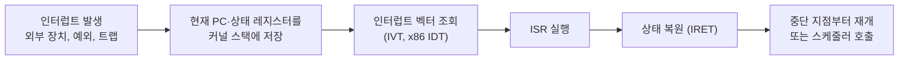

# 인터럽트 (Interrupt)

---

## I. 이벤트가 CPU를 부르는, 인터럽트의 개요

### 가. 정의

- 실행 중 하드웨어·소프트웨어 이벤트가 발생하면 [[CPU]]가 **현재 작업을 잠시 멈추고 해당 처리 루틴(ISR)을 실행한 뒤 원래 작업으로 복귀**하는 제어 메커니즘

### 나. 특징 및 필요성

| 구분 | 내용 |
| --- | --- |
| CPU 효율 | 느린 I/O 장치를 계속 확인(폴링)하지 않고 완료 시 통보받아 CPU 유휴 방지 |
| 시분할 | 타이머 인터럽트로 선점형 스케줄링 구현 |
| 예외 처리 | 0으로 나누기, 페이지 폴트, 보호 위반 등을 커널이 처리 |
| 보호 | 사용자 프로그램은 시스템 콜(트랩)로만 커널 기능 요청 |

---

## II. 처리 구조 및 구성요소

### 가. 인터럽트 처리 절차

- 하드웨어가 복귀 정보를 스택에 저장하고 벡터 테이블에서 ISR 주소를 찾아 실행, 끝나면 복원 후 재개 (처리 결과 다른 프로세스가 선택되면 그때 [[문맥 교환]] 발생)

### 나. 구성요소

| 구분 | 요소 | 설명 |
| --- | --- | --- |
| 외부 인터럽트 | 입출력·타이머 | 장치 컨트롤러가 비동기적으로 발생, 마스크 가능(Maskable) |
| | NMI (Non-Maskable) | 전원 이상·하드웨어 오류 등, 마스크 불가 |
| 내부 인터럽트 (예외) | Fault·Trap·Abort | 명령 실행 중 동기적으로 발생 (페이지 폴트, 0 나누기, 기계 검사) |
| 소프트웨어 인터럽트 | 시스템 콜 | `syscall`, `int 0x80`, ARM `SVC`로 의도적으로 커널 진입 |
| 자료구조 | 인터럽트 벡터 테이블 | 벡터 번호 → ISR 시작 주소 (x86은 IDT) |
| 처리 루틴 | ISR (Top Half) | 최소 작업만 빠르게 처리 |
| | Bottom Half | softirq·tasklet·workqueue로 나머지 작업 지연 처리 |
| 제어 하드웨어 | APIC | 멀티코어에서 인터럽트를 코어에 분배하고 우선순위 관리 |
| | MSI·MSI-X | 물리 핀 대신 PCIe 메모리 쓰기로 인터럽트 전달, 큐별 벡터 지원 |

---

## III. 비교 및 동향

### 가. 인터럽트 vs 폴링

| 비교 항목 | 인터럽트 | 폴링 |
| --- | --- | --- |
| 감지 방식 | 장치가 CPU에 신호 (이벤트 구동) | CPU가 상태 레지스터를 주기적으로 확인 |
| CPU 효율 | 이벤트가 드물 때 높음 | 대기 중 CPU 낭비 |
| 오버헤드 | 이벤트마다 진입·복귀 비용 | 진입 비용 없음 |
| 지연 | 짧음 | 확인 주기에 의존 (계속 돌면 매우 짧음) |
| 적합 | 일반 I/O, 키보드, 저빈도 이벤트 | 초고속 네트워크·NVMe 등 고빈도 이벤트 |

### 나. 동향

- **NAPI·인터럽트 병합**: Linux NAPI는 첫 패킷만 인터럽트로 받고 이후 폴링으로 일괄 처리, NIC의 인터럽트 병합(Coalescing)과 함께 인터럽트 폭주 방지
- **커널 우회 폴링**: DPDK·SPDK는 인터럽트 대신 사용자 공간 전용 코어가 장치를 폴링해 지연 최소화
- **사용자 인터럽트 (UINTR)**: Intel Sapphire Rapids부터 커널을 거치지 않고 사용자 프로세스 간 인터럽트를 전달하는 기능 제공

---

### 🔗 연관 토픽

- **소속 도메인**: [[00_운영체제_MOC|⚙️ 운영체제]]
- **세부 분류**: `1. 프로세스 & 스레드 관리`
- **핵심 연관 토픽**:
  - [[입출력발생]]
  - [[운영체제 특권레벨|운영체제 특권레벨 (Privilege Levels)]]
  - [[문맥 교환|문맥 교환 (Context Switching)]]
  - [[DMA(Direct Memory Access)]]
  - [[커널|커널(Kernel)]]
