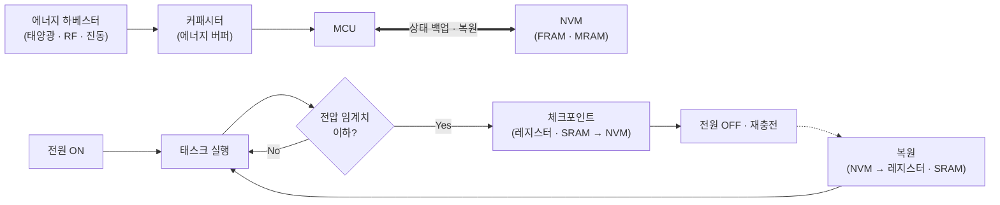

# 인터미턴트 컴퓨팅 (Intermittent Computing)

---

## I. 정전을 정상으로 받아들이는 연산, 인터미턴트 컴퓨팅의 개요

### 가. 정의

- 에너지 하베스팅으로 얻은 **불규칙한 전력 때문에 전원이 수시로 꺼지는 환경에서, 실행 상태를 비휘발성 메모리에 보존하고 재개하여 연산을 끝까지 완료**하는 배터리리스(Batteryless) 컴퓨팅 방식

### 나. 등장 배경 및 특징

| 구분 | 내용 |
| --- | --- |
| 배터리 한계 | 대량 IoT 기기의 배터리 교체 비용·폐배터리 환경 문제 |
| 전력 불안정 | 태양광·진동·RF 에너지는 공급이 불규칙해 잦은 전원 차단 발생 |
| 정전의 일상화 | 전원 차단을 예외가 아닌 정상 실행 흐름으로 취급 |
| 상태 보존 | FRAM 등 비휘발성 메모리(NVM)에 체크포인트 저장 |
| 정확성 문제 | 재실행 시 메모리 불일치가 생기지 않도록 프로그래밍 모델 필요 |

---

## II. 구조 및 기술요소

### 가. 동작 구조

- 커패시터 전압이 임계치 아래로 떨어지면 실행 문맥을 NVM에 저장하고, 충전 후 복원하여 중단 지점부터 재개

### 나. 기술요소

| 구분 | 요소 | 설명 |
| --- | --- | --- |
| 하드웨어 | 에너지 하베스팅 | 태양광·압전·열전·RF 에너지를 전기로 변환 |
| | NVM (FRAM, MRAM) | 전원 차단 후에도 유지, 쓰기 빠르고 내구성이 높아 잦은 체크포인트에 적합 |
| | 전압 모니터 | 임계 전압 도달 시 인터럽트 발생 |
| 실행 모델 | JIT 체크포인팅 | 전압 강하를 감지한 순간 동적으로 상태 저장 (Hibernus 등) |
| | 정적 체크포인팅 | 컴파일러가 코드에 저장 지점을 삽입 |
| | 태스크 기반 모델 | 프로그램을 원자적으로 재실행 가능한 태스크로 분할 (Chain, Alpaca) |
| 정확성 | WAR 위반 방지 | 읽은 뒤 쓴 NVM 변수가 재실행 시 다른 값을 읽는 문제를 버저닝·이중 버퍼로 방지 |
| | 시간 추적 | 꺼져 있던 시간을 잔류 전하 감쇠로 추정하는 무전원 타이머 |
| 응용 | Intermittent TinyML | 신경망 추론을 태스크 단위로 나눠 단속 실행 |

---

## III. 비교 및 동향

### 가. 배터리 기반 vs 인터미턴트 컴퓨팅

| 비교 항목 | 배터리 기반 컴퓨팅 | 인터미턴트 컴퓨팅 |
| --- | --- | --- |
| 전력 | 연속·안정 | 단속·예측 불가 |
| 정전 | 비정상 상황(장애) | 정상 실행 흐름 |
| 메모리 | 휘발성(SRAM·DRAM) 중심 | NVM 중심, 체크포인트 |
| 프로그래밍 | 연속 실행 가정 | 재실행 안전성(멱등성) 고려 |
| 유지보수 | 배터리 교체 필요 | 교체 불필요, 장기 무보수 운용 |
| 성능 | 안정적 처리량 | 에너지 수급에 따라 처리 지연 |

### 나. 동향

- **배터리리스 IoT**: 건물·교량 구조물 모니터링, 스마트 태그, 체내 이식형 센서 등 교체가 어려운 환경 대상 연구
- **엣지 AI 결합**: 무전원 단말에서 이상 탐지·간단한 인식 모델을 수행하는 Intermittent TinyML 연구 확대
- **Ambient IoT**: 3GPP Rel-19에서 배터리 없이 주변 RF 에너지로 동작하는 Ambient IoT 표준화 착수

---

### 🔗 연관 토픽

- **소속 도메인**: [[00_디지털서비스_MOC|🚀 디지털서비스]]
- **세부 분류**: `3. 사물인터넷 (IoT) & 스마트 플랫폼 · 메타버스`
- **핵심 연관 토픽**:
  - [[앰비언트 컴퓨팅|앰비언트 컴퓨팅 (Ambient Computing)]]
  - [[포그 컴퓨팅|포그 컴퓨팅 (Fog Computing)]]
  - [[EDGE|엣지 컴퓨팅]]
  - [[CPS]]
  - [[u-Health Smart Health]]
