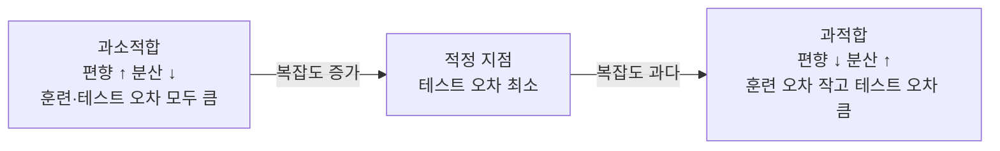

# 일반화 (Generalization)

---

## I. 처음 보는 데이터에서의 성능, 일반화의 개요

### 가. 정의

- 학습된 모델이 **훈련에 쓰지 않은 새로운 데이터에서도 정확하게 예측하는 능력**으로, 테스트 오차(일반화 오차)로 측정

### 나. 특징

| 구분 | 내용 |
| --- | --- |
| 일반화 격차 | 훈련 오차와 테스트 오차의 차이가 작을수록 양호 |
| 과적합 | 훈련 데이터의 잡음까지 학습 → 테스트 성능 저하 |
| 과소적합 | 모델이 너무 단순해 훈련 오차도 큼 |
| 편향–분산 | 제곱 오차 기준 일반화 오차 = 편향² + 분산 + 줄일 수 없는 오차 ([[편향]]) |
| 용어 구분 | 데이터 모델링의 일반화(is-a 추상화)와 다른 개념 ([[관계성]]) |

---

## II. 원리 및 확보 기법

### 가. 모델 복잡도와 오차

- 고전적 관점에서는 테스트 오차가 U자형, 매우 큰 신경망에서는 과적합 구간을 지나 다시 감소하는 이중 하강도 관찰됨

### 나. 확보 기법

| 구분 | 요소 | 설명 |
| --- | --- | --- |
| 정규화 | L1·L2 규제 | 가중치 크기에 벌점, L1은 희소화·L2는 가중치 감소 |
| | [[Dropout]] | 학습 중 뉴런 무작위 비활성화 |
| 학습 제어 | 조기 종료 | 검증 오차가 늘기 시작하면 학습 중단 |
| 검증 | 교차 검증 | K-Fold로 성능 추정 안정화 ([[분석 모델 평가 방법]]) |
| 데이터 | 데이터 증강 | 회전·자르기·노이즈 등으로 다양성 확대 |
| 앙상블 | 배깅·부스팅 | 여러 모델 결합으로 분산·편향 감소 ([[배깅]]) |
| 현상 | Double Descent | 과대 매개변수 모델에서 테스트 오차가 다시 감소 (Belkin 외, 2019) |
| | Grokking | 훈련 오차가 0이 된 뒤 오랜 학습 끝에 일반화가 급격히 향상 (Power 외, 2022) |

---

## III. 비교 및 동향

### 가. 과소적합 vs 과적합

| 비교 항목 | 과소적합 | 과적합 |
| --- | --- | --- |
| 원인 | 모델이 단순, 특성 부족 | 모델이 복잡, 데이터 부족 |
| 훈련 오차 | 큼 | 작음 |
| 테스트 오차 | 큼 | 큼 |
| 대응 | 복잡도·특성 증가 | 규제, 데이터 확대, 조기 종료, 앙상블 |

### 나. 동향

- **분포 외(OOD) 일반화**: 학습과 다른 환경·도메인에서도 동작하도록 도메인 적응·일반화 연구
- **파운데이션 모델**: 대규모 사전학습 후 제로샷·퓨샷으로 새 과제에 일반화 ([[초거대 언어 모델|LLM]])
- **데이터 품질 중심**: 레이블 오류·편향 제거가 일반화 성능에 직접 영향

---

### 🔗 연관 토픽

- **소속 도메인**: [[00_데이터베이스_MOC|🗄️ 데이터베이스]]
- **세부 분류**: `5. 분산 데이터베이스 & NoSQL & 대용량`
- **핵심 연관 토픽**:
  - [[배깅]]
  - [[편향]]
  - [[분석 모델 평가 방법]]
  - [[지도학습]]
  - [[경사하강법|경사하강법 (Gradient Descent Algorithm)]]
