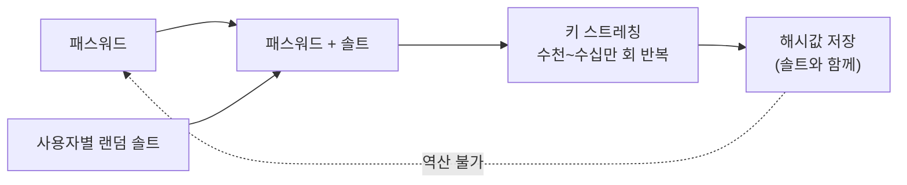

# 일방향 암호화 방식 (One-Way Encryption)

---

## I. 되돌릴 수 없는 변환, 일방향 암호화의 개요

### 가. 정의

- 임의 길이 입력을 **고정 길이 해시값(다이제스트)으로 변환하며, 해시값으로부터 원래 입력을 계산하는 것이 사실상 불가능**한 암호 방식 (해시 함수 기반)

### 나. 특징

| 구분 | 내용 |
| --- | --- |
| 일방향성 | 복호화 키가 없고 역산이 계산상 불가능 |
| 고정 길이 출력 | 입력 길이와 무관하게 일정 길이 출력 (SHA-256: 256비트) |
| 눈사태 효과 | 입력 1비트 변화에 출력 비트 약 절반이 바뀜 |
| 결정성 | 같은 입력은 항상 같은 출력 → 비교로 검증 |
| 용도 | 패스워드 저장, 무결성 검증, 전자서명 요약값 |

---

## II. 동작 구조 및 구성요소

### 가. 해시 기반 패스워드 저장 구조

- 입력 패스워드에 솔트를 붙여 반복 해시한 결과만 저장하고, 로그인 시 같은 과정으로 계산한 값과 비교

### 나. 구성요소

| 구분 | 요소 | 설명 |
| --- | --- | --- |
| 안전성 요건 | 역상 저항성 | $y$로부터 $H(x)=y$인 $x$를 찾기 어려움 ([[제1 역상 저항성]]) |
| | 제2 역상 저항성 | 주어진 $x$에 대해 $H(x)=H(x')$인 다른 $x'$를 찾기 어려움 ([[제2 역상 저항성]]) |
| | 충돌 저항성 | $H(x)=H(x')$인 임의의 쌍을 찾기 어려움 |
| 알고리즘 | SHA-2 | NSA 설계, Merkle-Damgård 구조 (SHA-256/512) |
| | SHA-3 | Keccak 기반 스펀지 구조 |
| | LSH | 국내 표준 해시 |
| 강화 기법 | 솔트 | 사용자별 난수로 레인보우 테이블 무력화 ([[해시 솔트와 키 스트레칭]]) |
| | 키 스트레칭 | 반복 연산으로 대입 공격 비용 증가 |
| 응용 | [[HMAC]] | 비밀키와 해시를 결합한 메시지 인증 코드 |
| | 작업증명(PoW) | 블록체인 채굴 난이도 조정 |

---

## III. 비교 및 동향

### 가. 일방향 vs 양방향 암호화

| 비교 항목 | 일방향 (해시) | 양방향 (대칭키) | 양방향 (공개키) |
| --- | --- | --- | --- |
| 목적 | 무결성, 패스워드 저장 | [[기밀성]], 대용량 암호화 | 키 교환, 전자서명 |
| 복호화 | 불가 | 가능 | 가능 |
| 키 | 없음 (HMAC은 비밀키) | 같은 비밀키 | 공개키·개인키 |
| 속도 | 매우 빠름 | 빠름 | 느림 |
| 대표 알고리즘 | SHA-256, SHA-3, LSH | [[AES]], ARIA, LEA | [[RSA (Rivest Shamir Adleman)\|RSA]], [[ECC]] |

### 나. 동향

- **패스워드 전용 함수**: 빠른 범용 해시 대신 메모리·연산 비용을 조절하는 Argon2id, scrypt, bcrypt, PBKDF2 사용 (OWASP 권고)
- **양자 영향**: Shor는 해시에 영향이 없고, Grover로 역상 강도가 절반이 되므로 장기 보호에는 SHA-384 이상 사용
- **취약 해시 퇴출**: MD5·SHA-1은 충돌이 실증되어 서명·인증서에서 사용 중단

---

### 🔗 연관 토픽

- **소속 도메인**: [[00_보안_MOC|🛡️ 보안]]
- **세부 분류**: `1. 정보보안 원칙 & 거버넌스 · 인증`
- **핵심 연관 토픽**:
  - [[해시함수|해시함수(알고리즘 측면)]]
  - [[해시 함수의 안전성]]
  - [[해시 솔트와 키 스트레칭|해시 솔트(Salt)와 키 스트레칭(Key Stretching)]]
  - [[HMAC|HMAC (Hash-based Message Authentication Code)]]
  - [[MDC]]
