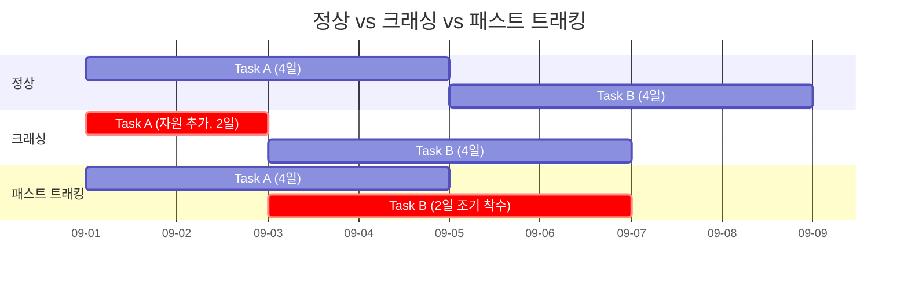

# 일정단축 기법 (Schedule Compression Techniques)

---

## I. 범위는 그대로, 기간을 줄이는 일정단축 기법의 개요

### 가. 정의

- 프로젝트 **범위를 줄이지 않고** 일정 제약·지연 만회를 위해 기간을 단축하는 기법으로, **크래싱(Crashing)** 과 **공정중첩단축(Fast Tracking)** 이 대표적 (PMBOK 일정 개발 프로세스의 기법)

### 나. 특징

| 구분 | 내용 |
| --- | --- |
| 적용 대상 | 주공정(Critical Path) 활동, 비주공정 단축은 전체 기간에 효과 없음 |
| 트레이드오프 | 크래싱은 비용 증가, 패스트 트래킹은 위험·재작업 증가 |
| 주공정 변화 | 단축 후 다른 경로가 새 주공정이 될 수 있어 재분석 필요 |
| 적용 계기 | 납기 지연 만회, 지체상금 회피, 시장 출시 앞당기기 |

---

## II. 동작 원리와 구성요소

### 가. 개념도

- 크래싱은 자원을 더 투입해 활동 기간 자체를 줄이고, 패스트 트래킹은 순차 활동을 겹쳐 수행

### 나. 구성요소

| 구분 | 요소 | 설명 |
| --- | --- | --- |
| 기법 | 크래싱 | 주공정 활동에 인력·초과근무·장비 투입, 단위기간당 단축 비용이 가장 작은 활동부터 적용 |
| | 패스트 트래킹 | 순차 활동을 병행, 임의적 의존관계(Discretionary)에만 적용 가능 |
| 분석 | 시간-비용 교환 | 정상점·급속점 비용 기울기로 최소 비용 단축안 산정 |
| 제약 | 수확 체감 | 인력 추가 시 소통 비용이 늘어 효과 감소 (브룩스의 법칙) |
| 위험 | 재작업 | 선행 작업 미완료 상태에서 후행 착수 시 결함·재작업 |
| 검증 | [[몬테카를로 시뮬레이션]] | 단축 후 일정 달성 확률 재평가 |

---

## III. 비교 및 동향

### 가. 크래싱 vs 패스트 트래킹

| 비교 항목 | 크래싱 | 패스트 트래킹 |
| --- | --- | --- |
| 방식 | 자원 추가 투입 | 순차 활동 병행 |
| 주요 대가 | 비용 증가 | 위험·재작업 증가 |
| 전제 | 자원을 늘리면 기간이 줄어드는 활동 | 의존관계를 조정할 수 있는 활동 |
| 한계 | 브룩스의 법칙, 투입 가능 자원 한계 | 강제적 의존관계(물리적 제약)는 병행 불가 |
| 선택 상황 | 예산 여유, 위험 수용 곤란 | 예산 추가 불가, 위험 수용 가능 |

### 나. 동향

- **CCPM**: 활동별 여유를 걷어 프로젝트 버퍼·피딩 버퍼로 관리해 지연 흡수 ([[CCM]])
- **애자일 대응**: 기간 고정(Time-box) 아래 범위를 조정하는 방식으로 일정 압박 대응
- **도구 지원**: PMIS가 비용 기울기·주공정 변화를 계산해 단축 시나리오 비교

---

### 🔗 연관 토픽

- **소속 도메인**: [[00_프로젝트관리_MOC|📋 프로젝트관리]]
- **세부 분류**: `1. PMBOK 표준 & 프로젝트 거버넌스`
- **핵심 연관 토픽**:
  - [[CPM|CPM (Critical Path Method)]]
  - [[CCM|CCM (Critical Chain Management)]]
  - [[프로젝트 일정관리]]
  - [[자원 최적화]]
  - [[몬테카를로 시뮬레이션]]
