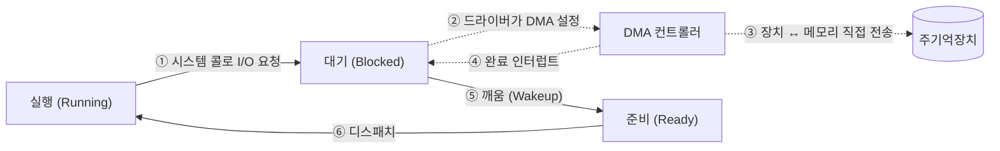

# 입출력발생 (I/O Request)

---

## I. CPU를 내려놓는 순간, 입출력발생의 개요

### 가. 정의

- 실행 중인 프로세스가 디스크·네트워크 등 **입출력을 시스템 콜로 요청하고, 완료될 때까지 CPU를 내놓고 대기(Blocked) 상태로 전이**하는 과정

### 나. 특징

| 구분 | 내용 |
| --- | --- |
| CPU 유휴 방지 | 입출력은 CPU보다 수천~수백만 배 느리므로 대기 중 다른 프로세스에 CPU 할당 (다중 프로그래밍) |
| 비선점 전이 | 프로세스가 스스로 CPU를 반환하는 대표적 계기 |
| 오버헤드 | 모드 전환, [[문맥 교환]], 완료 [[인터럽트]] 처리 비용 |
| 하드웨어 연계 | [[DMA(Direct Memory Access)\|DMA]]와 인터럽트로 데이터 전송 중 CPU 개입 최소화 |

---

## II. 처리 구조 및 구성요소

### 가. 입출력 처리 흐름

- 요청 프로세스는 장치 대기 큐로 이동하고, DMA 전송이 끝나면 인터럽트로 준비 큐에 복귀

### 나. 구성요소

| 구분 | 요소 | 설명 |
| --- | --- | --- |
| 소프트웨어 | 시스템 콜 | `read()`·`write()` 등으로 커널에 I/O 요청 |
| | 장치 대기 큐 | 장치별로 완료를 기다리는 프로세스 목록 |
| | 디바이스 드라이버 | 장치별 제어 방법을 감추고 표준 인터페이스 제공 |
| 하드웨어 | DMA | CPU 대신 컨트롤러가 장치와 메모리 사이 데이터 전송 |
| | 인터럽트 | 전송 완료를 CPU에 통보 |
| 입출력 방식 | 프로그램 I/O (PIO) | CPU가 상태를 폴링하며 직접 전송 |
| | 인터럽트 구동 I/O | 장치 준비 시 인터럽트, 바이트·워드 단위 전송은 CPU 담당 |
| | DMA I/O | 블록 단위 전송을 DMA가 처리, 완료 시 한 번만 인터럽트 |
| 성능 기법 | 버퍼링 | 속도 차이를 메모리 버퍼로 흡수 |
| | 스풀링 | 디스크를 큰 버퍼로 사용해 프린터 등 전용 장치 출력을 순차 처리 |

---

## III. 비교 및 동향

### 가. 동기 vs 비동기 I/O

| 비교 항목 | 동기 (Blocking) I/O | 비동기 I/O |
| --- | --- | --- |
| 동작 | 완료까지 호출 스레드 대기 | 요청 후 즉시 반환, 완료는 콜백·이벤트로 통보 |
| 상태 전이 | Running → Blocked → Ready | 호출 스레드는 계속 실행 |
| CPU 활용 | 스레드당 활용도 낮음 | 대기 중에도 다른 작업 수행 |
| 구현 | 단순 (순차 코드) | 복잡 (콜백, 상태 관리) |
| 예 | 일반 파일 입출력 | Node.js, Nginx, io_uring |

### 나. 동향

- **io_uring**: Linux 5.1부터 제공, 제출 큐(SQ)와 완료 큐(CQ)를 커널과 공유하는 링 버퍼로 시스템 콜 횟수 축소
- **커널 우회**: DPDK·SPDK가 사용자 공간에서 NIC·NVMe를 폴링 방식으로 직접 제어, 고성능 네트워크·스토리지에서 사용
- **NVMe 다중 큐**: 코어별 제출·완료 큐와 MSI-X 인터럽트로 입출력 경합 감소

---

### 🔗 연관 토픽

- **소속 도메인**: [[00_운영체제_MOC|⚙️ 운영체제]]
- **세부 분류**: `1. 프로세스 & 스레드 관리`
- **핵심 연관 토픽**:
  - [[인터럽트|인터럽트 (Interrupt)]]
  - [[DMA(Direct Memory Access)]]
  - [[프로세스 상태 전이도]]
  - [[문맥 교환|문맥 교환 (Context Switching)]]
  - [[커널|커널(Kernel)]]
