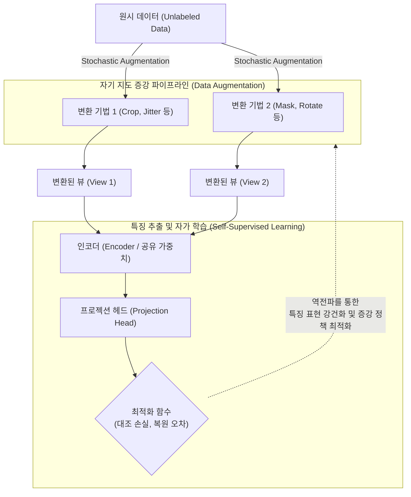

# 자기 지도 증강 (Self-Supervised Augmentation)

---

## I. 라벨링 한계 극복을 위한 비지도 학습의 핵심, 자기 지도 증강의 개요

### 가. 자기 지도 증강(Self-Supervised Augmentation)의 정의
- 정답 레이블(Label)이 없는 원시 데이터에 회전, 자르기, 마스킹 등의 변형을 가한 후, 데이터 간의 대조 학습이나 복원 손실을 통해 내재적 특징 표현을 자율 학습하는 데이터 증강 기법이다.

### 나. 자기 지도 증강의 등장 배경 및 주요 특징

| 구분 | 주요 내용 |
| --- | --- |
| 라벨링 비용 장벽 극복 | 대규모 파운데이션 모델 사전학습 시 수작업 어노테이션에 소요되는 막대한 시간과 비용 한계 해소 |
| 내재적 특징 표현 학습 | 수동 설계된 규칙 없이 데이터 자체의 기하학적·문맥적 불변성(Invariance)을 모델이 자율 학습 |
| 대조 학습(Contrastive) 연계 | 동일 데이터의 증강 뷰(Positive pair) 간 거리는 좁히고 타 데이터(Negative) 간 거리는 벌려 표현력 극대화 |
| 증강 정책 자동 탐색 | 도메인별 최적 변환 조합을 모델 스스로 탐색하여 다운스트림 태스크의 일반화 성능 향상 |

---

## II. 자기 지도 증강의 개념도 및 핵심 기술 요소

### 가. 자기 지도 증강의 아키텍처 및 동작 원리

* 레이블이 없는 단일 원시 데이터를 서로 다른 두 가지 이상의 증강 기법으로 변환(View 생성)하여, 두 뷰 간의 특징적 유사도를 극대화(대조 학습)하거나 변환 상태를 예측하도록 자가 학습을 수행함

### 나. 자기 지도 증강의 핵심 기술 요소

| 분류 | 요소기술(키워드) | 세부 설명 |
| --- | --- | --- |
| **이미지 증강 기법** | 기하학적/색상 변환 | Random Crop, Flip, Color Jitter링을 통해 이미지의 공간적 및 시각적 변형을 생성 (SimCLR 등에 활용) |
| **언어/비전 증강** | 마스킹 (Masking) | 입력 데이터(텍스트 토큰 또는 이미지 패치)의 일부를 무작위로 은닉하여 모델이 주변 맥락을 통해 복원하도록 유도 |
| **지도 학습 연계** | 대조 학습 (Contrastive) | 하나의 원본에서 분할된 긍정(Positive) 뷰 간의 거리는 가깝게, 부정(Negative) 뷰 간의 거리는 멀게 학습 |
| **지도 학습 연계** | 사전 작업 예측 (Pretext) | 데이터에 가해진 인위적 증강 상태(회전 각도, 퍼즐 배치 등) 자체를 임시 정답(Pseudo-label)으로 활용 |
| **정책 자동화** | 자기 지도 정책 탐색 | 다운스트림 레이블 없이 자기 지도 평가 지표만을 활용하여 최적의 데이터 증강 정책(Policy)을 자동 도출 |
| **지식 전이** | 자가 증류 (Self-Distillation) | 자기 지도 증강을 통해 스스로 생성한 임시 타겟 데이터를 교사(Teacher) 모델 없이 스스로에게 증류(학습)하는 기법 |
| **생성형 증강** | GAN / Diffusion 결합 | 적대적 훈련 메커니즘을 자기 지도 학습과 결합하여, 실제 데이터 분포에 근접한 고품질 가상 샘플을 생성 |
| **손실 함수** | InfoNCE Loss | 양성(Positive) 증강 쌍에 대한 상호 정보량(Mutual Information)의 하한선을 최대화하는 [[딥러닝]] 손실 함수 |

---

## III. 데이터 증강 기법의 비교 및 활용 동향

### 가. 전통적 지도 학습 증강과 자기 지도 증강 비교

| 비교 항목 | 전통적 데이터 증강 (Supervised Augmentation) | 자기 지도 증강 (Self-Supervised Augmentation) |
| --- | --- | --- |
| **주요 목적** | 모델의 과적합(Overfitting) 방지 및 데이터 양적 확대 | 레이블 없이 데이터 구조의 내재적 특징(Representation) 학습 |
| **구동 및 최적화** | 정답(Label) 의미 보존 여부 기반 수동/휴리스틱 적용 | 원본과 변환본 간의 대조 손실 및 복원 오차를 통한 자동 최적화 |
| **적용 시점** | 다운스트림(Downstream) 정교화 모델의 지도 학습 시 | 파운데이션 모델 등의 대규모 사전 학습(Pre-training) 시 |
| **대표 모델/기법** | Mixup, Cutout, AutoAugment | SimCLR, MoCo, MAE, Self-Augment, BYOL |

### 나. 발전 동향 및 활용 전망
- **마스크드 오토인코딩(MAE) 기반 확장**: 이미지 패치 또는 오디오 스펙트로그램의 75% 이상을 마스킹한 후 복원하는 생성적 자기 지도 증강 기법이 비전·멀티모달 파운데이션 모델의 핵심 사전학습 기법으로 정착.
- **다중 모달리티 및 시계열 확산**: 이미지/텍스트를 넘어 시계열 센서 데이터, 그래프 구조, 의료 생체신호(EEG/ECG) 등 도메인 고유의 시간축 지터링 및 서브그래프 마스킹 증강 기술 도입 가속화.
- **Data-Centric AI 기반 비용 최적화**: 값비싼 휴먼 인 더 루프(HITL) 라벨링 비용을 최소화하고, 자율주행·위성영상 등 미분류 원시 데이터셋의 고효율 표현 학습을 견인하는 핵심 파이프라인으로 확산.

---

### 🔗 연관 토픽

- **소속 도메인**: [[00_인공지능_MOC|🤖 인공지능]]
- **세부 분류**: `2. 머신러닝 기초 & 핵심 알고리즘`
- **핵심 연관 토픽**:
  - [[인공지능]]
  - [[강화학습]]
  - [[GAN (Generative Adversarial Network)]]
  - [[자기지도학습]]
  - [[모방 강화학습]]
