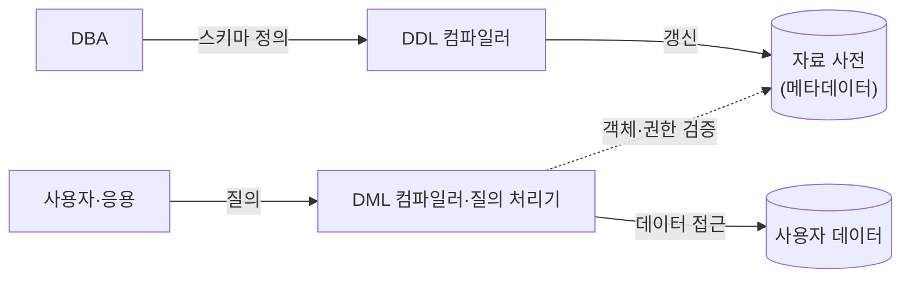

# 자료 사전 (Data Dictionary)

---

## I. 데이터에 대한 데이터, 자료 사전의 개요

### 가. 정의

- 데이터의 **이름·의미·구성·형식·제약조건 등 메타데이터를 일관되게 정의하고 관리하는 저장소**로, 구조적 분석에서는 DFD의 자료를 명세하는 도구, DBMS에서는 [[시스템 카탈로그]]로 구현

### 나. 특징

| 구분 | 내용 |
| --- | --- |
| 표준화 | 데이터 정의를 통일해 이해관계자 간 의사소통 오류 방지 |
| 구조적 분석 | [[데이터 흐름도]]의 자료 흐름·저장소를 기호로 상세 명세 |
| DBMS 관점 | [[DDL]] 실행 시 DBMS가 자동 생성·갱신, 사용자는 조회만 가능 |
| 디렉터리와 구분 | 사전은 의미 정보, 디렉터리는 물리적 위치 정보 관리 |

---

## II. 구조 및 명세 기호

### 가. DBMS에서의 참조 구조

- 모든 [[DML]] 질의는 실행 전에 자료 사전을 참조해 객체 존재와 권한을 검증

### 나. 구조적 분석의 명세 기호

| 구분 | 요소 | 설명 |
| --- | --- | --- |
| 명세 기호 | `=` (정의) | 좌변이 우변으로 구성됨 (예: 주소 = 시 + 구 + 번지) |
| | `+` (연결) | 자료 항목의 결합 (AND) |
| | `( )` (생략) | 생략 가능한 항목 (Optional) |
| | `{ }` (반복) | 반복 항목, `1{항목}N`처럼 최소·최대 횟수 표기 |
| | `[ ]` (선택) | 나열된 항목 중 하나 선택 (항목은 세로선으로 구분) |
| | `* *` (주석) | 설명문 |
| DB 요소 | 시스템 카탈로그 | 테이블·뷰·인덱스·권한 정보를 DBMS가 유지 |
| | 데이터 디렉터리 | 데이터 접근을 위한 물리적 위치 정보, 시스템만 접근 |

---

## III. 비교 및 동향

### 가. 자료 사전 vs 데이터 카탈로그

| 비교 항목 | 자료 사전 | 데이터 카탈로그 |
| --- | --- | --- |
| 목적 | 시스템 내 데이터 정의·구조 명세 | 전사 데이터 자산 검색·활용·거버넌스 |
| 사용자 | DBA, 개발자 | 분석가, 데이터 과학자, 현업 |
| 범위 | 단일 DB·애플리케이션 | 클라우드·레이크 등 이기종 소스 전체 |
| 메타데이터 | 기술 메타데이터 중심 | 비즈니스·운영 메타데이터, 계보(Lineage) |
| 갱신 | DDL 시 자동 또는 수동 작성 | 자동 수집·ML 기반 태깅 |

### 나. 동향

- **액티브 메타데이터**: 사용 이력을 분석해 추천·알림·품질 이상 탐지
- **데이터 패브릭**: 분산 환경 메타데이터를 통합해 [[데이터 거버넌스]] 기반으로 활용

---

### 🔗 연관 토픽

- **소속 도메인**: [[00_데이터베이스_MOC|🗄️ 데이터베이스]]
- **세부 분류**: `1. 데이터 모델링 & 관계형 DB 설계`
- **핵심 연관 토픽**:
  - [[시스템 카탈로그|시스템 카탈로그 (System Catalog)]]
  - [[데이터 흐름도]]
  - [[DDL]]
  - [[스키마]]
  - [[DBMS]]
