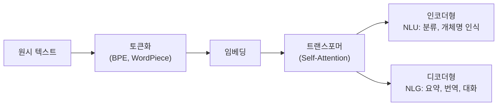

# 자연어처리 (NLP, Natural Language Processing)

---

## I. 사람의 언어를 이해하고 생성하는, 자연어처리의 개요

### 가. 정의

- 컴퓨터가 **사람의 언어(텍스트·음성)를 이해(NLU)하고 생성(NLG)하도록 분석·모델링**하는 인공지능 분야

### 나. 특징

| 구분 | 내용 |
| --- | --- |
| 발전 흐름 | 규칙 기반 → 통계·머신러닝 → [[딥러닝]](RNN) → [[트랜스포머]]·[[초거대 언어 모델\|LLM]] |
| 맥락 이해 | 문맥에 따라 단어 의미가 달라지는 다의성·순서를 반영한 표현 학습 |
| 범용화 | 하나의 사전학습 모델로 번역·요약·질의응답 등 여러 태스크 수행 |
| 과제 | 모호성, 언어별 자원 격차, [[할루시네이션]] |

---

## II. 처리 구조 및 핵심 기술

### 가. 트랜스포머 기반 처리 흐름

- 텍스트를 서브워드 토큰으로 나눠 벡터화하고, [[자기 집중]]으로 토큰 간 관계를 학습해 이해·생성 태스크 수행

### 나. 핵심 기술

| 구분 | 요소 | 설명 |
| --- | --- | --- |
| 전처리·표현 | 토큰화 | BPE·WordPiece 등 서브워드 분할로 미등록어(OOV) 문제 완화 |
| | 임베딩 | 토큰을 의미 공간의 벡터로 사상 (Word2Vec → 문맥 임베딩) |
| 모델 | 트랜스포머 | 어텐션으로 전체 시퀀스를 병렬 처리, [[RNN (Recurrent Neural Network)\|RNN]]의 순차 처리 한계 극복 |
| | 인코더·디코더형 | [[BERT]](이해), GPT(생성), T5(인코더-디코더) |
| 학습 | 사전학습 | 대규모 텍스트로 마스크 예측·다음 토큰 예측 (자기지도) |
| | 지시 미세조정 (SFT) | 지시-응답 쌍으로 추가 학습 |
| | 선호 정렬 | RLHF(보상 모델 + 강화학습), DPO(선호쌍 직접 최적화) |
| 활용 | [[RAG (Retrieval Augmented Generation) 검색 증강 생성 AI\|RAG]] | 외부 문서 검색 결과를 생성에 결합 |
| | [[프롬프트 엔지니어링]] | Few-shot, [[COT\|CoT]] 등 입력 설계로 성능 유도 |

---

## III. 비교 및 동향

### 가. 전통 NLP vs LLM 기반 NLP

| 비교 항목 | 전통·통계 NLP | LLM 기반 NLP |
| --- | --- | --- |
| 기법 | [[TF-IDF (Term Frequency - Inverse Document Frequency)\|TF-IDF]], HMM, CRF, [[서포트 벡터 머신\|SVM]] | 트랜스포머 (GPT, BERT, Llama) |
| 학습 | 태스크별 지도학습 | 자기지도 사전학습 + 미세조정·프롬프트 |
| 모델 구성 | 태스크마다 전용 모델 | 하나의 모델로 다중 태스크, 제로샷 가능 |
| 한계 | 문맥 반영 부족, 희소성 | 높은 연산 비용, 환각, 편향 |

### 나. 동향

- **경량·온디바이스 언어 모델**: 수억~수십억 파라미터 [[sLLM (Smaller Large Language Model)|sLLM]]을 스마트폰·PC에서 구동해 비용·프라이버시 문제 완화 ([[온디바이스 AI]])
- **에이전트화**: 자연어 요청을 계획 단계로 분해하고 도구·API를 호출해 작업을 수행하는 [[에이전틱 AI]]로 확장
- **멀티모달 통합**: 텍스트·이미지·음성을 함께 처리하는 [[멀티모달 AI]] 모델이 NLP 태스크를 흡수

---

### 🔗 연관 토픽

- **소속 도메인**: [[00_인공지능_MOC|🤖 인공지능]]
- **세부 분류**: `1. 수학 · 통계학 & 데이터 전처리`
- **핵심 연관 토픽**:
  - [[트랜스포머|트랜스포머(Transformer)]]
  - [[초거대 언어 모델|초거대 언어 모델(Large Language Model)]]
  - [[BERT]]
  - [[TF-IDF (Term Frequency - Inverse Document Frequency)]]
  - [[seq2seq]]
