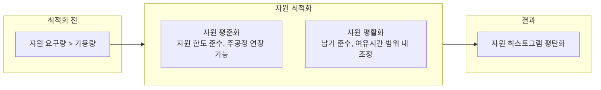

# 자원 최적화 (Resource Optimization)

---

## I. 자원 수요와 공급의 균형, 자원 최적화의 개요

### 가. 정의

- 일정 모델에서 **자원 수요와 가용량의 균형**을 맞추기 위해 활동의 시작·종료일을 조정하는 기법으로, **자원 평준화(Leveling)** 와 **자원 평활화(Smoothing)** 가 있음 (PMBOK 6판 일정 개발의 도구)

### 나. 필요성 및 특징

| 구분 | 내용 |
| --- | --- |
| 과다 할당 해소 | 핵심 인력·장비가 특정 기간에 과부하되거나 한정 기간에만 가용한 문제 해결 |
| 트레이드오프 | 자원 제약을 지킬지(평준화), 납기를 지킬지(평활화) 선택 |
| 자원 히스토그램 평탄화 | 투입량의 급격한 증감을 줄여 안정적 운영 |
| 의존관계 유지 | 활동 간 논리 관계는 유지한 채 일정만 이동 |

---

## II. 동작 원리와 구성요소

### 가. 개념도

- 자원 한도나 납기 중 무엇을 고정하느냐에 따라 활동을 앞뒤로 옮겨 자원 사용량을 평탄화

### 나. 구성요소

| 구분 | 요소 | 설명 |
| --- | --- | --- |
| 기법 | 자원 평준화 | 자원 제약에 맞춰 시작·종료일 조정, 주공정이 바뀌거나 늘어날 수 있음 |
| | 자원 평활화 | 자유·총 여유시간 범위 내에서만 조정, 주공정·완료일 불변, 과부하 일부 잔존 가능 |
| 분석 | 여유시간 (Float) | 총 여유(프로젝트 완료일 기준), 자유 여유(후속 활동 기준) |
| | 주공정 | 총 여유가 0인 최장 경로 ([[CPM]]) |
| 시각화 | 자원 히스토그램 | 기간별 자원 수요를 막대로 표시해 과부하 구간 식별 |
| 배분 규칙 | 우선순위 휴리스틱 | 최소 여유 우선, 최단 활동 우선 등 경험 규칙 |
| 유연성 | 활동 분할 | 활동을 중단했다가 재개해 자원 충돌 회피 |
| 복구 | [[일정단축 기법]] | 평준화로 늘어난 일정을 크래싱·패스트 트래킹으로 만회 |

---

## III. 비교 및 동향

### 가. 자원 평준화 vs 자원 평활화

| 비교 항목 | 자원 평준화 | 자원 평활화 |
| --- | --- | --- |
| 우선순위 | 자원 한도 | 프로젝트 납기 |
| 주공정 | 변경·연장 가능 | 변경 없음 |
| 이동 범위 | 여유와 무관하게 이동 | 여유시간 한도 내 |
| 과부하 해소 | 완전 해소 | 부분 해소 가능 |
| 적용 상황 | 핵심 인력·장비 추가 확보 불가 | 납기가 고정되어 지연 불가 |

### 나. 동향

- **CCPM 연계**: 자원 제약을 반영한 핵심 연쇄와 버퍼로 다중 프로젝트 자원 경합 관리 ([[CCM]])
- **도구 자동화**: PMIS의 자동 평준화와 What-if 시나리오 비교, 최적화 알고리즘 기반 일정 추천
- **개념 확장**: 클라우드 자원을 수요에 맞춰 조정하는 Right-sizing·FinOps도 같은 수급 균형 원리

---

### 🔗 연관 토픽

- **소속 도메인**: [[00_프로젝트관리_MOC|📋 프로젝트관리]]
- **세부 분류**: `2. 프로젝트 범위 & 일정 관리 (Scope & Schedule)`
- **핵심 연관 토픽**:
  - [[프로젝트 일정관리|프로젝트 일정관리(Project Schedule Management)에 대하여 설명하시오]]
  - [[CPM|CPM (Critical Path Method)]]
  - [[CCM|CCM (Critical Chain Management)]]
  - [[일정단축 기법]]
  - [[3점 산정]]
