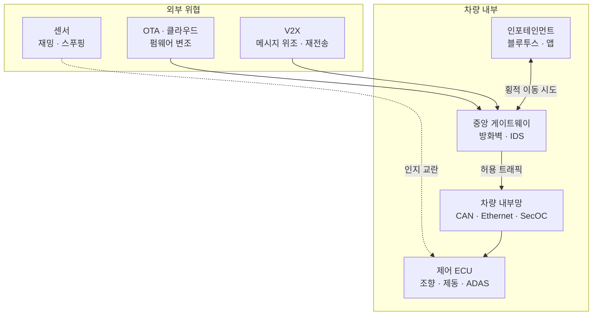

# 자율주행 자동차 보안취약점 및 대응방안

---

## I. 해킹이 곧 교통사고, 자율주행 자동차 보안의 개요

### 가. 정의

- [[Smart Car(자율주행)|자율주행]] 차량의 **센서·차량 내부망(CAN, 차량 이더넷)·외부 연결(V2X, OTA, 클라우드)을 사이버 위협으로부터 보호하여 탑승자 안전과 차량 기능을 보장**하는 보안 체계

### 나. 필요성

| 구분 | 내용 |
| --- | --- |
| 생명 직결 | 조향·제동 제어권 탈취 시 인명 사고 |
| 공격 표면 확대 | SDV(소프트웨어 중심 차량), V2X, 커넥티드 서비스로 외부 접점 증가 |
| 레거시 내부망 | CAN 버스에 인증·암호화가 없음 |
| 규제 의무화 | UNECE R155(CSMS)·R156(SUMS) 형식 승인 요건 |

---

## II. 위협 구조 및 대응 기술

### 가. 위협 벡터

- 외부 접점(IVI·텔레매틱스)을 통한 침투가 게이트웨이를 넘어 제어 ECU로 번지지 않도록 계층별 심층 방어 구성

### 나. 취약점 및 대응

| 구분 | 요소 | 설명 |
| --- | --- | --- |
| 센서 | 취약점: 센서 스푸핑 | 레이저·빛·가짜 표지로 LiDAR·카메라 인식 교란 (팬텀 공격) |
| | 대응: 센서 퓨전 | 레이더·라이다·카메라 교차 검증 |
| V2X | 취약점: 메시지 위조 | BSM 위조·재전송으로 [[C-ITS]]에 허위 정보 전파 |
| | 대응: V2X PKI | 인증서(SCMS 등)로 메시지 서명·검증, 익명 인증서로 프라이버시 보호 |
| 내부망 | 취약점: CAN 메시지 주입 | IVI·OBD 포트 침투 후 제어 메시지 주입 |
| | 대응: SecOC·IDS | CAN 메시지에 [[MAC]]·신선도 값 추가, 차량용 침입 탐지 |
| OTA | 취약점: 펌웨어 변조·다운그레이드 | 업데이트 경로 중간자 공격, 구버전 강제 설치 |
| | 대응: Uptane·HSM | 역할 분리 다중 서명 OTA 프레임워크, 하드웨어 보안 모듈로 키 보호 |
| 부팅 | 대응: Secure Boot | ECU 부팅 시 서명 검증 |

---

## III. 비교 및 동향

### 가. 규제·표준 비교

| 비교 항목 | UNECE R155 | UNECE R156 | [[차량 사이버 보안 국제 표준(ISO 21434)\|ISO/SAE 21434]] |
| --- | --- | --- | --- |
| 성격 | 법규 (형식 승인 요건) | 법규 (형식 승인 요건) | 국제 표준 (엔지니어링) |
| 대상 | 사이버보안 관리체계(CSMS) | 소프트웨어 업데이트 관리체계(SUMS) | 차량 전 수명주기 보안 프로세스 |
| 핵심 | 위험 평가, 모니터링, 대응 | 업데이트 무결성·이력 관리 | TARA(위협 분석·위험 평가) |
| 적용 | EU 2022.7 신규 차종, 2024.7 전 신규 차량 | R155와 동일 시기 | R155 대응 근거로 활용 |

### 나. 동향

- **존(Zonal) 아키텍처**: 도메인 분산 구조에서 중앙 컴퓨터 + 존 컨트롤러로 전환, 차량 이더넷 기반 [[세그멘테이션]]과 차량 내 [[제로 트러스트 보안모델|제로 트러스트]] 적용
- **차량 보안 관제(VSOC)**: 운행 차량 로그를 수집해 위협을 탐지하는 R155 사후 모니터링 체계
- **국내 제도**: 자동차관리법 개정으로 자동차 사이버보안 관리체계 인증 도입

---

### 🔗 연관 토픽

- **소속 도메인**: [[00_보안_MOC|🛡️ 보안]]
- **세부 분류**: `1. 정보보안 원칙 & 거버넌스 · 인증`
- **핵심 연관 토픽**:
  - [[Smart Car(자율주행)]]
  - [[스마트카 보안 취약점 및 대응방안|스마트카 보안 취약점 및 대응방안 (Smart Car Security)]]
  - [[차량 사이버 보안 국제 표준(ISO 21434)]]
  - [[C-ITS]]
  - [[MAC]]
