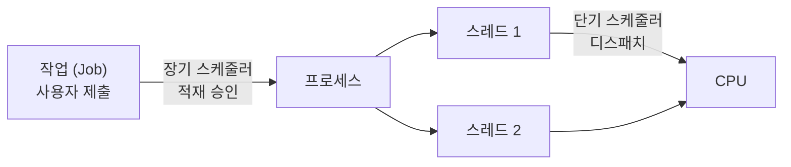

# 작업 (Job / Task)

---

## I. 사용자가 맡기는 일의 단위, 작업의 개요

### 가. 정의

- **작업(Job)**: 사용자가 시스템에 실행을 맡기는 일의 단위로, 하나 이상의 프로그램과 데이터로 구성되며 장기 스케줄러(Job Scheduler)가 메모리 적재 여부를 결정
- **태스크(Task)**: OS가 스케줄링하는 실행 단위를 가리키는 일반 용어 (Linux는 프로세스·스레드를 모두 `task_struct`로 관리)

### 나. 특징

| 구분 | 내용 |
| --- | --- |
| 계층 | 작업(Job) → [[프로세스]] → [[쓰레드\|스레드]] 순으로 세분화 |
| 스케줄링 | 작업은 장기 스케줄러, 프로세스·스레드는 단기 스케줄러가 관리 |
| 일괄 처리 기원 | 초기 배치 시스템에서 JCL로 기술한 작업을 순차 처리 |
| 현대 의미 | 분산 처리·클라우드에서 여러 태스크로 나뉘는 상위 실행 단위 |

---

## II. 구조 및 구성요소

### 가. 작업의 실행 계층

- 제출된 작업이 프로세스로 생성되고, 스레드 단위로 CPU를 할당받아 실행

### 나. 구성요소

| 구분 | 요소 | 설명 |
| --- | --- | --- |
| OS 관리 | [[PCB(Process Control Block)\|PCB]] / TCB | 실행 단위의 상태, PC, 레지스터, 메모리 정보 |
| | 작업 큐 (Job Queue) | 시스템에 제출돼 적재를 기다리는 작업 목록 |
| | 장기 스케줄러 | 작업을 메모리에 적재해 다중 프로그래밍 정도 조절 |
| 실행 단위 | 프로세스 | 독립 주소 공간을 가진 실행 중인 프로그램 |
| | 스레드 | 프로세스 안의 실행 흐름, 스케줄링 단위 |
| | 코루틴 | 사용자 수준에서 중단·재개하는 경량 실행 단위 |
| 분산·클라우드 | Spark Job·Stage·Task | Job이 Stage로, Stage가 파티션별 Task로 나뉘어 노드에서 병렬 실행 |
| | [[쿠버네티스]] Job | 완료될 때까지 Pod를 실행하는 일회성 작업 리소스 |

---

## III. 비교 및 동향

### 가. 실행 단위 비교

| 비교 항목 | 작업 (Job) | 프로세스 | 스레드 | 코루틴·가상 스레드 |
| --- | --- | --- | --- | --- |
| 관리 주체 | 장기 스케줄러, 배치 시스템 | OS 커널 | OS 커널 | 언어 런타임 |
| 자원 | 프로그램 + 데이터 묶음 | 독립 주소 공간 | Code·Data·Heap 공유 | 스레드 위에서 실행 |
| 전환 비용 | - | 큼 | 중간 | 매우 작음 |
| 예 | 배치 작업, 크론 작업 | 애플리케이션 실행 | 웹 서버 요청 처리 | Go 고루틴, Java 21 가상 스레드 |

### 나. 동향

- **워크플로 오케스트레이션**: Airflow·Argo Workflows가 작업 간 의존성을 DAG로 정의해 배치 작업 자동 실행
- **AI 학습 작업 스케줄링**: Slurm, Kubernetes 기반 Volcano·Kueue가 GPU 작업을 큐잉·일괄 배치(Gang Scheduling)
- **경량 실행 단위**: 가상 스레드·코루틴으로 하나의 작업을 대량의 경량 태스크로 분할해 I/O 동시성 확보

---

### 🔗 연관 토픽

- **소속 도메인**: [[00_운영체제_MOC|⚙️ 운영체제]]
- **세부 분류**: `1. 프로세스 & 스레드 관리`
- **핵심 연관 토픽**:
  - [[프로세스]]
  - [[쓰레드]]
  - [[스케줄링]]
  - [[프로세스 관리]]
  - [[PCB(Process Control Block)]]
