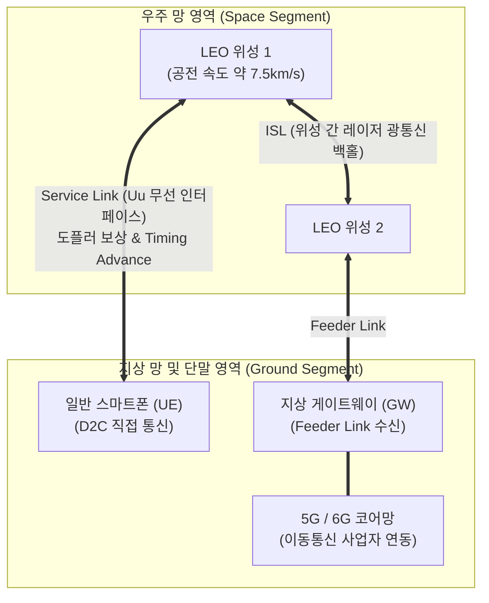

# 저궤도 위성 (LEO, Low Earth Orbit)

---

## I. 초공간 6G 통신의 핵심 인프라, 저궤도 위성의 개요

지구 표면으로부터 고도 300~1,500km의 낮은 궤도에서 운용되며, 20~40ms 수준의 짧은 지연시간과 3GPP NTN 표준을 바탕으로 스마트폰 직결(D2D/D2C) 광대역 통신을 제공하는 차세대 우주 통신 인프라이다.

| 구분 | 주요 내용 |
| --- | --- |
| **개념** | 지구 저궤도 상에 수천 기 이상의 군집 위성(Mega Constellation)을 배치하여 지상망의 지리적 한계를 넘어 글로벌 초공간 연결을 실현하는 통신 위성 |
| **등장 배경** | 정지궤도 위성(GEO)의 극심한 전파 지연(500ms 이상) 한계 극복, 도서·산간·해양 통신 음영 해소, 민간 우주 발사체 상용화로 발사 비용 대폭 절감 |
| **핵심 특징** | 초저지연 광대역 데이터 전송, 위성 간 레이저 링크(ISL), 위상 배열 평면 안테나를 통한 전자식 빔 조향, 지상 기지국 단말 직결(Direct-to-Cell) |

---

## II. 저궤도 위성의 시스템 아키텍처 및 핵심 기술 요소

### 가. 저궤도 위성의 3GPP NTN 기반 아키텍처

사용자의 상용 단말(UE)이 직접 LEO 위성에 접속하고, 위성 간 레이저 통신(ISL)으로 우주 공간에서 데이터를 라우팅한 후 지상 게이트웨이 및 이동통신 코어망으로 패킷을 고속 중계한다.

### 나. 저궤도 위성의 핵심 구성 및 기술 요소

| 분류 | 요소기술 (키워드) | 세부 설명 |
| --- | --- | --- |
| **표준 기술** | 3GPP NTN ([[비지상네트워크]]) | Release 17/18에서 정의된 5G/6G 위성 통신 표준 규격으로 지상 셀룰러 프로토콜의 우주 확장 지원 |
| **직결 통신** | D2C (Direct-to-Cell / D2D) | 대형 전용 안테나 없이 일반 스마트폰의 상용 주파수 및 모뎀을 통해 위성과 직접 음성·데이터 통신 |
| **우주 백홀** | ISL (Inter-Satellite Link) | 위성과 위성 사이를 광학 레이저 링크로 상호 연결하여 지상 기지국을 거치지 않는 초고속 우주 백홀 구현 |
| **안테나 빔** | 위상 배열 (Phased Array) | 초속 7.5km로 고속 비행하는 위성을 기계적 모터 회전 없이 전자적 위상 제어만으로 실시간 빔 추적 |
| **주파수 보정** | 도플러 편이 (Doppler Shift) 보상 | 위성의 극심한 궤도 이동으로 발생하는 주파수 왜곡 현상을 단말 GNSS 정보와 연동하여 사전 보상 |
| **지연 보정** | 타이밍 어드밴스 (Timing Advance) | 지상 셀 대비 현격히 긴 전파 거리를 단말이 위치 정보를 바탕으로 계산하여 전송 타이밍을 사전 동기화 |
| **페이로드 진화** | 재생 중계기 (Regenerative Payload) | 신호를 단순 증폭해 반사하는 Bent-pipe 방식을 넘어 위성 내부에 기지국(gNB) 연산 기능을 직접 탑재 |
| **모빌리티** | 초고속 빔/위성 간 핸드오버 | 위성의 공전 주기가 약 90~120분으로 매우 짧아 단말과의 연결을 유지하기 위해 빈번한 핸드오버 수행 |

---

## III. 위성 궤도별 비교 및 최신 동향

### 가. 정지궤도 위성(GEO) vs 저궤도 위성(LEO) 비교

| 비교 항목 | 정지궤도 위성 (GEO) | 저궤도 위성 (LEO) |
| --- | --- | --- |
| **궤도 고도** | 약 35,786 km (적도 상공) | **300 ~ 1,500 km** |
| **공전 주기** | 지구 자전 속도와 동일 (24시간 주기 고정) | **약 90 ~ 120분 (초속 7.5km 고속 이동)** |
| **전파 지연 (RTT)** | 약 500ms 이상 (대화형 통신에 지연 체감) | **20 ~ 40ms 수준 (지상망 광통신 유사)** |
| **글로벌 커버리지** | 위성 3~4기로 전 지구 커버 (극지방 제외) | 수백~수천 기 이상의 메가 콘스텔레이션 필요 |
| **사용자 단말** | 대형 파라볼라 안테나, 전용 위성전화 필수 | **일반 스마트폰(D2C) 및 소형 평면 안테나** |
| **대표 사업자** | 인텔샛, SES, 무궁화위성 | 스페이스X(스타링크), 유텔샛 원웹, 아마존 카이퍼 |

### 나. 최신 기술 동향 및 발전 방향

* **6G 지상-비지상 통합망의 주축**: 3GPP Release 19 및 6G 비전에서 저궤도 위성은 지상 5G/6G 기지국과 동일한 프로토콜 스택으로 단일 코어망에 수용되어 전 지구적 초공간 커버리지를 구현함.
* **우주 궤도 혼잡과 주파수 규제 이슈**: 수만 대의 메가 콘스텔레이션 구축에 따라 우주 쓰레기(Space Debris) 충돌 방지와 국제전기통신연합(ITU) 중심의 주파수 간섭 조정 및 궤도 점유권 분쟁 해결이 중요 과제로 부상함.

---

### 🔗 연관 토픽

- **소속 도메인**: [[00_네트워크_MOC|🌐 네트워크]]
- **세부 분류**: `4. 무선 및 차세대 이동통신 (5G/6G/Wi-Fi)`
- **핵심 연관 토픽**:
  - [[비지상네트워크]]
  - [[6G]]
  - [[SDR (Software Defined Radio)]]
  - [[게이트웨이]]
  - [[신뢰성]]
