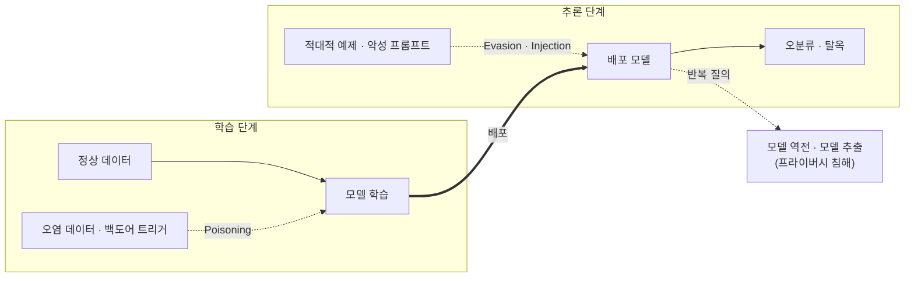

# 적대적 공격 (Adversarial Attack)

---

## I. AI 모델의 신뢰성을 위협하는 공격, 적대적 공격의 개요

### 가. 정의

- 사람이 인지하기 어려운 **미세한 노이즈(섭동, Perturbation)를 입력에 더하거나 학습 데이터를 오염**시켜 [[인공지능]] 모델의 오분류·오동작·정보 유출을 유도하는 공격

### 나. 특징

| 구분 | 내용 |
| --- | --- |
| 인지 차이 악용 | 모델의 고차원 선형성·패턴 인식 특성을 이용 |
| 전이성 (Transferability) | 한 모델용 적대적 예제가 구조가 다른 모델도 속임 → 블랙박스 공격 가능 |
| 현실 위협 | [[Smart Car(자율주행)\|자율주행]] 표지판 교란, 얼굴 인식 우회, [[초거대 언어 모델\|LLM]] 탈옥 |
| 체계화 | NIST·MITRE ATLAS가 학습 단계·추론 단계·프라이버시 공격으로 분류 |

---

## II. 공격 유형 및 핵심 기술

### 가. 생명주기별 공격 개념도

- 예: 판다 이미지에 기울기 방향 노이즈를 더하면 사람 눈엔 같은 판다지만 모델은 긴팔원숭이로 높은 확신을 가지고 오분류

### 나. 공격 기법

| 구분 | 기법 | 설명 |
| --- | --- | --- |
| 추론 단계 | 회피 공격 (Evasion) | 입력에 섭동을 더해 오분류 유도 |
| | FGSM | 손실 함수 기울기의 부호 방향으로 한 번에 노이즈 생성 |
| | PGD | 작은 스텝으로 반복하는 더 강력한 공격 |
| | 적대적 패치 | 물리 세계에 부착하는 스티커형 교란 |
| 학습 단계 | 데이터 오염 (Poisoning) | 라벨 반전 등으로 결정 경계 왜곡 ([[머신러닝 학습과정에서의 적대적 공격]]) |
| | 백도어 | 특정 트리거가 있을 때만 의도한 오동작 |
| 프라이버시 | 모델 역전 (Inversion) | 출력 신뢰도를 분석해 학습 데이터 복원 |
| | 모델 추출 (Extraction) | 반복 질의로 모델 기능 복제 |
| LLM 특화 | [[프롬프트 인젝션]] | 입력·외부 문서에 숨긴 지시어로 시스템 지시 무력화 |
| | 탈옥 (Jailbreak) | 역할극·우회 맥락으로 안전 가드레일 무력화 |
| 공격 조건 | 화이트박스 / 블랙박스 | 내부 구조·가중치 접근 여부 / 입출력만 관찰해 대리 모델로 전이 |
| 공격 목표 | Targeted / Untargeted | 특정 오답 유도 / 정답만 아니면 됨 |

### 다. 방어 기법

| 기법 | 설명 |
| --- | --- |
| 적대적 학습 | 적대적 예제를 학습 데이터에 포함해 강건성(Robustness) 향상 |
| 방어적 증류 | 온도를 높인 Softmax 확률로 학생 모델을 학습해 기울기 추출 방해 |
| 입력 변환·정제 | JPEG 압축, 블러, 양자화로 숨은 노이즈 제거 |
| 데이터 무결성 검증 | 학습 데이터 출처 증명, 이상치 탐지 |
| 가드레일·레드팀 | LLM 입출력 필터링, [[AI 레드팀(Red team) 테스트\|AI 레드팀]] |

---

## III. 비교 및 동향

### 가. 학습 단계 공격 vs 추론 단계 공격

| 비교 항목 | 학습 단계 (Poisoning·Backdoor) | 추론 단계 (Evasion·Inversion) |
| --- | --- | --- |
| 공격 대상 | 학습 데이터, 파이프라인, 사전학습 모델 | 배포된 모델의 API·입력 |
| 목표 | 결정 경계의 영구 왜곡 | 현재 입력의 오분류, 정보 탈취 |
| 필요 권한 | 데이터·인프라 접근 | API 접근 |
| LLM 사례 | RAG 지식 베이스 중독 | 프롬프트 인젝션, 탈옥 |
| 방어 | 출처 증명, 데이터 정제 | 적대적 학습, 입력 정제, 가드레일 |

### 나. 동향

- **간접 프롬프트 인젝션 위협**: AI 에이전트가 외부 웹페이지나 이메일을 분석하는 과정에서 숨겨진 악의적 지시어를 자동 실행하는 간접 인젝션 공격이 최우선 해결 과제로 부상 ([[OWASP Top 10 for LLM Application 2025]])
- **물리 환경 교란 및 센서 퓨전 대응**: 자율주행 차량 대상 스티커형 적대적 패치 공격에 대응하기 위해 레이더·라이다·카메라 간 센서 퓨전 교차 검증과 [[XAI]] 기반 의사결정 경로 검증 적용
- **거버넌스 및 레드팀 체계화**: MITRE ATLAS 위협 매트릭스를 기반으로 한 전사적 공격 표면 진단과 [[AI TRiSM]] 프레임워크 및 전담 [[AI 레드팀(Red team) 테스트|AI 레드팀]] 운용 의무화 추세 ([[딥러닝 취약점]], [[생성형 AI 위협 및 대응방안]])

---

### 🔗 연관 토픽

- **소속 도메인**: [[00_보안_MOC|🛡️ 보안]]
- **세부 분류**: `5. 사이버 공격 기법 & 침해사고 대응`
- **핵심 연관 토픽**:
  - [[머신러닝 학습과정에서의 적대적 공격]]
  - [[프롬프트 인젝션]]
  - [[AI 레드팀(Red team) 테스트]]
  - [[AI TRiSM]]
  - [[XAI]]
