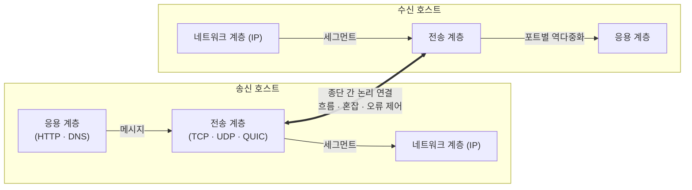

# 전송 계층 (Transport Layer, OSI 4계층)

---

## I. 프로세스 간 종단 통신, 전송 계층의 개요

### 가. 정의

- OSI 7계층 중 4계층으로, 송수신 호스트의 **애플리케이션([[프로세스]]) 간 논리적 통신을 제공**하고 분할·흐름 제어·오류 제어·[[TCP 혼잡제어|혼잡 제어]]로 신뢰성 또는 실시간성을 보장하는 계층

### 나. 특징

| 구분 | 내용 |
| --- | --- |
| Process-to-Process | IP가 호스트를 식별한다면 포트 번호로 프로세스를 식별 ([[다중화\|다중화·역다중화]]) |
| End-to-End | 중간 라우터는 관여하지 않고 양 끝 호스트에서만 동작 |
| 하위 결함 은닉 | 패킷 손실·순서 뒤바뀜을 감추고 상위 계층에 안정적 스트림 제공 |
| 선택적 신뢰성 | 신뢰성 중심의 연결형 [[TCP]], 속도 중심의 비연결형 UDP |
| 전송 단위 | TCP 세그먼트, UDP 데이터그램 |

---

## II. 동작 구조 및 핵심 기술

### 가. 동작 구조

- 응용 메시지를 MSS 크기로 분할하고 출발지·목적지 포트를 붙여 전송, 수신 측은 포트로 해당 프로세스에 전달

### 나. 핵심 기술

| 구분 | 기술 | 설명 |
| --- | --- | --- |
| 주소 | 포트 번호 | 16비트(0~65535), Well-known(0~1023)·Registered·Dynamic |
| 연결 관리 | 3-Way / 4-Way Handshake | TCP 연결 설정(SYN, SYN-ACK, ACK)과 종료(FIN·ACK) |
| 흐름 제어 | Sliding Window | 수신 윈도우(rwnd)로 수신 버퍼 오버플로 방지 |
| 혼잡 제어 | Slow Start, AIMD, Fast Retransmit/Recovery | 혼잡 윈도우(cwnd)로 네트워크 과부하 방지, CUBIC·BBR 알고리즘 ([[TCP 혼잡제어]]) |
| 오류 제어 | Checksum, ACK, 타이머 재전송 | 손상·분실 세그먼트 검출 후 ARQ 재전송 |
| 프로토콜 | [[TCP]] | 연결형, 순서·신뢰성 보장, 바이트 스트림 |
| | UDP | 비연결형, 8바이트 헤더, 실시간·소량 질의(DNS, VoIP) |
| | [[SCTP (Stream Control Transmission Protocol)\|SCTP]] | 멀티스트리밍·멀티호밍, 통신망 신호 전송 |
| | QUIC (RFC 9000) | UDP 위에 신뢰성·TLS 1.3·멀티스트림 통합, 커넥션 ID로 이동성 지원 |
| | MPTCP | 여러 경로(Wi-Fi + 5G)를 동시 사용해 대역폭 확장·무중단 핸드오버 |

---

## III. 비교 및 동향

### 가. TCP vs UDP vs QUIC

| 비교 항목 | TCP | UDP | QUIC |
| --- | --- | --- | --- |
| 연결 | 연결형 | 비연결형 | UDP 위의 논리 연결 |
| 신뢰성 | 재전송·순서 보장 | 보장 안 함 | 자체 구현으로 보장 |
| 연결 지연 | 1-RTT + TLS 1~2-RTT | 없음 | 1-RTT, 재연결 0-RTT (TLS 1.3 내장) |
| HOL Blocking | 단일 스트림이라 발생 | 해당 없음 | 스트림별 독립 처리로 해소 |
| 이동성 | IP·포트 변경 시 끊김 | 해당 없음 | 커넥션 ID로 유지 |
| 활용 | HTTP/1.1·2, 파일 전송 | DNS, 스트리밍, 게임 | [[HTTP 3\|HTTP/3]] |

### 나. 동향

- **QUIC·HTTP/3 확산**: 연결 지연과 HOL Blocking을 해결한 QUIC이 웹 트래픽의 주요 전송 방식으로 정착
- **커널 우회**: 100Gbps 이상 환경에서 [[커널]] 인터럽트 병목을 피하려 DPDK·RDMA와 유저 스페이스 전송 스택 도입
- **BBR 혼잡 제어**: 손실 기반 대신 대역폭·RTT를 추정해 전송률을 조절하는 BBR이 데이터센터·CDN에 확산

---

### 🔗 연관 토픽

- **소속 도메인**: [[00_네트워크_MOC|🌐 네트워크]]
- **세부 분류**: `1. OSI 7계층 & 데이터링크 계층 (L1/L2)`
- **핵심 연관 토픽**:
  - [[TCP]]
  - [[TCP 혼잡제어]]
  - [[HTTP 3|HTTP/3]]
  - [[SCTP (Stream Control Transmission Protocol)]]
  - [[네트워크 계층]]
