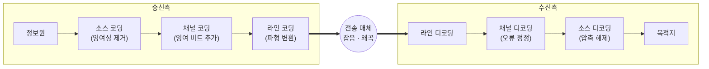

# 전송부호화 (소스 코딩, 채널 코딩, 라인 코딩)

---

## I. 줄이고, 보호하고, 신호로 바꾸는, 전송부호화의 개요

### 가. 정의

- 디지털 통신에서 **정보를 압축(소스 코딩)하고, 오류 정정용 잉여 비트를 더하고(채널 코딩), 매체에 맞는 신호 파형으로 바꾸는(라인 코딩)** 송신측 변환 과정

### 나. 특징

| 구분 | 내용 |
| --- | --- |
| 효율 | 소스 코딩으로 잉여성을 제거해 전송량 감소 |
| [[신뢰성]] | 채널 코딩으로 잡음·간섭에 의한 비트 오류 정정 |
| 매체 적응 | 라인 코딩으로 DC 성분 억제, 클럭 동기 정보 포함 |
| 분리 설계 | 섀넌의 소스-채널 분리 정리에 따라 각 단계를 독립 최적화 |
| 상세 노트 | 이론적 한계는 [[소스코딩, 채널코딩, 라인코딩 샤논 정리]] 참고 |

---

## II. 처리 구조 및 기술

### 가. 송수신 처리 흐름

- 송신측은 압축 → 오류 보호 → 파형 변환 순서로 처리하고, 수신측은 역순으로 복원

### 나. 단계별 기술

| 구분 | 기술 | 설명 |
| --- | --- | --- |
| 소스 코딩 | 무손실 압축 | 허프만, 산술 부호화, LZ77·LZW |
| | 손실 압축 | JPEG, MP3, H.264·HEVC·VVC (VVC는 HEVC 대비 약 50% 비트율 절감) |
| 채널 코딩 | 블록 부호 | 해밍, BCH, Reed-Solomon ([[해밍코드]], [[CRC]]는 검출용) |
| | 컨볼루션 · Turbo | 3G·4G 데이터 채널 |
| | LDPC | 5G NR 데이터 채널, 섀넌 한계에 근접 |
| | Polar | 5G NR 제어 채널, 채널 분극 현상 이용 |
| 라인 코딩 | NRZ · RZ · AMI | 기본 2진 파형, AMI는 DC 성분 제거 |
| | 맨체스터 | 비트 중간 천이로 클럭 동기 내장 (10BASE-T 이더넷) |
| | 4B/5B · 8B/10B · 64B/66B | 블록 부호화로 천이 밀도 확보 (Fast·Gigabit·10G 이더넷) |
| | PAM4 | 4레벨(2비트/심볼)로 심볼 속도 절반, 200G·400G·800G 이더넷, PCIe 6.0 |

---

## III. 비교 및 동향

### 가. 3단계 부호화 비교

| 비교 항목 | 소스 코딩 | 채널 코딩 | 라인 코딩 |
| --- | --- | --- | --- |
| 목적 | 효율 | 신뢰성 | 매체 전송 적합성 |
| 잉여성 | 제거 | 추가 | 파형 특성 부여 |
| 평가 지표 | 압축률, 화질(PSNR) | BER, 부호율, 섀넌 한계 근접도 | 대역 효율, DC 성분, 동기성 |
| 대표 기술 | 허프만, JPEG, VVC | Turbo, LDPC, Polar | NRZ, 맨체스터, PAM4 |

### 나. 동향

- **Semantic·JSCC**: [[딥러닝]] 오토인코더로 소스·채널 코딩을 결합하는 6G 연구
- **다중 레벨 신호 확산**: 데이터센터·AI 클러스터의 고속 링크에서 PAM4가 표준화, 더 높은 레벨(PAM6 등) 연구

---

### 🔗 연관 토픽

- **소속 도메인**: [[00_네트워크_MOC|🌐 네트워크]]
- **세부 분류**: `1. OSI 7계층 & 데이터링크 계층 (L1/L2)`
- **핵심 연관 토픽**:
  - [[소스코딩, 채널코딩, 라인코딩 샤논 정리]]
  - [[FEC(Forward Error Correction) BEC(Backward Error Correction)]]
  - [[해밍코드]]
  - [[CRC|CRC(Cyclic Redundancy Check)]]
  - [[PCM(Pulse-Code Modulation)]]
