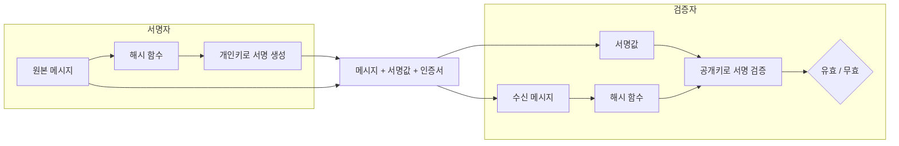

# 전자 서명 (Digital Signature)

---

## I. 서명자 확인과 위변조 방지, 전자 서명의 개요

### 가. 정의

- 서명자만 가진 **개인키로 메시지(해시값)에 서명값을 생성하고, 누구나 공개키로 검증**하여 [[무결성]]·서명자 인증·부인방지를 제공하는 공개키 암호 기반 기술

### 나. 제공 기능

| 구분 | 내용 |
| --- | --- |
| 무결성 | 서명 후 메시지가 바뀌면 검증 실패 |
| 인증 | 공개키 인증서로 서명자 신원 확인 |
| 부인방지 | 개인키는 서명자만 보유하므로 서명 사실 부인 불가 |
| 제공하지 않는 기능 | 기밀성 (메시지 자체는 암호화되지 않음, 필요 시 별도 암호화) |
| 법적 근거 | 국내 「전자서명법」 전면 개정(2020.12)으로 공인인증서 독점 폐지, 다양한 전자서명 인정 |

---

## II. 동작 원리 및 기술요소

### 가. 서명·검증 절차

- 서명자는 메시지 해시에 개인키로 서명하고, 검증자는 인증서의 공개키와 수신 메시지 해시로 서명의 유효성을 확인 (RSA는 해시를 개인키로 연산, ECDSA·EdDSA는 별도 서명 방정식 사용)

### 나. 기술요소

| 구분 | 요소 | 설명 |
| --- | --- | --- |
| 서명 알고리즘 | [[RSA (Rivest Shamir Adleman)\|RSA]]-PSS | 인수분해 문제 기반 |
| | ECDSA / EdDSA | [[ECC]] 이산대수 문제 기반, 짧은 키로 동등 보안 |
| 해시 | SHA-2 · SHA-3 | 메시지를 고정 길이 다이제스트로 축약 ([[해시함수]]) |
| 신뢰 체계 | PKI (CA · RA) | 공개키 인증서 발급·관리, 인증서로 공개키 소유자 보증 |
| | CRL / OCSP | 폐기 인증서 목록 / 실시간 인증서 상태 확인 |
| 시점 증명 | 타임스탬프 (TSA) | 서명 시점을 제3기관이 증명, 장기 검증 지원 |
| 응용 | 코드 서명 · 문서 서명 | 펌웨어·SW 배포 무결성, 전자계약 |
| | DID · VC | 분산 식별자와 검증 가능한 증명서에 서명 적용 |
| 차세대 | PQC 서명 | 양자 공격에 안전한 격자·해시 기반 서명 ([[양자내성암호]]) |

---

## III. 비교 및 동향

### 가. 전자 서명 vs MAC

| 비교 항목 | 전자 서명 | 메시지 인증 코드 ([[MAC]]) |
| --- | --- | --- |
| 키 | 비대칭키 (개인키 서명, 공개키 검증) | 대칭키 (송수신자 동일 키 공유) |
| 제공 기능 | 무결성, 인증, 부인방지 | 무결성, 인증 |
| 부인방지 | 제공 | 불가 (양측이 같은 키 보유) |
| 속도 | 상대적으로 느림 | 빠름 (HMAC 등) |
| 키 관리 | PKI로 다수 대상 확장 용이 | 쌍마다 비밀키 필요 (N(N-1)/2) |
| 적용 | 인증서, 전자계약, 코드 서명 | [[IP Sec\|IPsec]]·TLS 레코드 무결성 |

### 나. 동향

- **PQC 표준**: NIST FIPS 204(ML-DSA, Dilithium), FIPS 205(SLH-DSA, SPHINCS+) 확정(2024), Falcon 기반 FN-DSA 표준화 진행, 국내 KpqC 공모전 선정 알고리즘 표준화
- **전자서명 다변화**: 공인인증서 폐지 후 민간 인증서(금융·통신·플랫폼)와 FIDO 기반 간편 인증 확산
- **모바일 신분증 · DID**: 블록체인 기반 DID와 VC로 모바일 운전면허증·주민등록증 발급

---

### 🔗 연관 토픽

- **소속 도메인**: [[00_디지털서비스_MOC|🚀 디지털서비스]]
- **세부 분류**: `4. 데이터 플랫폼 & 개방형 API 생태계`
- **핵심 연관 토픽**:
  - [[비대칭키 암호화]]
  - [[해시함수]]
  - [[RSA (Rivest Shamir Adleman)]]
  - [[ECC|ECC(Elliptic Curve Cryptography)]]
  - [[양자내성암호]]
