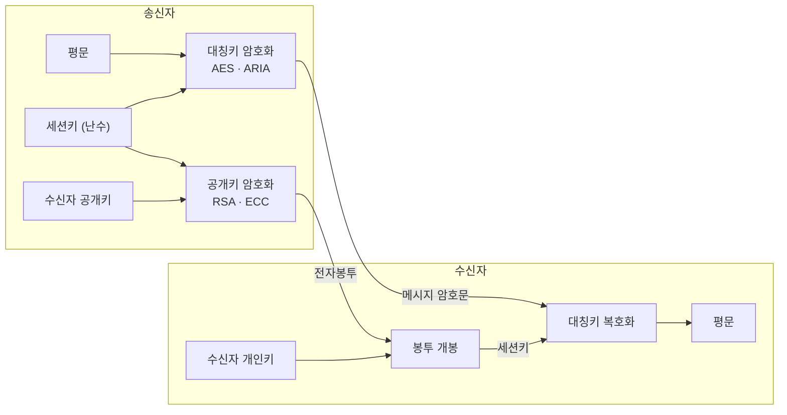

# 전자봉투 (Digital Envelope)

---

## I. 대칭키의 속도와 공개키의 키 분배, 전자봉투의 개요

### 가. 정의

- 메시지는 **일회용 대칭키(세션키)로 암호화**하고, 그 **세션키는 수신자의 공개키로 암호화**하여 함께 보내는 하이브리드 [[암호화]] 기법

### 나. 특징

| 구분 | 내용 |
| --- | --- |
| 키 분배 해결 | 세션키를 공개키로 보호해 사전 키 공유 불필요 |
| 성능 | 대용량 데이터는 빠른 대칭키로 처리 |
| 수신자 한정 | 수신자 개인키를 가진 사람만 봉투를 열 수 있음 ([[기밀성]]) |
| 다수 수신자 | 같은 세션키를 수신자별 공개키로 각각 봉투화 |

---

## II. 동작 구조 및 구성요소

### 가. 생성·개봉 절차

- 송신자는 세션키로 데이터를 암호화하고 세션키를 수신자 공개키로 봉투화하며, 수신자는 개인키로 봉투를 열어 세션키를 얻은 뒤 데이터를 복호화

### 나. 구성요소

| 구분 | 요소 | 설명 |
| --- | --- | --- |
| 키 | 세션키 | 난수 생성기로 만든 일회용 대칭키 |
| | 수신자 공개키 | 세션키를 암호화해 봉투 생성 |
| | 수신자 개인키 | 봉투를 열어 세션키 복원 |
| 알고리즘 | 대칭키 암호 | [[AES]], ARIA, SEED 등 [[블록 암호화\|블록 암호]] |
| | 공개키 암호 | [[RSA (Rivest Shamir Adleman)\|RSA]]-OAEP, ECIES 등 |
| 보조 | CSPRNG | 예측 불가능한 세션키 생성 |
| 표준·적용 | CMS(PKCS#7), S/MIME, PGP | 이메일·문서 암호화 형식 |
| 차세대 | KEM | 공개키로 공유 비밀을 캡슐화하는 방식, ML-KEM이 PQC 표준 |

---

## III. 비교 및 동향

### 가. 전자봉투 vs 전자서명

| 비교 항목 | 전자봉투 | 전자서명 |
| --- | --- | --- |
| 목적 | 기밀성, 키 전달 | [[무결성]], 인증, 부인방지 |
| 암호화(생성) 키 | 수신자 공개키 | 송신자 개인키 |
| 복호화(검증) 키 | 수신자 개인키 | 송신자 공개키 |
| 대상 | 세션키 | 메시지 해시값 |
| 열람·검증 가능자 | 지정된 수신자만 | 누구나 검증 가능 |

### 나. 동향

- **KEM 기반 전환**: HPKE(RFC 9180) 등 KEM-DEM 구조로 일반화, ML-KEM 적용으로 양자 내성 확보
- **서명과 결합**: S/MIME·PGP처럼 전자서명과 함께 써서 기밀성·무결성·인증·부인방지를 함께 제공
- **TLS 1.3**: RSA 키 전송 방식을 폐지하고 (EC)DHE 키 합의만 허용해 전방 비밀성 확보

---

### 🔗 연관 토픽

- **소속 도메인**: [[00_보안_MOC|🛡️ 보안]]
- **세부 분류**: `1. 정보보안 원칙 & 거버넌스 · 인증`
- **핵심 연관 토픽**:
  - [[비밀키 암호화와 비대칭키 암호화 비교|비밀키 암호화(Symmetric)와 비대칭키 암호화(Asymmetric) 비교]]
  - [[비대칭키 암호화]]
  - [[이중서명|이중서명 (Dual Signature)]]
  - [[RSA (Rivest Shamir Adleman)]]
  - [[양자내성암호]]
