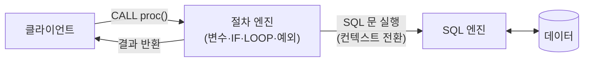

# 절차형 SQL (Procedural SQL)

---

## I. SQL에 제어 흐름을 더한 언어, 절차형 SQL의 개요

### 가. 정의

- 선언형 SQL에 **변수, 조건·반복문, 커서, 예외 처리를 더해 DBMS 안에서 절차적 로직을 실행하는 확장 언어** (표준 SQL/PSM, Oracle PL/SQL, SQL Server T-SQL, PostgreSQL PL/pgSQL)

### 나. 특징

| 구분 | 내용 |
| --- | --- |
| 서버 측 실행 | 여러 SQL을 DB 내부에서 처리해 네트워크 왕복 감소 |
| 모듈화 | 프로시저·함수로 로직 재사용 |
| 보안 | 테이블 직접 접근 대신 실행 권한만 부여 |
| 한계 | 벤더 종속, DB 서버 부하 집중, 버전 관리·테스트 어려움 |

---

## II. 구조 및 구성요소

### 가. 실행 구조

- 한 번의 호출로 여러 SQL과 제어 로직을 서버에서 실행, 절차 엔진과 SQL 엔진 간 전환 비용은 대량 처리(BULK)로 줄임

### 나. 구성요소

| 구분 | 요소 | 설명 |
| --- | --- | --- |
| 객체 | 저장 [[프로시저]] | 이름으로 호출하는 SQL·제어문 묶음, 반환값 선택 |
| | 사용자 정의 함수 | 값(또는 테이블)을 반드시 반환, SQL 문 안에서 호출 가능 |
| | 트리거 | [[DML]]·DDL 이벤트 발생 시 자동 실행 |
| 구문 | 선언부·실행부·예외부 | DECLARE, BEGIN … END, EXCEPTION |
| | 제어문 | IF·CASE, LOOP·WHILE·FOR |
| 데이터 처리 | 커서 | 다중 행 결과를 한 행씩 처리 (명시적·묵시적 커서) |
| | 동적 SQL | EXECUTE IMMEDIATE 등 실행 시 SQL 생성 ([[Dynamic SQL (동적 SQL)\|Dynamic SQL]]) |
| 트랜잭션 | COMMIT·ROLLBACK | 여러 DML의 원자성 제어 ([[트랜잭션]]) |

---

## III. 비교 및 동향

### 가. 절차형 SQL vs 선언형(표준) SQL

| 비교 항목 | 절차형 SQL | 선언형 SQL |
| --- | --- | --- |
| 처리 단위 | 행 단위 반복 가능 | 집합 단위 |
| 기술 방식 | How (처리 절차) | What (원하는 결과) |
| 변수·제어문 | 지원 | 미지원 |
| 실행 위치 | DB 서버 내 저장·실행 | 클라이언트가 전송, DB가 실행 |
| 예 | PL/SQL, T-SQL, PL/pgSQL | SELECT, INSERT, UPDATE |

### 나. 동향

- **로직의 애플리케이션 이동**: [[MSA (Micro Service Architecture)|MSA]]·클라우드 환경에서 업무 로직은 서비스 계층으로, 절차형 SQL은 데이터 집약 작업에 한정
- **클라우드 DW 스크립팅**: Snowflake Scripting, BigQuery 절차적 언어로 ELT·배치 작업 처리
- **집합 처리 우선**: 커서 반복 대신 단일 집합 SQL·MERGE로 재작성해 성능 향상

---

### 🔗 연관 토픽

- **소속 도메인**: [[00_데이터베이스_MOC|🗄️ 데이터베이스]]
- **세부 분류**: `3. 장애 회복 기법 & 데이터 무결성`
- **핵심 연관 토픽**:
  - [[Dynamic SQL (동적 SQL)]]
  - [[SQL 함수]]
  - [[SQL(Structured Query Language)]]
  - [[DML]]
  - [[트랜잭션]]
