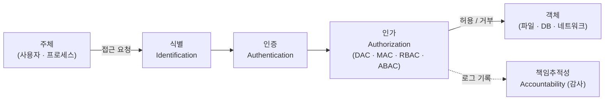

# 접근 제어 / 접근 통제 (Access Control)

---

## I. 정보 자산 보호의 핵심 통제, 접근 제어의 개요

### 가. 정의

- 인가된 **주체(Subject)** 만 정책에 따라 **객체(Object)** 에 접근하도록 권한을 부여·검증·기록하는 보안 통제 메커니즘

### 나. 등장 배경 및 원칙

| 구분 | 내용 |
| --- | --- |
| 등장 배경 | 내부자 위협·권한 남용, 악성코드의 권한 우회, 클라우드·[[제로 트러스트 보안모델\|Zero Trust]] 환경의 동적 권한 요구 |
| 보호 목표 | [[기밀성]]·[[무결성]]·[[가용성]] |
| 최소 권한 원칙 | 업무에 필요한 최소 권한만 부여 |
| 직무 분리 (SoD) | 승인과 실행을 분리해 단독 부정행위 방지 |
| Need-to-Know | 알아야 할 정보만 접근 |

---

## II. 접근 제어 절차 및 모델

### 가. 절차 (IAAA)

| 단계 | 내용 | 예 |
| --- | --- | --- |
| 식별 | 자신이 누구인지 주장 | ID, 사번 |
| 인증 | 주장한 신원 검증 | 비밀번호, 생체, MFA ([[생체 인증]], [[FIDO]]) |
| 인가 | 허용된 작업 범위 결정 | Read, Write, Execute |
| 책임추적성 | 행위 기록과 사후 감사 | 감사 로그 |

### 나. 접근 통제 모델

| 모델 | 통제 주체 | 결정 기준 | 설명 |
| --- | --- | --- | --- |
| [[DAC]] (임의적) | 객체 소유자 | 사용자 신분(ID) | 소유자가 임의로 권한 부여, ACL로 구현 |
| [[MAC]] (강제적) | 시스템·보안관리자 | 보안 등급(Label) | 주체의 인가 등급과 객체 등급 비교 |
| [[RBAC]] (역할 기반) | 시스템·보안관리자 | 역할(Role) | 직무에 권한을 부여, 인사 이동 시 관리 용이 |
| ABAC (속성 기반) | 정책 엔진 | 주체·객체·환경 속성 | 시간·위치·기기 상태 등을 조합한 동적 제어 |

### 다. 구현 기법 및 보안 모델

| 구분 | 요소 | 설명 |
| --- | --- | --- |
| 구현 | ACL | 객체별로 접근 가능한 주체 목록 |
| | Capability List | 주체별로 접근 가능한 객체 목록 |
| MAC 보안 모델 | Bell-LaPadula (BLP) | **기밀성**: No Read Up, No Write Down |
| | Biba | **무결성**: No Read Down, No Write Up |
| | Clark-Wilson | 무결성: 정형화된 트랜잭션과 직무 분리 |

---

## III. 모델 비교 및 동향

### 가. DAC vs MAC vs RBAC vs ABAC

| 비교 항목 | DAC | MAC | RBAC | ABAC |
| --- | --- | --- | --- | --- |
| 장점 | 유연, 구현 용이 | 최고 수준 기밀성 | 권한 관리 용이, SoD 구현 | 세밀한 상황 기반 제어 |
| 단점 | 트로이 목마에 취약 | 구현 복잡, 경직 | 역할 설계 어려움 (역할 폭증) | 정책 설계 복잡 |
| 활용 | 일반 OS, 상용 [[DBMS]] | 군사·공공 망 | 기업 ERP, 인트라넷 | 제로 트러스트, 클라우드 |

### 나. 동향

- **지속적 접근 평가 (CAE·CARTA)**: 최초 인증 후에도 세션 중 위치·기기 상태 변화를 감시해 권한을 동적으로 회수
- **CIEM**: 멀티 클라우드의 과다 권한을 가시화하고 ML로 최소 권한에 맞게 자동 축소
- **통합 관리**: [[IAM]]·PAM과 연계한 계정·특권 접근 관리 ([[서버 접근 통제]])

---

### 🔗 연관 토픽

- **소속 도메인**: [[00_보안_MOC|🛡️ 보안]]
- **세부 분류**: `1. 정보보안 원칙 & 거버넌스 · 인증`
- **핵심 연관 토픽**:
  - [[RBAC]]
  - [[DAC]]
  - [[MAC]]
  - [[IAM]]
  - [[제로 트러스트 보안모델|제로 트러스트 (Zero Trust) 보안모델]]
