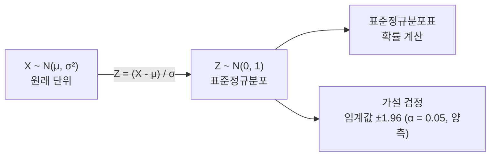

# 정규분포 (Normal Distribution)

---

## I. 통계 추론의 기준 분포, 정규분포의 개요

### 가. 정의

- 평균을 중심으로 좌우 대칭인 **종 모양의 연속확률분포**, $X \sim N(\mu, \sigma^2)$, $f(x) = \frac{1}{\sigma\sqrt{2\pi}} e^{-\frac{(x-\mu)^2}{2\sigma^2}}$

### 나. 특징

| 구분 | 내용 |
| --- | --- |
| 대칭성 | 평균 = 중앙값 = 최빈값, 왜도 0, 첨도 3 |
| 모수 | 평균 $\mu$(위치), 분산 $\sigma^2$(퍼짐) 두 개로 결정 |
| 경험 법칙 | $\pm1\sigma$ 68.3%, $\pm2\sigma$ 95.4%, $\pm3\sigma$ 99.7% |
| 근거 | [[중심극한정리]]로 많은 독립 요인의 합·표본평균이 정규분포에 근사 |
| 선형성 | 독립 정규 변수의 선형 결합도 정규분포 |

---

## II. 구조 및 핵심 요소

### 가. 표준화 개념도

- 평균을 빼고 표준편차로 나눠 단위가 다른 데이터를 같은 기준으로 비교하고 확률 계산

### 나. 핵심 요소

| 구분 | 요소 | 설명 |
| --- | --- | --- |
| 모수 | 평균 $\mu$ | 분포의 중심 위치 |
| | 표준편차 $\sigma$ | 곡선의 폭, 클수록 넓고 낮음 |
| 확률 | PDF | 곡선 아래 면적이 확률, 전체 면적 1 |
| | CDF $\Phi(z)$ | 표준정규분포의 누적확률 |
| 변환 | Z-점수 | $(X-\mu)/\sigma$, 평균에서 몇 표준편차 떨어졌는지 |
| 근사 | 중심극한정리 | 표본평균의 분포가 정규분포에 근사 |
| AI 적용 | 가중치 초기화 | Xavier·He 초기화가 정규(또는 균등) 분포 사용 |
| | [[VAE]]·확산 모델 | 잠재 변수·노이즈를 가우시안으로 가정, 재매개변수화 기법 |
| | [[배치 정규화]] | 층 입력을 평균 0·분산 1로 정규화해 학습 안정화 (분포를 정규분포로 만드는 것은 아님) |

---

## III. 비교 및 동향

### 가. 정규분포 vs 표준정규분포

| 비교 항목 | 정규분포 | 표준정규분포 |
| --- | --- | --- |
| 표기 | $N(\mu, \sigma^2)$ | $N(0, 1)$ |
| 모수 | 데이터마다 다름 | 평균 0, 분산 1 고정 |
| 단위 | 원 데이터 단위 유지 | 무차원 (Z-점수) |
| 용도 | 실제 데이터 분포 모델링 | 확률표 조회, 척도 비교, 검정 |

### 나. 동향

- **통계적 이상 탐지**: 지표가 $\pm3\sigma$를 벗어나면 이상으로 보는 관리도·모니터링 규칙에 활용, 단 금융·트래픽처럼 꼬리가 두꺼운 데이터는 정규 가정이 위험을 과소평가 ([[이상 감지]])
- **생성 모델의 노이즈 분포**: [[Diffusion 모델]]은 데이터에 가우시안 노이즈를 단계적으로 더하고, 이를 역으로 제거하는 과정을 학습해 이미지·음성 생성
- **불확실성 표현**: 가우시안 프로세스, 칼만 필터 등이 정규분포 가정으로 예측 분포 제공

---

### 🔗 연관 토픽

- **소속 도메인**: [[00_인공지능_MOC|🤖 인공지능]]
- **세부 분류**: `1. 수학 · 통계학 & 데이터 전처리`
- **핵심 연관 토픽**:
  - [[확률분포]]
  - [[중심극한정리|중심극한정리 (Central Limit Theorem)]]
  - [[왜도 & 첨도|왜도(skewness) & 첨도(kurtosis)]]
  - [[Z-검정|Z-검정 (Z-test)]]
  - [[가설 검정]]
