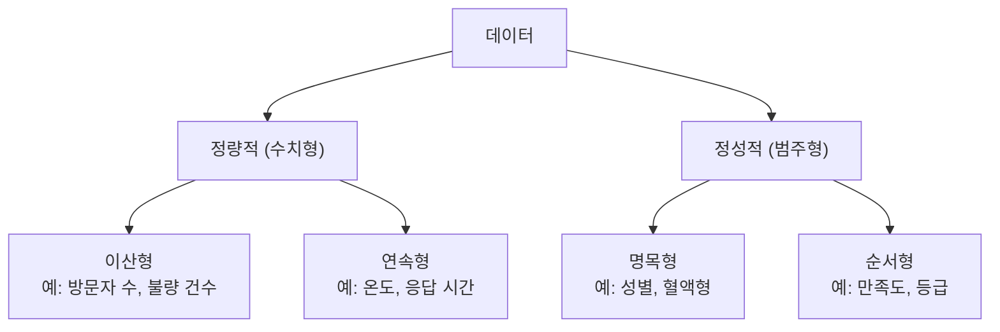

# 정량적 데이터 (Quantitative Data)

---

## I. 수치로 측정하는 데이터, 정량적 데이터의 개요

### 가. 정의

- 대상의 특성을 **수치로 측정해 크기·양을 나타내고 산술 연산이 의미를 갖는** 데이터 (수치형 데이터)

### 나. 특징

| 구분 | 내용 |
| --- | --- |
| 산술 연산 | 평균·분산 등 계산 가능 |
| 세분류 | 이산형(셀 수 있음)과 연속형(측정값) |
| 측정 척도 | 등간 척도, 비율 척도 |
| 분석 | [[기술 통계]], 검정, 회귀 등 수리 모델의 직접 입력 |

---

## II. 분류 체계 및 구성요소

### 가. 데이터 분류 체계

- 정량적 데이터는 등간·비율 척도, 정성적 데이터는 명목·서열 척도로 측정

### 나. 구성요소

| 구분 | 요소 | 설명 |
| --- | --- | --- |
| 유형 | 이산형 | 정수 값만 가짐, 셀 수 있음 (예: 요청 건수) |
| | 연속형 | 구간 내 임의의 실수 값 (예: 지연 시간) |
| 척도 | 등간 척도 | 간격은 같으나 절대 0 없음, 덧셈·뺄셈만 의미 (예: 섭씨온도) |
| | 비율 척도 | 절대 0 존재, 비율·배수 비교 가능 (예: 무게, 매출) |
| 전처리 | 스케일링 | Min-Max 정규화, Z-Score 표준화 ([[정규화, 규제화, 표준화]]) |
| | [[이상치]] 처리 | IQR·Z-Score로 탐지 후 제거·대체 |
| | 구간화 (Binning) | 연속값을 구간 범주로 변환 |
| 분석·시각화 | 기술 통계 | 평균, 중앙값, 분산, 표준편차 |
| | 히스토그램·산점도 | 분포와 두 변수 관계 확인 |

---

## III. 비교 및 동향

### 가. 정량적 vs 정성적 데이터

| 비교 항목 | 정량적 | 정성적 |
| --- | --- | --- |
| 성질 | 수치형 | 범주형 |
| 질문 | 얼마나? 몇 개? | 어떤 종류? |
| 척도 | 등간, 비율 | 명목, 서열 |
| 연산 | 사칙연산, 평균 | 빈도, 최빈값 (서열은 중앙값까지) |
| 분석 | [[회귀분석]], [[t-검정 (t-test)\|t-검정]], [[ANOVA(Analysis of variance)\|ANOVA]] | 카이제곱 검정, [[로지스틱회귀분석\|로지스틱 회귀]](종속변수) |
| 시각화 | 히스토그램, 박스 플롯, 산점도 | 막대 그래프, 파이 차트 |

### 나. 동향

- **정성 데이터의 수치화**: 원-핫·타깃 인코딩, 텍스트·이미지 임베딩으로 범주·비정형 데이터를 실수 벡터로 바꿔 모델 입력으로 사용
- **혼합 분석**: 행동 로그(정량)와 리뷰·VoC 감성 분석(정성)을 결합해 고객 분석

---

### 🔗 연관 토픽

- **소속 도메인**: [[00_인공지능_MOC|🤖 인공지능]]
- **세부 분류**: `1. 수학 · 통계학 & 데이터 전처리`
- **핵심 연관 토픽**:
  - [[데이터 유형]]
  - [[기술 통계|기술 통계(Descriptive statistics)]]
  - [[이상치]]
  - [[정규화, 규제화, 표준화]]
  - [[회귀분석|회귀분석(Regression Analysis)]]
