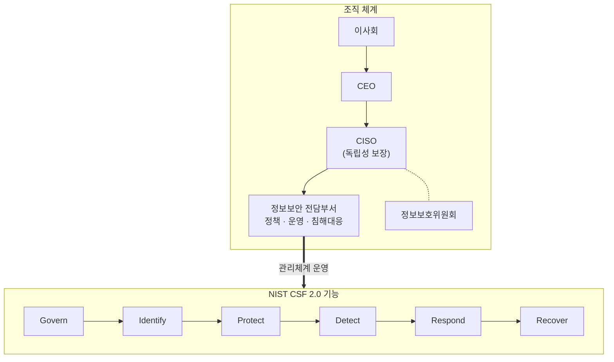

# 정보보안 부서의 신설과 정보보안 체계

---

## I. 보안을 경영 의제로, 정보보안 부서와 체계의 개요

### 가. 정의

- **CISO(정보보호최고책임자) 아래 IT 운영과 분리된 전담 조직을 두고, 거버넌스·위험관리·컴플라이언스(GRC)에 기반한 관리적·기술적·물리적 보안 체계를 구축**하는 활동

### 나. 필요성

| 구분 | 내용 |
| --- | --- |
| 법적 요구 | 정보통신망법상 CISO 지정·신고, 일정 규모 이상 기업은 CISO 겸직 제한 |
| 인증 의무 | ISMS 인증 의무 대상 기업 (ISMS-P는 자율) |
| 위협 증가 | [[랜섬웨어]], APT, 공급망 공격 |
| 독립성 | IT 운영 부서 산하에서는 견제가 어려워 분리 필요 |
| 환경 변화 | 클라우드·원격근무로 경계 보안 한계 |

---

## II. 조직 구조 및 구성요소

### 가. 거버넌스 구조

- CISO가 경영진·위원회의 지원을 받아 전담 부서를 지휘하고, 식별부터 복구까지 전 기능을 관리체계로 운영

### 나. 구성요소

| 구분 | 요소 | 설명 |
| --- | --- | --- |
| 거버넌스 | CISO·전담 조직 | IT 운영과 분리된 보안 책임자와 전담 인력 |
| | 정보보호위원회 | 정책·예산·위험 수용 등 전사 의사결정 |
| | GRC | 거버넌스·위험관리·규제 준수를 통합 관리 |
| 관리적 보안 | [[ISMS-P]] | 관리체계 수립·운영 및 인증 |
| | 위험 관리 | 자산 식별, [[위험분석 방법론\|위험 분석]], 대책 선정 |
| | [[정보보호 공시제도\|정보보호 공시]] | 투자·인력·활동 현황 공시 |
| 기술적 보안 | [[제로 트러스트 보안모델\|제로 트러스트]] | 신원 기반 지속 검증과 최소 권한 |
| | [[DevSecOps]] | 개발 파이프라인에 SAST·[[DAST]] 등 자동 점검 |
| 보안 운영 | [[SIEM]]·[[SOAR (Security Orchestration, Automation and Response)\|SOAR]] | 통합 관제와 플레이북 기반 자동 대응 |
| | 침해사고 대응(CERT) | 탐지·분석·복구·재발 방지 |
| 물리적 보안 | 망분리·출입통제 | 중요 시설 접근 통제 |

---

## III. 비교 및 동향

### 가. 전통적 vs 차세대 보안 체계

| 비교 항목 | 전통적 체계 | 차세대 체계 |
| --- | --- | --- |
| 조직 위상 | IT 부서 하위 조직 | CEO·이사회 보고 독립 조직 |
| 보안 모델 | 경계 방어 | 제로 트러스트, [[사이버 레질리언스\|복원력]] |
| 대응 방식 | 사후·수동 분석 | 자동화 탐지·대응 |
| 인프라 | 온프레미스 | 멀티·하이브리드 클라우드 |
| 기준 | 내부 보안 지침 | NIST CSF 2.0(Govern 기능 추가), ISMS-P |

### 나. 동향

- **이사회 책임 강화**: 미국 SEC 사이버보안 공시 규칙(2023)으로 중대 사고 4영업일 내 공시와 이사회 감독 체계 연례 공시 의무화
- **NIST CSF 2.0(2024)**: Govern 기능 신설로 공급망·거버넌스 강조
- **AI 기반 보안 운영**: 생성형 AI로 경보 분류·분석 보고서 작성을 지원해 관제 인력 부족 보완

---

### 🔗 연관 토픽

- **소속 도메인**: [[00_보안_MOC|🛡️ 보안]]
- **세부 분류**: `1. 정보보안 원칙 & 거버넌스 · 인증`
- **핵심 연관 토픽**:
  - [[ISMS-P]]
  - [[정보보호 공시제도]]
  - [[위험분석 방법론|위험분석 방법론 (ISO/IEC 1335-1, 위험분석 전략/평가)]]
  - [[SOAR (Security Orchestration, Automation and Response)]]
  - [[사이버 레질리언스|사이버 레질리언스(Cyber Resilience)]]
