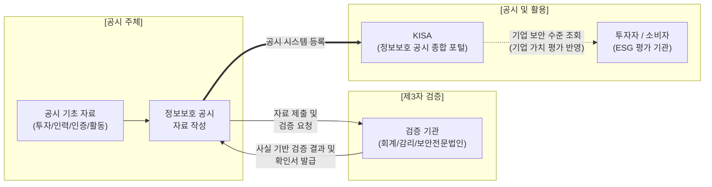

# 정보보호 공시제도

---

## I. 투명한 정보보호 투자와 알 권리 보장, 정보보호 공시제도의 개요

### 가. 정의

- 기업이 정보보호 투자 현황, 전담 인력, 관련 인증 획득, 이용자 보호 활동 내역을 외부에 공개하여 이용자의 알 권리를 보장하고 자율적인 정보보호 투자를 촉진하는 법적 제도 (정보보호산업진흥법 기반)

### 나. 주요 특징

| 구분 | 주요 내용 |
| --- | --- |
| 의무 및 자율 공시 병행 | 일정 규모 이상(매출 3,000억 이상, 일평균 이용자 100만 명 이상 등) 기업 의무 공시, 일반 기업 자율 공시 |
| 제3자 사전 검증 | 회계법인·감리법인 등 제3자 검증을 통해 공시 산출 데이터의 객관성 및 [[신뢰성]] 확보 |
| 불이행 시 제재 | 의무 대상 기업의 공시 미이행 또는 허위 공시 적발 시 1천만 원 이하의 과태료 부과 |
| 인센티브 체계 | 성실 자율공시 기업 대상 [[ISMS-P]] 인증 수수료 최대 30% 감면 및 정부 포상 혜택 부여 |

## II. 정보보호 공시제도의 프로세스 및 핵심 구성 요소

### 가. 정보보호 공시제도의 프로세스 및 구성도

* 기업은 가이드라인에 따라 4대 항목을 작성하고, 회계법인 등의 외부 제3자 검증을 거쳐 신뢰성을 확보한 후 한국인터넷진흥원(KISA) 종합 포털에 전자 공시함

### 나. 정보보호 공시제도의 4대 항목 및 핵심 요소

| 구분 | 요소기술(키워드) | 세부 설명 |
| --- | --- | --- |
| **공시 항목 1** | 정보보호 투자 현황 | 전체 정보기술(IT) 부문 투자액 대비 **정보보호 부문 투자액 및 비율(%)** 산출 |
| **공시 항목 2** | 정보보호 인력 현황 | 전체 정보기술(IT) 부문 인력 대비 **내부/외부 정보보호 전담 인력 수 및 비율(%)** |
| **공시 항목 3** | 인증/평가 현황 | ISMS, ISMS-P, ISO27001, 주요정보통신기반시설 취약점 평가 등 획득 현황 |
| **공시 항목 4** | 이용자 보호 활동 | CISO 지정, 침해사고 대응 모의훈련, 보안 배상책임보험 가입 등 기타 보호 활동 |
| **신뢰성 확보** | 제3자 검증 제도 | 회계법인, 정보시스템감리법인 등을 통해 공시 데이터의 정합성 및 객관성 확인 |
| **의무 대상** | 의무 공시 기업 | ISP, IDC 사업자, 매출액 3,000억 이상 또는 일평균 이용자 100만 명 이상 기업 |
| **제재 수단** | 과태료 부과 | 의무 대상 기업이 공시를 이행하지 않거나 허위 공시 시 1천만 원 이하 과태료 부과 |
| **활성 정책** | 자율 공시 인센티브 | 자율공시 기업 대상 우수기업 표창 및 ISMS-P 인증 수수료 감면 (최대 30%) 혜택 |

---

## III. 의무 공시와 자율 공시 비교 및 향후 발전 방향

### 가. 의무 공시 vs 자율 공시 비교

| 비교 항목 | 의무 공시 (Mandatory) | 자율 공시 (Voluntary) |
| --- | --- | --- |
| **적용 대상** | ISP, IDC, 일정 규모(매출 3,000억 이상 등) 이상 기업 | 의무 공시 대상에 해당하지 않는 모든 기업/기관 |
| **법적 구속력** | 미이행 또는 허위 공시 시 과태료 (1천만 원 이하) 부과 | 법적 제재 없음 (기업의 자발적 참여 기반) |
| **제3자 검증** | 공시 산출물에 대해 회계/감리 법인 검증 필수 권고 | 선택 사항 (검증 수행 시 공시 포털에 검증 여부 표기) |
| **주요 혜택** | 법적 규제 준수(Compliance) 달성 | [[ISMS-P]] 인증 수수료 감면(최대 30%), 정부 포상 가점 |
| **추진 목적** | 대규모 침해사고 예방 및 시장 투명성 강제 확보 | 기업 보안 브랜드 가치 제고 및 ESG 경영 평가 대응 |

### 나. 최신 동향 및 향후 발전 방향

- **ESG 경영 공시 지표와의 결합**: 사이버 보안 역량이 단순 전산 리스크를 넘어 [[ESG 경영]]의 지배구조(Governance) 및 사회적 책임(Social) 평가 핵심 지표로 통합 활용
- **공시 데이터 신뢰성 검증 체계 고도화**: 허위 또는 과장 공시를 방지하기 위해 국세청 결산 자료 연계 및 KISA 종합 포털 기반의 지능형 교차 검증 자동화 도입
- **중소·중견기업 자율공시 지원 확대**: 보안 투자 여력이 부족한 중소기업 대상 공시 가이드라인 컨설팅 제공 및 CISO 선임 지원을 통해 국가 전반의 사이버 복원력 상향 평준화 유도

---

### 🔗 연관 토픽

- **소속 도메인**: [[00_보안_MOC|🛡️ 보안]]
- **세부 분류**: `6. 개인정보보호 & 프라이버시 강화 기술`
- **핵심 연관 토픽**:
  - [[ISMS-P]]
  - [[신뢰성]]
  - [[ISP (Information Strategy Plan)]]
  - [[개인정보보호법]]
  - [[ESG 경영]]
