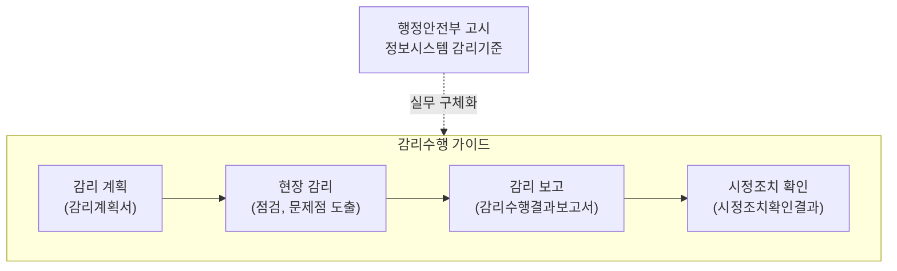

# 정보시스템 감리수행 가이드 v2.1 (NIA)

---

## I. 감리 실무의 표준 절차서, 감리수행 가이드의 개요

### 가. 정의

- 공공 정보화 사업 감리를 일관되게 수행하도록 행정안전부 고시(정보시스템 감리기준)를 바탕으로 **감리 절차·점검 체계·산출물 양식**을 정리한 한국지능정보사회진흥원(NIA)의 실무 지침

### 나. 필요성 및 특징

| 구분 | 내용 |
| --- | --- |
| 편차 축소 | 감리원 역량에 따른 판단 차이 최소화 |
| 법·제도 반영 | 전자정부법, SW 진흥법, 개인정보·SW 개발보안 기준 현행화 |
| 표준 절차 | 계획 → 착수 → 현장 감리 → 보고 → 시정조치 확인 |
| 점검 체계 | 감리 시점·영역·관점의 [[정보시스템 감리 프레임워크\|감리 프레임워크]] 적용 |

---

## II. 수행 절차와 구성요소

### 가. 개념도

- 감리기준을 실무 절차로 구체화해 계획·현장 점검·보고·시정조치 확인을 표준화. 세부 절차는 [[공통감리 절차]] 참조

### 나. 구성요소

| 구분 | 요소 | 설명 |
| --- | --- | --- |
| 수행 절차 | 감리 계획 | 사업 이해, 감리원 편성, 사업 특성 반영 점검항목, 감리계획서 통보 |
| | 현장 감리 | 인터뷰, 문서 검토, 시험·도구 진단으로 문제점 도출 |
| | 감리 보고 | 감리수행결과보고서 작성·제출, 개선 권고 |
| | 시정조치 확인 | 사업자 조치 결과 확인 후 발주기관에 통보 |
| 점검 체계 | 감리 프레임워크 | 시점(요구정의·설계·종료) × 영역 × 관점 |
| 품질 검증 | 요구사항 추적성 | 제안요청서 → 요구사항 정의서 → 설계서 → 테스트 양방향 추적 |
| 보안 점검 | SW 개발보안 | 행정안전부 보안약점 기준(구현 단계 49개, 2021 개정) 진단 결과 확인 ([[시큐어코딩]]) |
| | 개인정보 | [[개인정보 영향평가]] 결과 반영 여부 |
| 검증 도구 | 자동화 도구 | 정적 분석([[SAST]]), 성능·부하 시험, DB 진단 도구 |

---

## III. 비교 및 동향

### 가. 한계와 보완 방향

| 구분 | 한계 | 보완 방향 |
| --- | --- | --- |
| 점검 대상 | 문서 대조 중심, 동작하는 SW의 결함 식별 미흡 | 시험 입회·동적 시험([[DAST]]) 비중 확대 |
| 수행 시점 | 단계 고정 점검이 애자일 반복과 불일치 | 반복 주기 연계 점검, 사업 특성별 테일러링 |
| 신기술 | 클라우드·AI 사업 특성 반영 부족 | [[클라우드 감리]], [[인공지능 감리]] 등 특화 점검 |

### 나. 동향

- **클라우드 네이티브 사업 대응**: [[MSA (Micro Service Architecture)|MSA]], [[컨테이너]], CI/CD 파이프라인 점검 항목 보강
- **도구·AI 보조**: 추적성 검증, 점검항목 초안 작성에 분석 도구와 LLM 활용 시도

---

### 🔗 연관 토픽

- **소속 도메인**: [[00_프로젝트관리_MOC|📋 프로젝트관리]]
- **세부 분류**: `4. 품질 보증 · 위험 관리 & 정보시스템 감리`
- **핵심 연관 토픽**:
  - [[정보시스템 감리 프레임워크|정보시스템 감리 프레임워크 (Information System Audit Framework)]]
  - [[공통감리 절차]]
  - [[정보시스템 감리결과보고서]]
  - [[정보시스템 감리]]
  - [[CSAP|CSAP, CSAP(Cloud Security Assurance Program)]]
