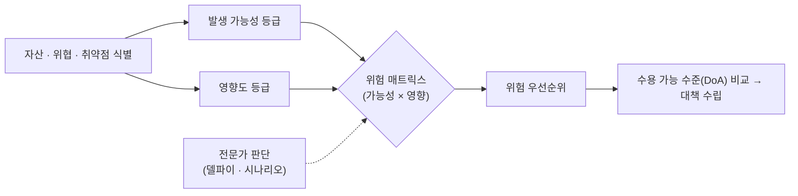

# 정성적 위험 분석 (Qualitative Risk Analysis)

---

## I. 경험과 판단으로 위험을 서열화, 정성적 위험 분석의 개요

### 가. 정의

- 금액 등 객관적 수치 대신 **전문가의 지식·경험으로 위험의 발생 가능성과 영향을 등급(상·중·하)으로 평가해 우선순위를 정하는** 위험 분석 기법

### 나. 특징

| 구분 | 내용 |
| --- | --- |
| 등장 배경 | 사고 이력 등 정량 데이터 부족, 신속한 우선순위 도출 필요 |
| 신속 · 저비용 | 복잡한 계산·데이터 수집 없이 단기간 수행 |
| 직관적 결과 | 위험 매트릭스로 시급한 위험을 한눈에 식별 |
| 한계 | 평가자 주관 개입, 투자 대비 효과(ROI) 산출 곤란 |

---

## II. 분석 절차 및 구성요소

### 가. 분석 절차

- 전문가 판단으로 가능성과 영향을 등급화해 매트릭스에 배치하고, 수용 가능 수준을 넘는 위험부터 대책 수립

### 나. 구성요소

| 구분 | 요소 | 설명 |
| --- | --- | --- |
| 평가 기법 | 델파이법 | 전문가 집단의 익명 반복 설문으로 합의 도출 |
| | 시나리오법 | 위협 사건 시나리오를 작성해 결과를 추론 |
| | 순위 결정법 | 위험 요소를 상호 비교해 서열화 |
| | 체크리스트법 | 사전 준비한 위험 목록으로 신속 점검 |
| 도구 | 위험 매트릭스 (P-I) | 가능성과 영향을 교차한 등급 격자 |
| 판단 기준 | DoA (Degree of Assurance) | 조직이 수용 가능한 위험 수준 |
| 대응 | 위험 처리 전략 | 감소·회피·전가·수용 |

---

## III. 비교 및 동향

### 가. 정성적 vs 정량적 위험 분석

| 비교 항목 | 정성적 | [[정량적 위험 분석\|정량적]] |
| --- | --- | --- |
| 척도 | 등급·서열 (상·중·하) | 금액 (ALE = SLE × ARO) |
| 기법 | 델파이, 시나리오, 매트릭스 | 과거 자료 분석, 몬테카를로, 확률 분포 |
| 소요 자원 | 적음 | 많음 (데이터·계산) |
| 결과 | 위험 우선순위 목록 | 연간 예상 손실, 대책 ROI |
| 장단점 | 신속 / 주관 개입 | 객관적 보고 / 데이터 필수 |

### 나. 동향

- 정성 분석으로 고위험을 걸러낸 뒤 해당 위험만 FAIR 등으로 정량화하는 혼합(반정량) 방식 활용
- [[CTI]] 정보를 활용해 LLM으로 조직 맞춤 위험 시나리오를 생성하는 시도

---

### 🔗 연관 토픽

- **소속 도메인**: [[00_소프트웨어공학_MOC|🏗️ 소프트웨어공학]]
- **세부 분류**: `3. 요구사항 공학 & UML 객체지향 분석/설계`
- **핵심 연관 토픽**:
  - [[정량적 위험 분석]]
  - [[위험 기반 테스트]]
  - [[ISMS-P]]
  - [[CTI]]
  - [[FMEA (Failure Mode and Effects Analysis)]]
