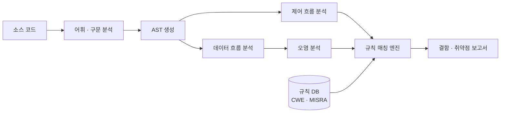

# 정적 분석 도구 (Static Analysis Tools)

---

## I. 실행하지 않고 찾는 결함, 정적 분석 도구의 개요

### 가. 정의

- 프로그램을 **실행하지 않고 소스·바이트 코드의 구조와 흐름을 분석해 결함, 보안 약점, 코딩 표준 위배를 자동 식별**하는 도구

### 나. 특징

| 구분 | 내용 |
| --- | --- |
| Shift-Left | 코딩·빌드 단계에서 결함을 찾아 수정 비용 최소화 |
| 표준 준수 | MISRA C, CERT, [[CWE]], 행안부 SW 보안약점 기준 점검 |
| 전수 분석 | 실행 경로를 가리지 않고 코드 전체를 검사 (테스트로 도달하기 어려운 경로 포함) |
| 한계 | 오탐(False Positive)이 많고 실행 환경·설정 결함은 탐지 불가 |

---

## II. 분석 구조 및 요소 기술

### 가. 분석 구조

- 코드를 AST로 변환한 뒤 제어·데이터 흐름 모델을 만들고, 규칙 DB와 매칭해 결함을 도출

### 나. 요소 기술

| 구분 | 요소 | 설명 |
| --- | --- | --- |
| 모델링 | AST | 문법에 따라 코드를 계층 트리로 변환 |
| 흐름 분석 | 제어 흐름 분석 (CFG) | 실행 경로를 그래프로 모델링, 도달 불가 코드·무한 루프 식별 |
| | 데이터 흐름 분석 | 변수 정의·참조·소멸 추적, 미초기화 변수·자원 누수 탐지 |
| 보안 분석 | 오염 분석 (Taint) | 외부 입력(Source)이 검증 없이 위험 함수(Sink)에 도달하는 경로 추적 (SQL Injection, [[XSS]]) |
| 정밀 분석 | 심볼릭 실행 · 추상 해석 | 입력을 기호·추상값으로 다뤄 경로 조건과 런타임 오류 가능성 검증 |
| 규칙 | 패턴 매칭 | 하드코딩된 비밀번호 등 알려진 안티패턴 탐지 |
| | 코딩 표준 룰셋 | CWE, CERT C/C++, MISRA, 행안부 구현단계 보안약점 |
| 품질 지표 | 복잡도 · 중복 | [[McCabe 회전 복잡도]], 코드 중복률 측정 |

---

## III. 비교 및 동향

### 가. SAST vs DAST

| 비교 항목 | [[SAST]] (정적) | [[DAST]] (동적) |
| --- | --- | --- |
| 분석 방식 | 소스·바이너리 내부 구조 분석 | 실행 중인 애플리케이션에 공격 시뮬레이션 |
| 시점 | 코딩·빌드 (초기) | 테스트·스테이징 (후기) |
| 관점 | [[화이트박스 테스트\|화이트박스]] | [[블랙박스 테스트\|블랙박스]] |
| 장점 | 결함 위치(코드 라인) 정확히 제시 | 설정·인증 등 실행 시 결함 탐지 |
| 단점 | 오탐 많음, 실행 환경 결함 탐지 불가 | 코드 위치 특정 곤란, 커버리지 제한 |

### 나. 동향

- LLM으로 오탐을 걸러내고 수정 패치를 제안하는 AI 보조 SAST 확산 (GitHub Copilot Autofix 등)
- PR·CI 단계에 품질 게이트로 내장해 기준 미달 시 머지 차단 (SonarQube, CodeQL, Semgrep)

---

### 🔗 연관 토픽

- **소속 도메인**: [[00_소프트웨어공학_MOC|🏗️ 소프트웨어공학]]
- **세부 분류**: `1. 소프트웨어 개발 생명주기(SDLC) & 방법론`
- **핵심 연관 토픽**:
  - [[SAST]]
  - [[DAST]]
  - [[화이트박스 테스트]]
  - [[McCabe 회전 복잡도]]
  - [[DevSecOps]]
