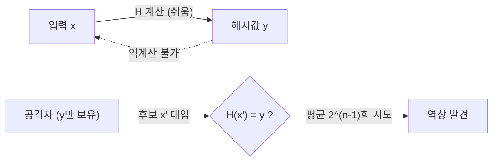

# 제1 역상 저항성 (Pre-image Resistance)

---

## I. 해시값에서 원문으로 돌아갈 수 없는, 역상 저항성의 개요

### 가. 정의

- 해시값 $y$가 주어졌을 때 **$H(x) = y$를 만족하는 입력 $x$를 찾는 것이 계산상 불가능**한 성질 (일방향성)

### 나. 특징

| 구분 | 내용 |
| --- | --- |
| 일방향성 | 해시 계산은 쉽고 역계산은 어려움 |
| 공격 비용 | n비트 해시에 대해 일반 공격 약 $2^n$회 |
| 응용 근거 | 패스워드 해시 저장, 해시 타임락(HTLC), 커밋먼트 |
| 한계 | 입력 공간이 작으면(짧은 패스워드) 사전·전수 대입으로 역상 탐색 가능 |

---

## II. 공격 구조 및 구성요소

### 가. 순방향 vs 역방향

- 해시에 수학적 역함수가 없어 공격자는 후보 입력을 대입해 비교하는 방법 외에 효율적 경로가 없어야 함

### 나. 구성요소

| 구분 | 요소 | 설명 |
| --- | --- | --- |
| 기반 | 일방향 함수 | 계산은 다항 시간, 역계산은 비현실적 |
| 공격 | 전수 조사 | 평균 $2^{n-1}$, 최대 $2^n$회 |
| | 사전·레인보우 테이블 | 작은 입력 공간(패스워드)을 미리 계산해 시간-메모리 절충 |
| 방어 | 솔트 | 사용자별 난수로 사전 계산 무력화 ([[해시 솔트와 키 스트레칭]]) |
| | 키 스트레칭 | Argon2id·PBKDF2·bcrypt로 대입 비용 증가 |
| 구조 | MD·스펀지 구조 | SHA-2 압축 함수, SHA-3 스펀지 구조 |
| 양자 | Grover | 역상 탐색을 $2^{n/2}$로 단축 → 256비트 출력이면 128비트 수준 유지 |

---

## III. 비교 및 동향

### 가. 해시 3대 안전성 비교

| 비교 항목 | 역상 저항성 | [[제2 역상 저항성]] | 충돌 저항성 |
| --- | --- | --- | --- |
| 주어진 것 | 해시값 $y$ | 입력 $x$ | 없음 |
| 공격 목표 | $H(x)=y$인 $x$ | $H(x')=H(x)$인 $x' \neq x$ | $H(x)=H(x')$인 임의 쌍 |
| 고전 비용 | $2^n$ | $2^n$ (MD 구조 긴 메시지는 저하) | $2^{n/2}$ (생일 공격) |
| 양자 비용 | $2^{n/2}$ (Grover) | $2^{n/2}$ | 이론상 $2^{n/3}$ (BHT) |
| 깨질 때 영향 | 패스워드·커밋 값 노출 | 특정 문서 위조 | 서명·인증서 위조 |

### 나. 동향

- **취약 해시 퇴출**: MD5·SHA-1 사용 중단, SHA-2·SHA-3 중심 운영
- **해시 기반 서명**: SLH-DSA(FIPS 205)·XMSS·LMS는 해시의 역상 계열 안전성에 기반한 PQC 서명
- **패스워드 저장 기준**: 메모리 비용이 큰 Argon2id를 우선 권고 (OWASP)

---

### 🔗 연관 토픽

- **소속 도메인**: [[00_보안_MOC|🛡️ 보안]]
- **세부 분류**: `2. 현대 암호학 & 키 관리 · 전자서명`
- **핵심 연관 토픽**:
  - [[제2 역상 저항성]]
  - [[해시 함수의 안전성]]
  - [[해시함수|해시함수(알고리즘 측면)]]
  - [[해시 솔트와 키 스트레칭|해시 솔트(Salt)와 키 스트레칭(Key Stretching)]]
  - [[일방향 암호화 방식]]
